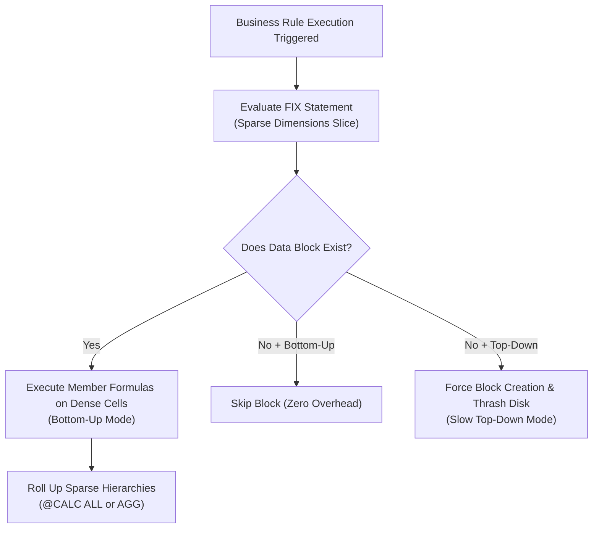

# 11. Business Rules — Essbase Calc Script Optimization, FIX Scopes & Parallelism

> **Consultant High-Yield Summary:**  
> Business rules drive calculation logic across Cloud EPM cubes. Mastering procedural calculation syntax, precise FIX/ENDFIX block scoping, `@CALCPARALLEL` multithreading, and bottom-up versus top-down calculation formulas is vital for building sub-second calculation engines.

---

## 🎯 Live Interactive Visual Architecture Card

<b>🎯 Live Interactive Architecture Card: Essbase Calc Engine Scoping & Block Iteration Mechanics</b>

| Calc Component | Operational Physics | Optimization Law & Review Defense |
| :--- | :--- | :--- |
| **FIX / ENDFIX** | Restricts calculation scope to specific Sparse member combinations | Always FIX on Sparse dimensions; never FIX on Dense dimensions (calculate dense members directly). |
| **Bottom-Up Calc** | Formula executes only on existing physical data blocks | Default, high-speed calculation mode. Fast and skips missing blocks. |
| **Top-Down Calc** | Formula executes across all potential block intersections | Triggered by cross-dimensional formulas or `@PRIOR` without explicit block creation; causes severe performance thrashing. |
| **Parallel Calculation** | `SET CALCPARALLEL n;` or `FIXPARALLEL (dim, n)` | Splits calculation across multiple CPU threads. Optimal `n` is 2 to 4 threads in Cloud EPM. |

---

## 🏛️ Architectural Comparison & Design Patterns

| Calculation Mode | Bottom-Up Calculation | Top-Down Calculation |
| :--- | :--- | :--- |
| Block Processing | Iterates ONLY through existing, allocated data blocks | Evaluates every Cartesian combination in the FIX scope, creating blocks |
| Speed & Overhead | Sub-second execution; memory and disk efficient | Extremely slow; can cause block explosion and memory buffer exhaustion |
| Formula Trigger | Standard formulas without cross-dimensional operators | Formulas using `@ISMBR`, `@PRIOR`, or cross-dimensional `->` syntax without explicit block creation |

---

## 💼 Tough & Twisted Review Scenarios (Consultant Review Defense)

### Question 1: "Why should you never write a FIX statement on a Dense dimension (e.g. FIX(Jan, Feb, Mar))?"
> **Consultant Model Answer:**  
> In Essbase, Dense dimensions exist inside every data block as cell array offsets. A FIX statement does not reduce the number of blocks loaded from disk; Essbase must still load the entire block containing all months. Placing Dense dimensions in a FIX statement forces Essbase to repetitively cycle through the block multiple times, increasing CPU overhead without reducing I/O. Instead, calculate dense members directly inside the formula block.

---

## 📑 Complete Document Catalog

| # | Document File | Topic Description |
|---|---------------|-------------------|
| 01 | [07.01_Business_Rules_and_Calc_Scripts.md](./07.01_Business_Rules_and_Calc_Scripts.md) | 07.01 Business Rules and Calc Scripts — Complete Beginner Guide |
| 02 | [07.02_Execution_and_Optimization.md](./07.02_Execution_and_Optimization.md) | 07.02 — Business Rule Execution and Optimization: Complete Guide |
| 03 | [07.03_Cross_Dimensional_Operators_and_Syntax.md](./07.03_Cross_Dimensional_Operators_and_Syntax.md) | 07.03 — Cross-Dimensional Operators and Syntax: Complete Guide |
| 04 | [07.04_DATACOPY_and_Data_Movement.md](./07.04_DATACOPY_and_Data_Movement.md) | 07.04 — DATACOPY and Data Movement: Complete Guide |
| 05 | [07.05_Allocation_Patterns_and_Spreading.md](./07.05_Allocation_Patterns_and_Spreading.md) | 07.05 — Allocation Patterns and Spreading: Complete Guide |
| 06 | [07.06_Currency_Conversion_Rules.md](./07.06_Currency_Conversion_Rules.md) | 07.06 — Currency Conversion Rules: Complete Guide |
| 07 | [07.07_Essbase_Calc_Script_Syntax_Bible.md](./07.07_Essbase_Calc_Script_Syntax_Bible.md) | 07.07 Essbase Calc Script Syntax Bible |
| 08 | [07.08_Advanced_Script_Patterns_Cookbook.md](./07.08_Advanced_Script_Patterns_Cookbook.md) | 07.08 Advanced Script Patterns Cookbook |
| 09 | [07.10_Business_Rules_Complete_Guide.md](./07.10_Business_Rules_Complete_Guide.md) | Business Rules — Complete Guide |
| 10 | [07.20_FIX_Aggregation_Bible_Deep_Dive.md](./07.20_FIX_Aggregation_Bible_Deep_Dive.md) | 07.20 FIX & Aggregation Bible — Deep Dive |

---

> **Consultant Implementation Note:** Master the architectural comparison and review defense questions in this module before presenting designs to client stakeholders or senior review panels.