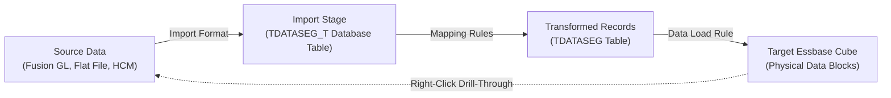

# 13. Data Integration — Pipeline, TDATASEG, Mapping Logic & Drill-Through

> **Consultant High-Yield Summary:**  
> Data Integration (formerly Data Management / FDMEE) is the unified ETL and data exchange pipeline in Cloud EPM. It extracts financial and operational data from source GLs, flat files, HCM, or Fusion, transforms dimensional coordinates through mapping tables, stages records in `TDATASEG`, and loads data to target Essbase cubes with full drill-through auditing.

---

## 🎯 Live Interactive Visual Architecture Card

<b>🎯 Live Interactive Architecture Card: Cloud EPM Data Integration Pipeline Architecture</b>

| Pipeline Stage | Database Mechanism | Review Defense & Operational Physics |
| :--- | :--- | :--- |
| **1. Import & Parse** | File / SQL staging into `TDATASEG_T` | Validates file structure, delimiter, and column alignment according to Import Format. |
| **2. Transformation & Mapping** | Dimension mappings staged in `TDATASEG` | Applies Explicit, Between, In, Multi-Dim, and Like mappings. Unmapped members trigger rule abort. |
| **3. Export & Validation** | Direct Essbase data stream | Formats records into Essbase data blocks; writes numeric cells directly into .PAG storage. |
| **4. Drill-Through Audit** | URL / Landing Page back to Source GL | Stores source transaction IDs; allows users in Smart View to right-click a cell and inspect general ledger journals. |

---

## 🏛️ Architectural Comparison & Design Patterns

| Mapping Type | Processing Precedence | Consultant Usage Law |
| :--- | :--- | :--- |
| Explicit Mapping | 1 (Highest Precedence) | 1-to-1 direct override (e.g. Account `1001` -> `Cash_USD`). Takes absolute priority. |
| Between / In Mapping | 2 (Intermediate Precedence) | Range-based grouping (e.g. Accounts `4000` to `4999` -> `Revenue_Group`). |
| Like Mapping | 3 (Lowest Precedence) | Wildcard pattern matching (e.g. `*` -> `*` pass-through, or `6*` -> `OpEx_*`). |

---

## 💼 Tough & Twisted Review Scenarios (Consultant Review Defense)

### Question 1: "A monthly GL data load fails with the error '3333 invalid member name in dimension Account'. What happened in the pipeline, and how do you resolve it?"
> **Consultant Model Answer:**  
> A new general ledger account `3333` was created in the source ERP that has no corresponding mapping rule in Data Integration. When the mapping engine ran, member `3333` dropped through to unmapped status. Fix: 1) Verify if `3333` should map to an existing EPM account or requires a new metadata member. 2) If new, add member `3333` to the Account dimension and execute a Database Refresh. 3) Add an Explicit or Like mapping rule in Data Integration. 4) Re-run the data load rule.

---

## 📑 Complete Document Catalog

| # | Document File | Topic Description |
|---|---------------|-------------------|
| 01 | [11.01_Data_Management_vs_Data_Integration.md](./11.01_Data_Management_vs_Data_Integration.md) | 11.01 — Data Management vs Data Integration: Complete Guide |
| 02 | [11.02_Flat_File_Import_Patterns.md](./11.02_Flat_File_Import_Patterns.md) | 11.02 — Flat File Import Patterns: Complete Guide |
| 03 | [11.10_ERP_Integration.md](./11.10_ERP_Integration.md) | 🔗 Document 10 — ERP Integration & Data Flow |
| 04 | [11.11_Data_Maps.md](./11.11_Data_Maps.md) | 🔄 Document 16 — Data Integration and Data Maps |
| 05 | [11.12_Data_Integration_Oracle_Deep_Reference.md](./11.12_Data_Integration_Oracle_Deep_Reference.md) | Data Integration & Data Management — Oracle Official Deep Reference |
| 06 | [Oracle_EPM_Data_Integration_Master_Guide.md](./Oracle_EPM_Data_Integration_Master_Guide.md) | Oracle EPM Cloud — Data Integration Master Guide |
| 07 | [Oracle_EPM_Data_Integration_Master_Guide_v2.md](./Oracle_EPM_Data_Integration_Master_Guide_v2.md) | Oracle EPM Cloud — Data Integration Master Guide |

---

> **Consultant Implementation Note:** Master the architectural comparison and review defense questions in this module before presenting designs to client stakeholders or senior review panels.