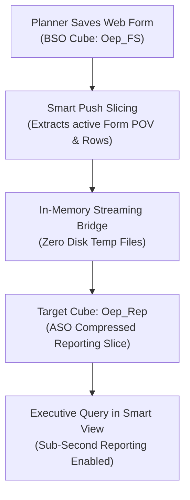

# 14. Data Maps and Smart Push — Inter-Cube Data Movement & Fast Spreading

> **Consultant High-Yield Summary:**  
> Data Maps define declarative point-to-point mappings between cubes (e.g. BSO input cube to ASO reporting cube, or Workforce to Financials). Smart Push is the real-time execution engine that triggers Data Maps synchronously upon form save or asynchronously via business rules, eliminating batch data export/import routines.

---

## 🎯 Live Interactive Visual Architecture Card

<b>🎯 Live Interactive Architecture Card: Smart Push In-Memory Synchronization Architecture</b>

| Parameter | Technical Engine | Consultant Rule & Performance Physics |
| :--- | :--- | :--- |
| **Source -> Target** | BSO (Input/Calc) -> ASO (Reporting) | Pushes aggregated data from calculation cubes into compressed ASO cubes for instant executive reporting. |
| **Form Binding** | 'Run on Save' checkbox on Data Form | Intercepts the form's active POV and edited rows; streams data directly in-memory to the target cube. |
| **Data Clear Options** | Overwrite existing target cells | Does NOT clear target partitions unless explicit clear region is configured; fast memory push. |
| **Dimensional Mapping** | 1-to-1, Unmapped to Target, or Excluded | Allows dimension expansion (e.g. single Currency dimension in source mapped to multi-currency target). |

---

## 🏛️ Architectural Comparison & Design Patterns

| Data Movement Method | Data Management / FDMEE | Data Maps & Smart Push |
| :--- | :--- | :--- |
| Architecture | Relational database staging (`TDATASEG`) with file spooling | Direct in-memory kernel-to-kernel streaming |
| Execution Latency | 1 to 10 minutes (Batch ETL pipeline) | 100ms to 3 seconds (Real-time form save integration) |
| Drill-Through | Full audit drill-through to source ERP journals | Internal cube-to-cube sync; no external ERP drill-through |

---

## 💼 Tough & Twisted Review Scenarios (Consultant Review Defense)

### Question 1: "A client complains that clicking 'Save' on a planning form takes 30 seconds. You discover a Smart Push is attached. How do you diagnose and fix it?"
> **Consultant Model Answer:**  
> The Smart Push is pushing an unconstrained dimensional slice instead of the form's active context. Check the Data Map configuration: 1) Ensure 'Use Form Context' is selected on the form's Smart Push tab. 2) If unconstrained, the Smart Push attempts to push the entire Entity or Account hierarchy across all Years, forcing Essbase into massive memory extraction. Restricting the Smart Push to the form POV brings save time back to under 1 second.

---

## 📑 Complete Document Catalog

| # | Document File | Topic Description |
|---|---------------|-------------------|

---

> **Consultant Implementation Note:** Master the architectural comparison and review defense questions in this module before presenting designs to client stakeholders or senior review panels.