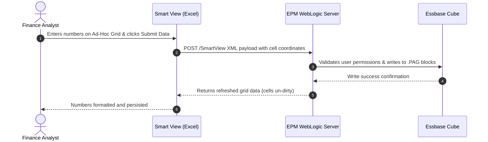

# 15. Smart View — Microsoft Office Add-in, Ad-Hoc Grids & Formula Engine

> **Consultant High-Yield Summary:**  
> Oracle Smart View for Office is the comprehensive spreadsheet integration tool for Cloud EPM. Finance users live in Smart View for ad-hoc multidimensional slicing, zooming, pivoting, data submission, and formula-based reporting using HsGetValue and HsSetValue functions.

---

## 🎯 Live Interactive Visual Architecture Card

<b>🎯 Live Interactive Architecture Card: Smart View Ad-Hoc Query & Data Submission Lifecycle</b>

| Smart View Operation | Under-the-Hood Mechanism | Consultant Defense & Best Practice |
| :--- | :--- | :--- |
| **Ad-Hoc Analysis** | Establishes XML/REST grid connection to Essbase | Users zoom in, zoom out, keep only, and pivot dimensions between Rows, Columns, and POV. |
| **Submit Data** | Sends only modified cells back to Essbase BSO blocks | Must be on Level 0 leaf stored intersections. Submitting to Dynamic Calc parent cells will fail or revert. |
| **Free-Form Mode** | Types member names directly into blank Excel sheet | Sheet must contain at least one valid dimension member in cell A1 to establish cube context. |
| **HsGetValue / HsSetValue** | Individual cell formula retrieval and write-back | Replaces volatile ad-hoc grids with pixel-perfect executive financial report templates. |

---

## 🏛️ Architectural Comparison & Design Patterns

| Connection Mode | Ad-Hoc Analysis Grid | Function-Based Report (HsGetValue) |
| :--- | :--- | :--- |
| Grid Flexibility | Dynamic: dimensions expand, pivot, and drill freely | Static: formulas pinned to exact cell coordinates |
| Data Submission | Supported natively via 'Submit Data' button | Requires `HsSetValue` and explicit submit sheet command |
| Performance | Fast retrieval for large blocks; handles thousands of rows | Can be slow if thousands of individual `HsGetValue` formulas execute |

---

## 💼 Tough & Twisted Review Scenarios (Consultant Review Defense)

### Question 1: "A user clicks 'Submit Data' in Smart View. The cell turns from dirty (teal/yellow) back to normal white, no error appears, but when they refresh, the number reverts to original. Why?"
> **Consultant Model Answer:**  
> The user entered data on a **Dynamic Calc** member (e.g. a parent account or dynamic ratio). Essbase cannot physically store data in dynamic calculation cells. The submit call transmits the data, but the Essbase kernel silently drops writes to dynamic cells. When the sheet refreshes, Essbase re-evaluates the dynamic formula from leaf children, wiping out the typed number.

---

## 📑 Complete Document Catalog

| # | Document File | Topic Description |
|---|---------------|-------------------|
| 01 | [01_Smart_View_Architecture_and_Connection_Management.md](./01_Smart_View_Architecture_and_Connection_Management.md) | 01 — Smart View and connections |
| 02 | [01_Smart_View_Architecture_and_Connection_Management_v2.md](./01_Smart_View_Architecture_and_Connection_Management_v2.md) | 01 — Smart View Architecture & Connection Management |
| 03 | [02_Ad_Hoc_Analysis_Grid_Operations_and_Physics.md](./02_Ad_Hoc_Analysis_Grid_Operations_and_Physics.md) | 02 — Ad hoc analysis and grid operations |
| 04 | [02_Ad_Hoc_Analysis_Grid_Operations_and_Physics_v2.md](./02_Ad_Hoc_Analysis_Grid_Operations_and_Physics_v2.md) | 02 — Ad Hoc Analysis: Grid Operations & Dimensional Slicing |
| 05 | [03_Smart_View_Options_Deep_Dive.md](./03_Smart_View_Options_Deep_Dive.md) | 03 — Smart View options |
| 06 | [03_Smart_View_Options_Deep_Dive_v2.md](./03_Smart_View_Options_Deep_Dive_v2.md) | 03 — Smart View Options: Configuration & Formatting Bible |
| 07 | [04_Flex_Forms_and_Advanced_Worksheets.md](./04_Flex_Forms_and_Advanced_Worksheets.md) | 04 — Flex forms, supporting detail, comments, and attachments |
| 08 | [04_Flex_Forms_and_Advanced_Worksheets_v2.md](./04_Flex_Forms_and_Advanced_Worksheets_v2.md) | 04 — Flex Forms, Supporting Detail, & Advanced Worksheets |
| 09 | [05_Formulas_Functions_and_VBA_Automation.md](./05_Formulas_Functions_and_VBA_Automation.md) | 05 — Smart View worksheet functions and VBA |
| 10 | [05_Formulas_Functions_and_VBA_Automation_v2.md](./05_Formulas_Functions_and_VBA_Automation_v2.md) | 05 — Smart View Functions (`HsGetValue`) & VBA Automation |
| 11 | [06_Troubleshooting_Performance_and_Interview_Guide.md](./06_Troubleshooting_Performance_and_Interview_Guide.md) | 06 — Smart View troubleshooting and professional review |
| 12 | [06_Troubleshooting_Performance_and_Interview_Guide_v2.md](./06_Troubleshooting_Performance_and_Interview_Guide_v2.md) | 06 — Smart View & Ad Hoc: Troubleshooting, Performance, & Interview Bible |
| 13 | [10.01_Smart_View_Architecture_and_Connections.md](./10.01_Smart_View_Architecture_and_Connections.md) | 10.01 — Smart View Architecture and Connections: Complete Guide |
| 14 | [10.02_Smart_View_Ad_Hoc_Analysis.md](./10.02_Smart_View_Ad_Hoc_Analysis.md) | 10.02 — Smart View Ad Hoc Analysis: Complete Guide |
| 15 | [10.03_Smart_View_Functions_HsGetValue.md](./10.03_Smart_View_Functions_HsGetValue.md) | 10.03 — Smart View Functions (HsGetValue): Complete Guide |
| 16 | [10.04_Smart_View_Troubleshooting.md](./10.04_Smart_View_Troubleshooting.md) | 10.04 — Smart View Troubleshooting: Complete Guide |
| 17 | [10.10_Smart_View_Overview.md](./10.10_Smart_View_Overview.md) | Smart View — Complete Guide |
| 18 | [10.11_Smart_View_Oracle_Deep_Reference.md](./10.11_Smart_View_Oracle_Deep_Reference.md) | Smart View — Oracle Official Deep Reference |
| 19 | [10.12_Smart_View_Specialized_Deep_Reference.md](./10.12_Smart_View_Specialized_Deep_Reference.md) | Smart View Specialized Tools — Oracle Deep Reference |

---

> **Consultant Implementation Note:** Master the architectural comparison and review defense questions in this module before presenting designs to client stakeholders or senior review panels.