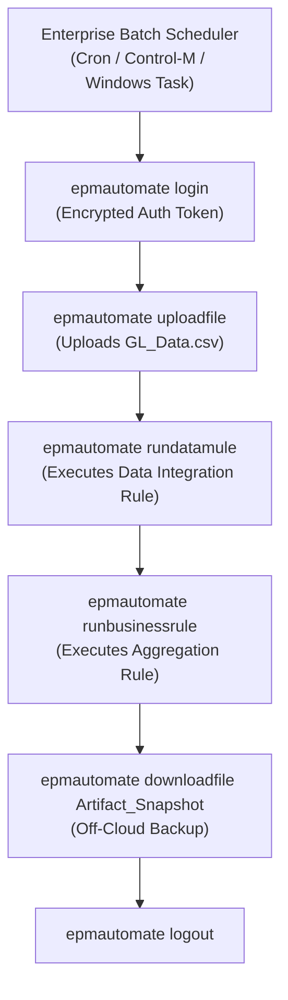

# 17. EPM Automate — Headless CLI Batch Orchestration & Automation Runbooks

> **Consultant High-Yield Summary:**  
> EPM Automate is Oracle's official command-line interface (CLI) for administering and automating Cloud EPM instances. It allows technical consultants and enterprise scheduling systems (Control-M, Autosys, Azure DevOps, Cron) to execute daily maintenance, data loads, cube refreshes, business rules, and snapshot backups completely headless.

---

## 🎯 Live Interactive Visual Architecture Card

<b>🎯 Live Interactive Architecture Card: EPM Automate Batch Automation Pipeline</b>

| Command Category | Core CLI Commands | Production Implementation Rule |
| :--- | :--- | :--- |
| **Authentication** | `epmautomete login`, `encrypt`, `logout` | Never hardcode passwords; always generate encrypted password files using `epmautomete encrypt`. |
| **Data & Jobs** | `runbusinessrule`, `rundatamule`, `importdata` | Polls job status automatically; returns exit code `0` on success, non-zero on failure. |
| **Lifecycle & Backup** | `copysnapshot`, `downloadfile`, `exportapp` | Daily snapshot downloaded off-cloud to secure on-premises storage or OCI Object Storage bucket. |
| **Cube Operations** | `refreshcube`, `restructurecube`, `clearcube` | Always execute `refreshcube` after metadata changes before running data loads or calc rules. |

---

## 🏛️ Architectural Comparison & Design Patterns

| Automation Interface | EPM Automate CLI | Direct REST API |
| :--- | :--- | :--- |
| Ease of Scripting | Extremely simple: single-line commands in Bash or PowerShell | Requires HTTP client, JSON payload serialization, and token headers |
| Job Status Polling | Built-in: CLI waits synchronously until job finishes | Asynchronous: script must manually poll `/jobs/{jobId}` until status != -1 |
| Ideal Use Case | Nightly scheduled batch pipelines and operational runbooks | Programmatic micro-integrations, custom web portals, and microservices |

---

## 💼 Tough & Twisted Review Scenarios (Consultant Review Defense)

### Question 1: "A nightly EPM Automate script fails with 'Error: Session expired or invalid credentials'. The password was encrypted with `epmautomate encrypt`. What happened?"
> **Consultant Model Answer:**  
> Two common causes: 1) The encryption key is tied to the specific OS user profile and machine that ran the `encrypt` command. If the script was moved to a different server or scheduled under a different service account (e.g. `SYSTEM` or `srv_batch`), the encrypted password cannot be decrypted. 2) The service account password in OCI IAM expired. Solution: Generate the encrypted password file directly under the batch service account on the target execution server.

---

## 📑 Complete Document Catalog

| # | Document File | Topic Description |
|---|---------------|-------------------|
| 01 | [01_Architecture_Installation_and_Authentication.md](./01_Architecture_Installation_and_Authentication.md) | 01 — Architecture, Installation, & Authentication |
| 02 | [02_Environment_and_Snapshot_Lifecycle.md](./02_Environment_and_Snapshot_Lifecycle.md) | 02 — Environment & Snapshot Lifecycle Management |
| 03 | [03_Data_and_Metadata_Automation.md](./03_Data_and_Metadata_Automation.md) | 03 — Data & Metadata Automation: ETL Pipeline |
| 04 | [04_Business_Rules_Jobs_and_Calculations.md](./04_Business_Rules_Jobs_and_Calculations.md) | 04 — Business Rules, Calculations, & Governance |
| 05 | [05_Enterprise_Scripting_Runbooks_and_Error_Handling.md](./05_Enterprise_Scripting_Runbooks_and_Error_Handling.md) | 05 — Enterprise Scripting Frameworks & Nightly Runbooks |
| 06 | [06_Troubleshooting_Return_Codes_and_Interview_Guide.md](./06_Troubleshooting_Return_Codes_and_Interview_Guide.md) | 06 — EPM Automate: Troubleshooting, Error Codes, & Interview Bible |
| 07 | [14.01_EPM_Automate_Best_Practices.md](./14.01_EPM_Automate_Best_Practices.md) | 14.01 — EPM Automate Best Practices: Complete Guide |
| 08 | [14.10_EPM_Automate_Complete_Guide.md](./14.10_EPM_Automate_Complete_Guide.md) | EPM Automate — Complete Guide |
| 09 | [14.11_EPM_Automate_Oracle_Deep_Reference.md](./14.11_EPM_Automate_Oracle_Deep_Reference.md) | EPM Automate — Oracle Official Deep Reference |

---

> **Consultant Implementation Note:** Master the architectural comparison and review defense questions in this module before presenting designs to client stakeholders or senior review panels.