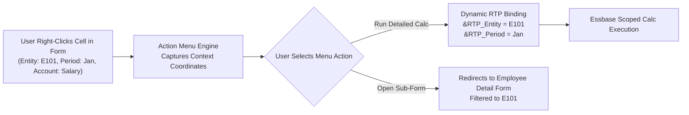

# 18. Action Menus — Form Context Interception & Dynamic RTP Passing

> **Consultant High-Yield Summary:**  
> Action Menus provide right-click context-sensitive functionality on data forms. When a user right-clicks a cell, an Action Menu captures the exact multidimensional coordinate (Entity, Account, Period, Year) and dynamically injects those coordinates into target business rules as Runtime Prompts (RTP) or redirects to secondary forms.

---

## 🎯 Live Interactive Visual Architecture Card

<b>🎯 Live Interactive Architecture Card: Action Menu Context Interception & Rule Launch Architecture</b>

| Action Menu Type | Target Object | Consultant Implementation Value |
| :--- | :--- | :--- |
| **Business Rule** | Calc Manager Rule with Runtime Prompts (RTP) | Injects the right-clicked row/column coordinate directly into the rule's RTP, scoping calculations instantly. |
| **Secondary Form** | Target Data Form | Navigates the user to a detailed breakdown form filtered automatically to the selected cost center. |
| **URL / External Page** | Web Dashboard or External System | Constructs a dynamic URL appending query string parameters from form context. |
| **Manage Approvals** | Approval Unit Promotion Screen | Opens the workflow submission window for the selected Entity and Scenario. |

---

## 🏛️ Architectural Comparison & Design Patterns

| Execution Method | Static Form Button / On-Save Calc | Right-Click Action Menu |
| :--- | :--- | :--- |
| Execution Flexibility | Fires unconditionally on entire form context when saved | Executed on demand only on specific rows/cells chosen by the user |
| Context Passing | Limited to static form POV or prompt prompts | Dynamically captures row, column, and POV coordinates of clicked cell |
| User Experience | User must manually navigate between related forms | Seamless 1-click drill-down to supporting detail forms |

---

## 💼 Tough & Twisted Review Scenarios (Consultant Review Defense)

### Question 1: "A consultant configures an Action Menu to run a business rule with an RTP for Entity, but when users click the menu, the rule fails with 'Invalid Member'. Why?"
> **Consultant Model Answer:**  
> The Action Menu was configured with the wrong context mapping or attached to a form where Entity is on the Page axis instead of Rows or Columns. If the dimension is not on an active grid coordinate that the right-click can resolve, the RTP receives a null or empty string at runtime, causing the calc script validation to fail. Ensure the targeted dimension is properly mapped in the Action Menu designer.

---

## 📑 Complete Document Catalog

| # | Document File | Topic Description |
|---|---------------|-------------------|
| 01 | [01_Action_Menu_Architecture_and_Context_Relay.md](./01_Action_Menu_Architecture_and_Context_Relay.md) | 01 — Action Menu Architecture & Context Relay |
| 02 | [02_The_9_Menu_Item_Types_Complete_Guide.md](./02_The_9_Menu_Item_Types_Complete_Guide.md) | 02 — The 9 Menu Item Types: Complete Reference |
| 03 | [03_Required_Parameters_and_Targeting_Matrix.md](./03_Required_Parameters_and_Targeting_Matrix.md) | 03 — Required Parameters & Targeting Matrix |
| 04 | [04_Business_Rules_Integration_and_RTP_Passing.md](./04_Business_Rules_Integration_and_RTP_Passing.md) | 04 — Business Rules Integration & RTP Passing |
| 05 | [05_Troubleshooting_Security_and_Best_Practices.md](./05_Troubleshooting_Security_and_Best_Practices.md) | 05 — Action Menus: Troubleshooting, Security, & Interview Bible |

---

> **Consultant Implementation Note:** Master the architectural comparison and review defense questions in this module before presenting designs to client stakeholders or senior review panels.