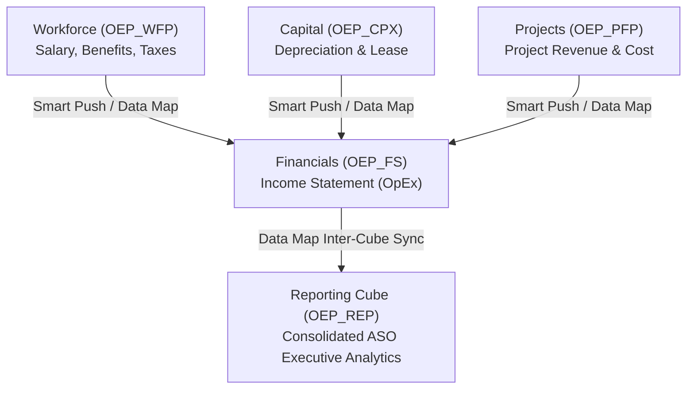

# 19. EPBCS Modules — Out-of-the-Box Business Processes & Extension Boundaries

> **Consultant High-Yield Summary:**  
> Enterprise Planning and Budgeting Cloud Service (EPBCS) provides pre-built, best-practice business process modules: Financials (OEP_FS), Workforce (OEP_WFP), Capital (OEP_CPX), Projects (OEP_PFP), and Strategic Modeling. Mastering progressive enablement, standard dimensional architectures, and module integration via Data Maps is essential for enterprise delivery.

---

## 🎯 Live Interactive Visual Architecture Card

<b>🎯 Live Interactive Architecture Card: EPBCS Modular Architecture & Inter-Module Data Flow</b>

| Module Name | Primary Cube | Core Financial Purpose |
| :--- | :--- | :--- |
| **Financials** | `OEP_FS` (BSO) + `OEP_REP` (ASO) | Fully integrated Income Statement, Balance Sheet, and Cash Flow statements. |
| **Workforce** | `OEP_WFP` (BSO) | Detailed headcount planning, salary, compensation, benefits, and tax calculations. |
| **Capital** | `OEP_CPX` (BSO) | New capital asset planning, depreciation, lease accounting (IFRS 16), and asset retirement. |
| **Projects** | `OEP_PFP` (BSO) | Internal and contract project budgeting, capitalization, resource billing, and milestone tracking. |
| **Strategic Modeling** | Long-Term Simulator | M&A modeling, corporate debt restructuring, scenario analysis, and executive balance sheets. |

---

## 🏛️ Architectural Comparison & Design Patterns

| Application Framework | Custom Planning (PBCS) | Modular Planning (EPBCS) |
| :--- | :--- | :--- |
| Design Approach | Clean slate: dimensions, rules, and forms designed from scratch | Turnkey: pre-built dimensions, drivers, member formulas, and forms |
| Implementation Speed | Slower: requires authoring every business rule and calculation | Rapid: configure out-of-the-box features in Enable Features wizard |
| Customization Freedom | 100% complete flexibility over all dimensions and rules | Structured: core module rules and dimensions are locked; extended via hooks |

---

## 💼 Tough & Twisted Review Scenarios (Consultant Review Defense)

### Question 1: "Can an administrator disable a feature in an EPBCS module once it has been enabled in the wizard?"
> **Consultant Model Answer:**  
> No. In EPBCS, enabling features is strictly **progressive and irreversible**. Once a feature (e.g. Employee Demographics in Workforce, or Lease Assets in Capital) is enabled, its dimensions, accounts, and rules are permanently written into the application repository and cannot be disabled. If enabled mistakenly, the application must be restored from a prior snapshot or recreated.

---

## 📑 Complete Document Catalog

| # | Document File | Topic Description |
|---|---------------|-------------------|
| 01 | [01_Financials_Module_OEP_FS.md](./01_Financials_Module_OEP_FS.md) | 01 Financials Module (`OEP_FS`): The Complete Techno-Functional Master Blueprint |
| 02 | [02_Workforce_Module_OEP_WFP.md](./02_Workforce_Module_OEP_WFP.md) | 02 Workforce Module (`OEP_WFP`): Complete Techno-Functional Engineering Guide |
| 03 | [03_Capital_Module_OEP_CPX.md](./03_Capital_Module_OEP_CPX.md) | 03 Capital Module (`OEP_CPX`): Complete Techno-Functional Engineering Guide |
| 04 | [04_Projects_Module_OEP_PFP.md](./04_Projects_Module_OEP_PFP.md) | 04 Projects Module (`OEP_PFP`): Complete Techno-Functional Engineering Guide |
| 05 | [05_Strategic_Modeling_HSF.md](./05_Strategic_Modeling_HSF.md) | 05 Strategic Modeling (HSF): Long-Range Planning, M&A, and Balance Sheet Optimization |
| 06 | [06_Cross_Module_Integration_and_Data_Flow.md](./06_Cross_Module_Integration_and_Data_Flow.md) | 06 Cross-Module Integration, Data Maps, and Multi-Cube Orchestration |

---

> **Consultant Implementation Note:** Master the architectural comparison and review defense questions in this module before presenting designs to client stakeholders or senior review panels.