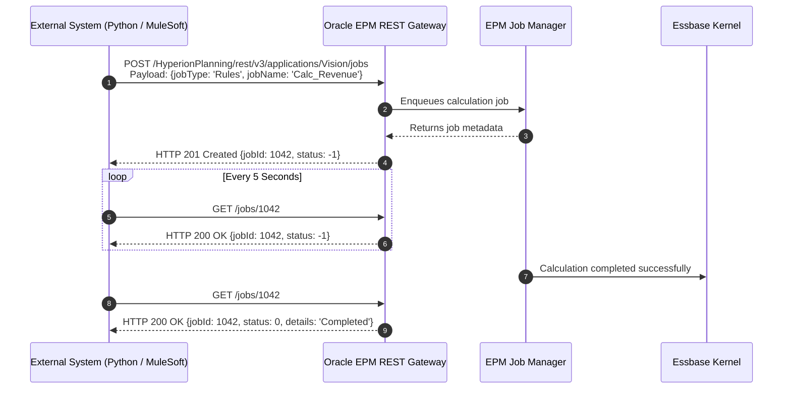

# 20. REST API — Headless HTTP Endpoints, JSON Payloads & Integration Architecture

> **Consultant High-Yield Summary:**  
> The Oracle Cloud EPM REST API provides headless, programmatic access to all pod operations. Technical consultants use REST endpoints to trigger business rules, submit data, poll job consoles, import metadata, and integrate EPM with external enterprise systems (Python, Java, Node.js, MuleSoft, Workato).

---

## 🎯 Live Interactive Visual Architecture Card

<b>🎯 Live Interactive Architecture Card: Cloud EPM REST API Communication Architecture</b>

| Endpoint Group | HTTP Method & URI | Technical Purpose & Review Rule |
| :--- | :--- | :--- |
| **Jobs Execution** | `POST /jobs` | Triggers asynchronous jobs (Rules, Data Rules, Refresh Cube, Export Metadata). |
| **Job Status Polling** | `GET /jobs/{jobId}` | Polls job execution. Returns `status: -1` (In Progress), `0` (Success), `>0` (Failed). |
| **Data Slices** | `POST /applications/{app}/dataexport` | Extracts precise multidimensional grid data in JSON format for external systems. |
| **Authentication** | Basic Auth or OAuth2 Bearer Token | Use OAuth2 token exchange with OCI IAM for secure enterprise headless communication. |

---

## 🏛️ Architectural Comparison & Design Patterns

| Integration Approach | EPM Automate CLI | REST API Endpoints |
| :--- | :--- | :--- |
| Execution Model | Synchronous CLI tool executing on a host computer/server | Direct stateless HTTP requests from any programming language or cloud service |
| Job Status Handling | CLI automatically blocks until job completion | Asynchronous: caller must implement polling loop on `/jobs/{jobId}` |
| Payload Flexibility | Limited to predefined command parameters | Full JSON payload flexibility for dynamic parameters and data slices |

---

## 💼 Tough & Twisted Review Scenarios (Consultant Review Defense)

### Question 1: "A developer writes a Python script that calls `POST /jobs` to run a business rule, receives HTTP 201 Created, and immediately triggers a report extraction. The report has old data. Why?"
> **Consultant Model Answer:**  
> Because `POST /jobs` is strictly **asynchronous**. HTTP 201 Created only confirms that the job was successfully accepted and enqueued in the Job Manager (status = -1); it does NOT mean the calculation has finished! The script MUST implement a polling loop calling `GET /jobs/{jobId}` and wait until `status` becomes `0` (Success) before proceeding to the report extraction step.

---

## 📑 Complete Document Catalog

| # | Document File | Topic Description |
|---|---------------|-------------------|
| 01 | [13.02_REST_API_Integration.md](./13.02_REST_API_Integration.md) | 13.02 — REST API Integration: Complete Guide |
| 02 | [13.10_REST_API_Complete_Guide.md](./13.10_REST_API_Complete_Guide.md) | REST API — Complete Guide |
| 03 | [13.11_REST_API_Oracle_Deep_Reference.md](./13.11_REST_API_Oracle_Deep_Reference.md) | REST API — Oracle Official Deep Reference |

---

> **Consultant Implementation Note:** Master the architectural comparison and review defense questions in this module before presenting designs to client stakeholders or senior review panels.