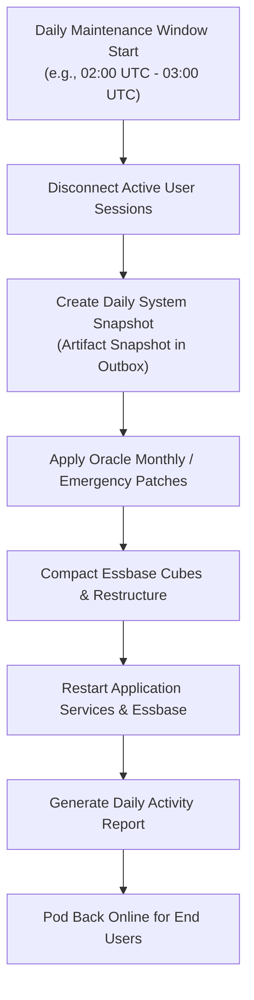

# 21. System Administration — Daily Maintenance Window, Activity Reports & Diagnostics

> **Consultant High-Yield Summary:**  
> System Administration in Cloud EPM governs environment health, operational governance, user sessions, and performance monitoring. Key responsibilities include managing the mandatory 1-hour Daily Maintenance Window, analyzing Activity Reports, diagnosing memory utilization, and managing pod infrastructure.

---

## 🎯 Live Interactive Visual Architecture Card

<b>🎯 Live Interactive Architecture Card: Daily Maintenance Window & Service Health Architecture</b>

| Administrative Domain | Operational Mechanism | Consultant Governance Law |
| :--- | :--- | :--- |
| **Daily Maintenance Window** | 1-hour automated daily downtime | Creates the daily `Artifact Snapshot`, applies platform patches, restarts WebLogic and Essbase. |
| **Activity Report** | Auto-generated daily performance log | Identifies top 10 slowest forms, heaviest calc scripts, high-memory users, and cube block statistics. |
| **Session Management** | Web UI / EPM Automate `logoffusers` | Terminate runaway user queries or stuck sessions locking Essbase cubes before batch jobs. |
| **Service Requests (SR)** | Oracle Cloud Support Portal | Use Severity 1 for complete production pod outages; include environment URL and Activity Report. |

---

## 🏛️ Architectural Comparison & Design Patterns

| Administrative Metric | Healthy System Baseline | Production Risk / Red Alert |
| :--- | :--- | :--- |
| Block Size | 8 KB to 100 KB | > 200 KB (Memory thrashing; buffer overflow risk) |
| Form Load Latency | < 2 seconds | > 10 seconds (User frustration, browser timeouts) |
| Daily Snapshot Size | Stable day-over-day growth (< 5%) | Sudden 200%+ jump (Indicates severe block explosion) |

---

## 💼 Tough & Twisted Review Scenarios (Consultant Review Defense)

### Question 1: "What happens if a long-running batch calculation script is still executing when the scheduled Daily Maintenance Window begins?"
> **Consultant Model Answer:**  
> Oracle Cloud EPM forces an orderly shutdown. The system will wait a brief grace period, but if the job does not complete, the maintenance process forcefully terminates the running business rule, rolls back uncommitted transactions, and proceeds with the maintenance window and pod restart. Any unsaved data from that rule is lost. Consultants must schedule nightly batches to conclude well before the maintenance window starts.

---

## 📑 Complete Document Catalog

| # | Document File | Topic Description |
|---|---------------|-------------------|
| 01 | [15.01_Jobs_Types_and_Scheduling.md](./15.01_Jobs_Types_and_Scheduling.md) | 15.01 — Jobs, Job Types, and Scheduling: Complete Guide |
| 02 | [15.02_Daily_Maintenance_and_Audit.md](./15.02_Daily_Maintenance_and_Audit.md) | 15.02 — Daily Maintenance and Audit: Complete Guide |
| 03 | [15.03_Substitution_Variable_Management.md](./15.03_Substitution_Variable_Management.md) | 15.03 — Substitution Variable Management: Complete Guide |
| 04 | [15.04_Dynamic_Smart_Lists_and_Action_Context.md](./15.04_Dynamic_Smart_Lists_and_Action_Context.md) | 15.04 — Dynamic Smart Lists and Action Context: Complete Guide |
| 05 | [15.05_LCM_Lifecycle_Management.md](./15.05_LCM_Lifecycle_Management.md) | 15.05 — LCM Lifecycle Management: Complete Guide |
| 06 | [15.06_Sandbox_and_Version_Management.md](./15.06_Sandbox_and_Version_Management.md) | 15.06 — Sandbox and Version Management: Complete Guide |
| 07 | [15.10_Admin_Tools.md](./15.10_Admin_Tools.md) | 🛡️ Document 19 — Admin Tools and Security |
| 08 | [15.11_Administration_Oracle_Deep_Reference.md](./15.11_Administration_Oracle_Deep_Reference.md) | Administration & Operations — Oracle Official Deep Reference |
| 09 | [15.12_Admin_Specialized_Deep_Reference.md](./15.12_Admin_Specialized_Deep_Reference.md) | Specialized Administration & Automation — Oracle Deep Reference |
| 10 | [Oracle_EPM_Audit_Master_Guide.md](./Oracle_EPM_Audit_Master_Guide.md) | Oracle EPM Cloud: The Ultimate Master Guide to Auditing |
| 11 | [Oracle_EPM_Daily_Maintenance_Master_Guide.md](./Oracle_EPM_Daily_Maintenance_Master_Guide.md) | Oracle EPM Cloud: The Ultimate Master Guide to Daily Maintenance |
| 12 | [Oracle_EPM_Jobs_Master_Guide.md](./Oracle_EPM_Jobs_Master_Guide.md) | Oracle EPM Cloud: The Ultimate Master Guide to Jobs |

---

> **Consultant Implementation Note:** Master the architectural comparison and review defense questions in this module before presenting designs to client stakeholders or senior review panels.