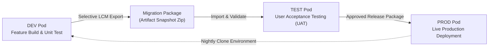

# 22. Application Lifecycle — Snapshot Migration, LCM & Pod Provisioning

> **Consultant High-Yield Summary:**  
> Application Lifecycle Management (ALM/LCM) governs the creation, backup, migration, and promotion of EPM applications across DEV, TEST, and PROD pods. Mastering artifact snapshots, selective migration, clean environment resets, and snapshot cloning ensures seamless release governance.

---

## 🎯 Live Interactive Visual Architecture Card

<b>🎯 Live Interactive Architecture Card: Application Lifecycle & Migration Pipeline</b>

| Lifecycle Operation | Technical Mechanism | Consultant Governance Law |
| :--- | :--- | :--- |
| **Artifact Snapshot** | Complete zip package of metadata, rules, forms, security | The definitive gold-copy backup. Always take a manual snapshot BEFORE importing any change. |
| **Selective Migration** | Exports specific artifact branches (e.g. only Forms) | Ideal for deploying bug fixes without overwriting unrelated application configurations. |
| **Clone Environment** | EPM Automate `cloneEnvironment` | Clones entire pod (including users, data, artifacts) directly from PROD to TEST/DEV in 1 step. |
| **Recreate Service** | Reset instance to factory clean state | Completely wipes the pod; mandatory before importing a fresh full-application snapshot. |

---

## 🏛️ Architectural Comparison & Design Patterns

| Migration Approach | Full Application Snapshot Import | Selective Artifact Import |
| :--- | :--- | :--- |
| Scope | Overwrites entire application (dimensions, cubes, forms, security) | Overwrites ONLY selected folders (e.g. 2 specific business rules) |
| Risk Level | High: can overwrite production configurations and security | Low: strictly targeted changes to approved objects |
| Recommended Timing | Initial go-live or full quarterly environment refreshes | Routine sprint deployments, hotfixes, and report updates |

---

## 💼 Tough & Twisted Review Scenarios (Consultant Review Defense)

### Question 1: "A consultant imports an artifact snapshot into TEST, but the import log shows hundreds of errors stating 'Parent member does not exist'. What caused this and how do you fix it?"
> **Consultant Model Answer:**  
> Incorrect import dependency order. The consultant attempted to import artifacts (such as Data Forms, Security, or Business Rules) before importing the underlying Dimension Metadata, or imported dimensions out of hierarchical order. Fix: In Cloud EPM LCM, always import **Dimensions and Metadata first**, perform a **Database Refresh**, and only then import Forms, Rules, and Security.

---

## 📑 Complete Document Catalog

| # | Document File | Topic Description |
|---|---------------|-------------------|
| 01 | [00_MASTER_INDEX.md](./00_MASTER_INDEX.md) | 📖 Oracle Cloud EPM — Application Creation & Lifecycle Management Master Bible |
| 02 | [README.md](./README.md) | 🏛️ Oracle Fusion Cloud EPM: Application Creation & Lifecycle Management Master Suite |

---

> **Consultant Implementation Note:** Master the architectural comparison and review defense questions in this module before presenting designs to client stakeholders or senior review panels.