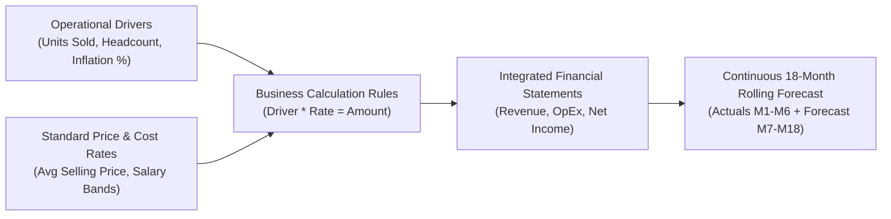

# 23. Planning Concepts — Driver-Based Modeling, Rolling Forecasts & Variances

> **Consultant High-Yield Summary:**  
> Enterprise Planning transitions organizations from static annual budgets to dynamic, continuous rolling forecasts. Technical consultants build driver-based models where revenue and expense lines calculate automatically from operational volume, unit pricing, headcount, and inflation assumptions rather than arbitrary manual input.

---

## 🎯 Live Interactive Visual Architecture Card

<b>🎯 Live Interactive Architecture Card: Driver-Based Planning & Rolling Forecast Mechanics</b>

| Planning Methodology | Mathematical Mechanics | Consultant Outline & Storage Rule |
| :--- | :--- | :--- |
| **Driver-Based Budgeting** | `Financial Line = Operational Driver * Rate` | Store drivers in non-aggregating accounts (`~`); calculate financial results on-the-fly or via rules. |
| **Rolling Forecast** | Continuously projects 12 to 18 future months | Uses Substitution Variables (`&CurPeriod`, `&CurYear`) to dynamically shift historical Actuals vs Forecast periods. |
| **Variance Analysis** | `Variance = Actual - Budget` (and `%`) | Calculate dynamic variance members in Account dimension with Two-Pass enabled on percentage ratios. |
| **Target Seeding** | Copies historical actuals + % growth to plan | Uses high-speed `@DATACOPY` or Groovy to initialize forecast versions without manual data entry. |

---

## 🏛️ Architectural Comparison & Design Patterns

| Planning Methodology | Traditional Static Annual Budget | Continuous Rolling Forecast |
| :--- | :--- | :--- |
| Time Horizon | Fixed 12-month calendar/fiscal year (e.g. Jan - Dec) | Dynamic forward-looking 12 to 24 month rolling window |
| Maintenance Overhead | Intense, exhausting 3-month annual budget cycle | Lightweight, continuous monthly or quarterly updates |
| EPM Configuration | Static Scenario and Version dimensions | Requires dynamic substitution variables (`&FcstStart`, `&FcstEnd`) |

---

## 💼 Tough & Twisted Review Scenarios (Consultant Review Defense)

### Question 1: "How do you prevent planners from editing historical Actuals months on a rolling forecast form that contains both Actuals and Forecast months?"
> **Consultant Model Answer:**  
> Multiple enforcement layers: 1) Form Design: Split the form or use 'Read-Only' property on the Actuals column slice. 2) Valid Intersections: Configure a Valid Intersection rule marking Scenario 'Actual' as read-only or invalid for data entry. 3) Substitution Variables & Form Suppression: Use substitution variables (`&CurPeriod`) so the form dynamically shifts the editable columns forward automatically each month without manual form edits.

---

## 📑 Complete Document Catalog

| # | Document File | Topic Description |
|---|---------------|-------------------|
| 01 | [04.20_Applications_and_Cubes.md](./04.20_Applications_and_Cubes.md) | 📓 Document 05 — Applications & Cubes in Planning |
| 02 | [04.21_Planning_Concepts.md](./04.21_Planning_Concepts.md) | 📝 Document 09 — Planning Concepts — Drivers, Forecasts & More |
| 03 | [04.22_Planning_Administration_Oracle_Reference.md](./04.22_Planning_Administration_Oracle_Reference.md) | Planning Administration — Complete Oracle Reference |
| 04 | [04.23_OOTB_Modules_Oracle_Deep_Reference.md](./04.23_OOTB_Modules_Oracle_Deep_Reference.md) | OOTB Planning Modules — Oracle Official Deep Reference |
| 05 | [04.24_Advanced_Planning_Modules_Deep_Reference.md](./04.24_Advanced_Planning_Modules_Deep_Reference.md) | Advanced Planning Modules — Oracle Deep Reference |

---

> **Consultant Implementation Note:** Master the architectural comparison and review defense questions in this module before presenting designs to client stakeholders or senior review panels.