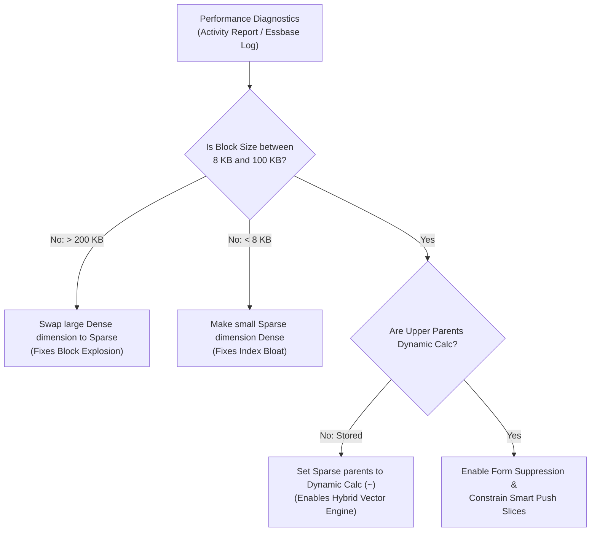

# 24. Performance Tuning — Essbase Block Sizing & Query Latency Optimization

> **Consultant High-Yield Summary:**  
> Performance tuning in Cloud EPM is 95% architectural and 5% infrastructure. Technical consultants optimize Essbase outlines by sizing blocks between 8 KB and 100 KB, ordering dimensions according to the Hourglass Principle, converting Upper Stored parents to Dynamic Calc in Hybrid BSO, and suppressing empty cells on web forms.

---

## 🎯 Live Interactive Visual Architecture Card

<b>🎯 Live Interactive Architecture Card: Essbase Block Optimization & Memory Architecture</b>

| Performance Pillar | Optimization Law | Production Metric & Target |
| :--- | :--- | :--- |
| **Dense Dimension Selection** | Only high-density, heavily correlated dimensions | Account and Period are standard Dense. Target block size: **8 KB to 100 KB**. |
| **Hybrid BSO Storage** | Upper sparse parent members must be Dynamic Calc | Eliminates physical storage for parent blocks; zero batch consolidation time. |
| **Hourglass Principle** | Dense (Large to Small) -> Sparse (Small to Large) | Minimizes index file (.IND) thrashing and maximizes memory cache efficiency. |
| **Web Form Performance** | Keep forms under **500 rows and 30 columns** | Always enable 'Suppress Missing Blocks' to prevent scanning empty sparse space. |

---

## 🏛️ Architectural Comparison & Design Patterns

| Diagnostic Indicator | Optimal Production Health | Severe Performance Pathology |
| :--- | :--- | :--- |
| Block Size | 8 KB to 100 KB | > 200 KB (Memory thrashing, buffer overflows) |
| Parent Sparse Storage | 100% Dynamic Calc (`~`) in Hybrid BSO | Stored (`+`) parents (forces slow batch CALC ALL) |
| Calc Script Duration | Sub-second to < 10 seconds | > 5 minutes (Runaway loops or top-down thrashing) |

---

## 💼 Tough & Twisted Review Scenarios (Consultant Review Defense)

### Question 1: "A cube refresh takes 2 hours and calculations are crawling. You inspect the outline and find Account (Dense, 1000 members), Period (Dense, 20 members), and Department (Dense, 500 members). What is the root cause?"
> **Consultant Model Answer:**  
> Severe Block Explosion. The block size is: `1000 * 20 * 500 * 8 bytes = 80,000,000 bytes = 80 MB per block`! In Essbase, an 80 MB block completely overwhelms data caches and JVM buffers, causing massive disk paging and memory freezing. Fix: Immediately convert Department to SPARSE. The block size becomes `1000 * 20 * 8 bytes = 160 KB` (or further reduced to ~50 KB), instantly accelerating calculations by 100x.

---

## 📑 Complete Document Catalog

| # | Document File | Topic Description |
|---|---------------|-------------------|
| 01 | [16.01_Performance_Monitoring_and_Tuning.md](./16.01_Performance_Monitoring_and_Tuning.md) | 16.01 — Performance Monitoring and Tuning: Complete Guide |
| 02 | [16.02_BSO_vs_ASO_Performance_Patterns.md](./16.02_BSO_vs_ASO_Performance_Patterns.md) | 16.02 — BSO vs ASO Performance Patterns: Complete Guide |
| 03 | [16.10_Performance_Complete_Guide.md](./16.10_Performance_Complete_Guide.md) | Performance Optimization — Complete Guide |
| 04 | [16.11_Performance_Oracle_Deep_Reference.md](./16.11_Performance_Oracle_Deep_Reference.md) | Performance & Optimization — Oracle Official Deep Reference |

---

> **Consultant Implementation Note:** Master the architectural comparison and review defense questions in this module before presenting designs to client stakeholders or senior review panels.