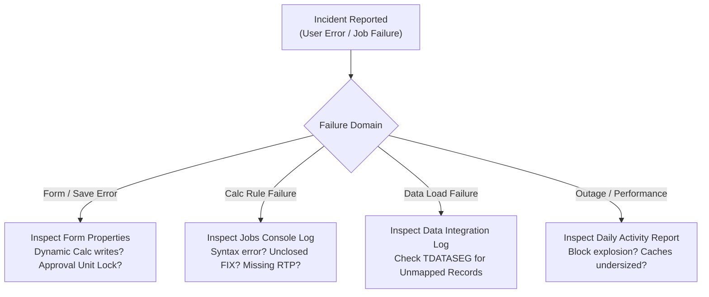

# 25. Debugging and Troubleshooting — Log Diagnostics, Error Codes & Root-Cause Analysis

> **Consultant High-Yield Summary:**  
> When production applications fail, technical consultants must systematically isolate root causes using Essbase application logs, Jobs Console stack traces, and Activity Reports. Mastering error codes (e.g. 1000000 - 1200000), Smart View submission traps, and calculation syntax failures ensures rapid incident resolution.

---

## 🎯 Live Interactive Visual Architecture Card

<b>🎯 Live Interactive Architecture Card: Systematic Troubleshooting & Root-Cause Isolation Flow</b>

| Diagnostic Tool | Inspection Target | Typical Error Diagnostic |
| :--- | :--- | :--- |
| **Jobs Console** | Application Job Stacks & Status | Identifies failed business rules, metadata refresh crashes, and LCM import syntax errors. |
| **Activity Report** | Daily Performance Diagnostic | Identifies top 10 slowest forms, heaviest calc scripts, high-memory users, and cube block statistics. |
| **Essbase Log** | Low-Level Storage Kernel Operations | Reports block creation counts, memory buffer allocation failures, and formula syntax errors. |
| **Data Integration Log** | Pipeline Process Details (`.log`) | Displays unmapped account records, rejected rows, and column alignment parsing errors. |

---

## 🏛️ Architectural Comparison & Design Patterns

| Error Symptom | Probable Root Cause | Immediate Corrective Action |
| :--- | :--- | :--- |
| Form cell is grayed out / Read-Only | Cell is Dynamic Calc, locked by Approval Unit, or restricted by CLS | Verify member storage property and Approval Unit status |
| Calc rule fails: 'Unknown Member' | Member created in Planning but cube not refreshed | Execute Database Refresh (Cube Refresh) |
| Smart View: 'Grid too large' | Query exceeds max cell threshold without suppression | Enable 'Suppress Missing Blocks' and zoom in on specific branch |

---

## 💼 Tough & Twisted Review Scenarios (Consultant Review Defense)

### Question 1: "A business rule fails in production with 'Cannot calculate. Essbase Error(1200497): Error in formula for member [Margin_Pct]'. The rule worked fine yesterday. What changed?"
> **Consultant Model Answer:**  
> A division-by-zero or missing data error. Yesterday, the underlying denominator (e.g. Revenue) had data. Today, a user cleared or loaded zeros into Revenue, causing the member formula to evaluate `0 / 0`. Fix: Always wrap division formulas in defensive zero-checks: `IF ("Revenue" != 0 AND "Revenue" != #Missing) "Margin" / "Revenue"; ELSE #Missing; ENDIF`.

---

## 📑 Complete Document Catalog

| # | Document File | Topic Description |
|---|---------------|-------------------|
| 01 | [17.01_Debugging_Methodology_and_Log_Analysis.md](./17.01_Debugging_Methodology_and_Log_Analysis.md) | 17.01 — Debugging Methodology and Log Analysis: Complete Guide |
| 02 | [17.02_Common_Error_Resolution_Patterns.md](./17.02_Common_Error_Resolution_Patterns.md) | 17.02 — Common Error Resolution Patterns: Complete Guide |
| 03 | [17.10_Debugging_Complete_Guide.md](./17.10_Debugging_Complete_Guide.md) | Debugging & Troubleshooting — Complete Guide |
| 04 | [17.11_Debugging_Oracle_Deep_Reference.md](./17.11_Debugging_Oracle_Deep_Reference.md) | Debugging & Troubleshooting — Oracle Official Deep Reference |

---

> **Consultant Implementation Note:** Master the architectural comparison and review defense questions in this module before presenting designs to client stakeholders or senior review panels.