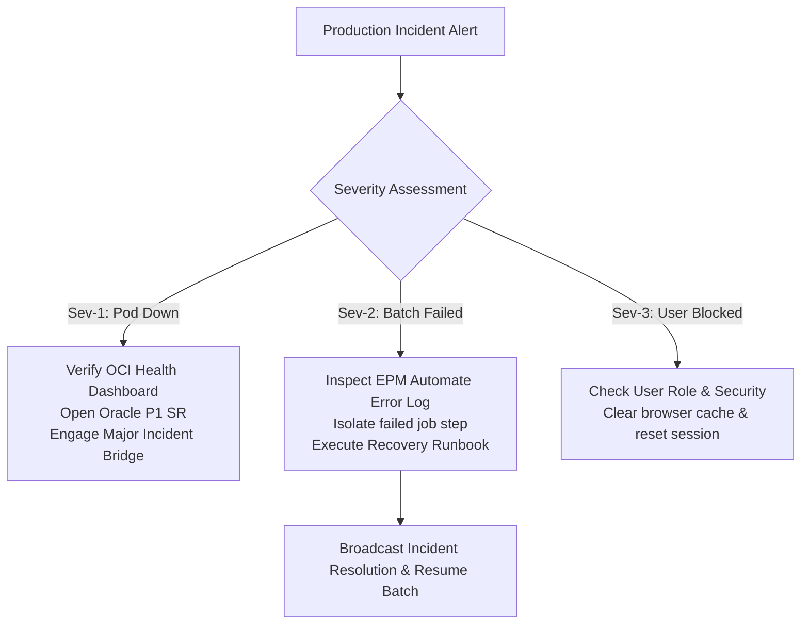

# 26. Production Support — Severity Triage, Lock Resolution & Batch Recovery

> **Consultant High-Yield Summary:**  
> Production Support consultants maintain business continuity across live enterprise EPM environments. Key capabilities include triaging Sev-1/Sev-2 incidents, resolving cube lockouts during peak close cycles, restarting hung jobs, and executing disaster recovery runbooks.

---

## 🎯 Live Interactive Visual Architecture Card

<b>🎯 Live Interactive Architecture Card: Production Support Incident Triage & Resolution Matrix</b>

| Severity Level | Incident Criteria | SLA & Consultant Action Protocol |
| :--- | :--- | :--- |
| **Severity 1 (Sev-1)** | Complete pod outage; entire finance organization blocked | 15-minute response. Check OCI status, log Oracle SR, restart pod if accessible. |
| **Severity 2 (Sev-2)** | Critical batch job failed; nightly load stalled before market open | 1-hour response. Analyze log stack, re-run failed data pipeline slice, notify stakeholders. |
| **Severity 3 (Sev-3)** | Non-blocking bug; isolated user unable to submit specific form | 4-8 hour response. Verify user security, browser cache, and approval unit ownership. |
| **Severity 4 (Sev-4)** | Minor cosmetic issue, text update, or feature request | Handled during routine sprint enhancement cycles. |

---

## 🏛️ Architectural Comparison & Design Patterns

| Operational Phase | Standard Daily Operations | Peak Month-End / Budget Close |
| :--- | :--- | :--- |
| Maintenance Window | Standard scheduled 1-hour window (e.g. 02:00 UTC) | Temporarily shifted or paused to avoid disrupting late-night finance batches |
| Metadata Updates | Allowed with proper change control approval | Strict freeze: ZERO metadata changes or cube refreshes during close week |
| Support Readiness | Standard ticket queue monitoring | War room / active standby for rapid triage and lock resolution |

---

## 💼 Tough & Twisted Review Scenarios (Consultant Review Defense)

### Question 1: "During month-end close, an admin attempts a Database Refresh while 50 users are submitting data. What happens?"
> **Consultant Model Answer:**  
> Database lock collision. The Database Refresh requires an exclusive outline lock on Essbase cubes. The refresh will either hang waiting for active user transactions to release, or forcefully disconnect users, discarding unsaved data forms and creating severe user frustration. Rule: Never execute a Database Refresh during active business hours; schedule refreshes during maintenance windows or maintenance freezes.

---

## 📑 Complete Document Catalog

| # | Document File | Topic Description |
|---|---------------|-------------------|
| 01 | [18.01_Common_Support_Tickets.md](./18.01_Common_Support_Tickets.md) | 18.01 — Production Support Tickets: Complete Guide |
| 02 | [18.01_Incident_Management_and_L3_Support.md](./18.01_Incident_Management_and_L3_Support.md) | 18.01 Incident Management and L3 Support |
| 03 | [18.10_Production_Support_Guide.md](./18.10_Production_Support_Guide.md) | Production Support — Complete Guide |
| 04 | [18.11_Production_Support_Oracle_Deep_Reference.md](./18.11_Production_Support_Oracle_Deep_Reference.md) | 18.11 Production Support Oracle Deep Reference |

---

> **Consultant Implementation Note:** Master the architectural comparison and review defense questions in this module before presenting designs to client stakeholders or senior review panels.