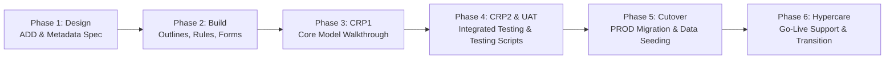

# 27. Implementation — Delivery Methodology, CRP Milestones & Cutover Governance

> **Consultant High-Yield Summary:**  
> Successful EPM implementations follow structured delivery methodologies (Agile, Waterfall, or Hybrid). Technical consultants participate across all project phases: Requirements Discovery, Solution Design, Build & Configuration, Conference Room Pilots (CRP1, CRP2), User Acceptance Testing (UAT), Cutover, and Hypercare.

---

## 🎯 Live Interactive Visual Architecture Card

<b>🎯 Live Interactive Architecture Card: EPM Implementation Project Lifecycle</b>

| Project Phase | Key Technical Deliverables | Review Sign-Off Gate |
| :--- | :--- | :--- |
| **Phase 1: Discover & Design** | Architecture Design Document (ADD), Dimension Model | Client approves dimensional hierarchy specifications and cube architecture. |
| **Phase 2: Build & Configure** | Metadata, Forms, Calc Rules, Data Integration, Security | Unit test sign-off; models validated against sample client data. |
| **Phase 3: Test (CRP & UAT)** | CRP1 (Core model), CRP2 (Full integration), UAT (User testing) | Client business leads execute end-to-end test scripts and sign off acceptance. |
| **Phase 4: Cutover & Go-Live** | Historical data load, security cutover, batch scheduling | Go/No-Go decision gate; PROD environment handed over to business. |
| **Phase 5: Hypercare** | Daily war-room triage, performance monitoring, training | Transition to steady-state Client Center of Excellence (CoE). |

---

## 🏛️ Architectural Comparison & Design Patterns

| Project Milestone | Conference Room Pilot 1 (CRP1) | User Acceptance Testing (UAT) |
| :--- | :--- | :--- |
| Audience | Core project team and finance champions | Broad end-user community and departmental planners |
| System Maturity | 60-70% built: validates core calculations and dimensionality | 95-100% built: production-ready forms, security, and data pipelines |
| Primary Goal | Validate design choices and catch architecture flaws early | Formal client sign-off verifying business requirements are met |

---

## 💼 Tough & Twisted Review Scenarios (Consultant Review Defense)

### Question 1: "What is the primary risk during the Cutover phase of an EPM project, and how is it mitigated?"
> **Consultant Model Answer:**  
> Historical data reconciliation failure and extended cutover windows. If historical trial balance data loaded from the ERP does not balance down to the dollar against legacy reports, business stakeholders will halt go-live. Mitigation: Execute multiple mock cutovers in TEST during the build phase to validate historical data load scripts, mapping rules, and consolidation calculations before final cutover weekend.

---

## 📑 Complete Document Catalog

| # | Document File | Topic Description |
|---|---------------|-------------------|
| 01 | [19.01_EPM_Implementation_Lifecycle.md](./19.01_EPM_Implementation_Lifecycle.md) | 19.01 — EPM Implementation Lifecycle: Complete Guide |
| 02 | [19.01_Requirement_Gathering_and_Workshops.md](./19.01_Requirement_Gathering_and_Workshops.md) | 19.02 — Requirement Gathering and Workshops: Complete Guide |
| 03 | [19.10_Implementation_Methodology.md](./19.10_Implementation_Methodology.md) | Implementation Methodology — Complete Guide |

---

> **Consultant Implementation Note:** Master the architectural comparison and review defense questions in this module before presenting designs to client stakeholders or senior review panels.