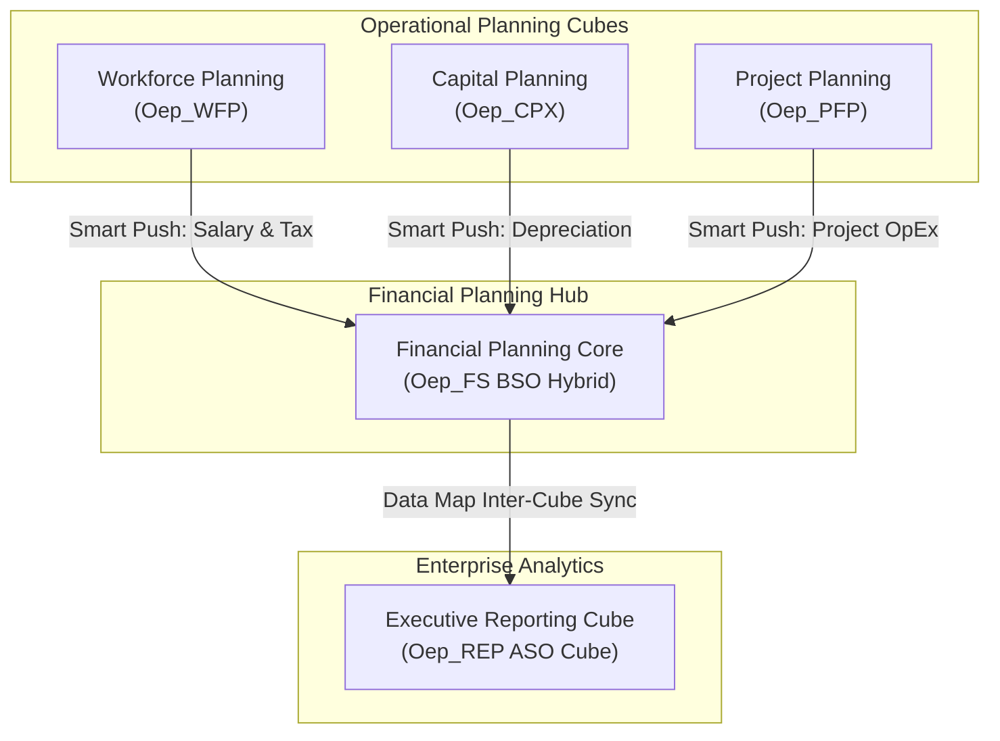

# 28. Projects — Enterprise Multi-Cube Architectures & Delivery Blueprints

> **Consultant High-Yield Summary:**  
> Enterprise EPM projects involve sophisticated multi-pod and multi-cube solutions integrating Financials, Workforce, Capital, and Sales Planning. Technical consultants design scalable inter-cube data flows, automated reconciliation bridges, and enterprise reporting layers.

---

## 🎯 Live Interactive Visual Architecture Card

<b>🎯 Live Interactive Architecture Card: Enterprise Multi-Cube Connected Solution Topology</b>

| Application Cube | Cube Architecture | Functional Role in Enterprise Solution |
| :--- | :--- | :--- |
| **Financials (Oep_FS)** | BSO (Hybrid) | Central consolidation hub for P&L, Balance Sheet, and driver-based revenue. |
| **Workforce (Oep_WFP)** | BSO (Hybrid) | Granular employee and job planning; feeds aggregated salary/benefits to Financials. |
| **Capital (Oep_CPX)** | BSO (Hybrid) | Asset depreciation and capital expenditure planning; feeds depreciation to Financials. |
| **Corporate Reporting** | ASO (Compressed) | High-concurrency query cube receiving consolidated numbers via Smart Push. |

---

## 🏛️ Architectural Comparison & Design Patterns

| Architecture Choice | Single Monolithic Cube | Multi-Cube Modular Architecture |
| :--- | :--- | :--- |
| Dimensional Density | Extremely bloated; contains 18+ dimensions to fit all needs | Lean and focused: 10-12 dimensions tailored to each functional domain |
| Block Size & Performance | High risk of block explosion; slow calculations and queries | Optimal block size (8-100 KB); sub-second user responsiveness |
| Security Boundaries | Complex security rules required to hide HR data from sales | Clean security separation: HR users restricted to Workforce cube |

---

## 💼 Tough & Twisted Review Scenarios (Consultant Review Defense)

### Question 1: "Why is separating HR/Workforce planning into a dedicated cube considered standard best practice instead of combining it with General Financials?"
> **Consultant Model Answer:**  
> Two critical reasons: 1) Dimensionality & Block Physics: Workforce requires granular dimensions (Employee, Job, Pay Component) that general financial planners do not need; combining them bloats the block size and explodes sparsity. 2) Confidentiality & Security: Employee salary, bonus, and personal data is sensitive; having a dedicated cube allows clean access control without complex cell-level security rules across the entire general ledger.

---

## 📑 Complete Document Catalog

| # | Document File | Topic Description |
|---|---------------|-------------------|
| 01 | [20.01_Manufacturing_Industry_Design.md](./20.01_Manufacturing_Industry_Design.md) | 20.01 — Manufacturing Industry Design Pattern |

---

> **Consultant Implementation Note:** Master the architectural comparison and review defense questions in this module before presenting designs to client stakeholders or senior review panels.