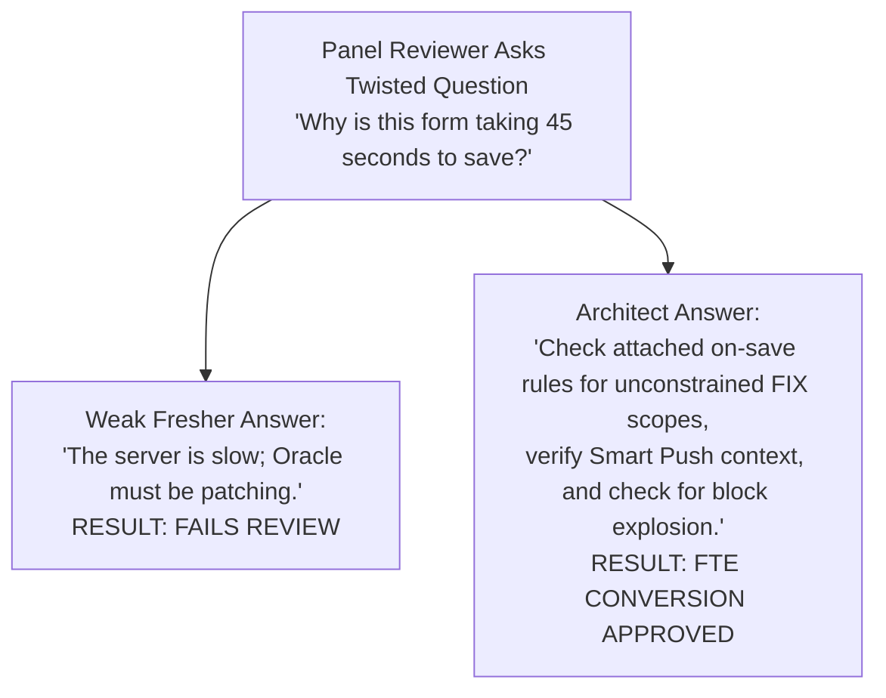

# 29. Interview Preparation — Fresher-to-FTE Conversion Questions & Technical Defense

> **Consultant High-Yield Summary:**  
> Technical interviewers and senior review panels test whether a junior consultant truly understands underlying Essbase physics and Cloud EPM architecture or is merely memorizing UI click-paths. Mastering twisted technical questions, block calculations, and architectural trade-offs guarantees conversion to billable FTE.

---

## 🎯 Live Interactive Visual Architecture Card

<b>🎯 Live Interactive Architecture Card: Technical Review Defense Competency Radar</b>

| Evaluation Dimension | Senior Review Expectation | Red-Flag Fresher Answer |
| :--- | :--- | :--- |
| **Essbase Block Physics** | Calculates block size mathematically; explains dense/sparse impacts | 'Dense is for big dimensions and sparse is for small dimensions.' |
| **Calculation Scoping** | Explains FIX on Sparse dimensions and bottom-up iteration | 'I just click the CALC ALL button in Calc Manager.' |
| **Hybrid BSO Internals** | Details why upper parents must be Dynamic Calc (ASO vector engine) | 'Hybrid is just a mix of both, I don't know the difference.' |
| **Security Precedence** | Explains least-privilege collision rules (None > Read > Write) | 'The user gets whatever permission group they were added to last.' |

---

## 🏛️ Architectural Comparison & Design Patterns

| Review Question | Beginner / Trap Answer | Senior Consultant Model Answer |
| :--- | :--- | :--- |
| What is Implied Share? | It's when two members share data | When a parent has 1 consolidatable child, Essbase treats parent and child as sharing the same cell coordinate to save space. |
| Why use Groovy? | Because it's newer than Calc Manager | To dynamically scope calculations strictly to edited cells (`operation.grid`), reducing execution time from minutes to milliseconds. |
| How does Hybrid BSO work? | It combines BSO and ASO | BSO storage kernel at Level 0 for procedural calculations + in-memory ASO vector engine at upper levels for instant dynamic rollups. |

---

## 💼 Tough & Twisted Review Scenarios (Consultant Review Defense)

### Question 1: "Explain exactly what happens inside Essbase when a data cell changes from #Missing to a number."
> **Consultant Model Answer:**  
> If the sparse coordinates for that cell do not belong to an existing data block, Essbase: 1) Allocates a new physical data block in memory (sized to the product of all dense dimensions * 8 bytes). 2) Initializes all dense cells in that block to #Missing. 3) Writes the new numeric value into the specific dense cell offset. 4) Adds an index entry into the index (.IND) file pointing to the new block's page (.PAG) file offset. 5) Marks the block as dirty in the data cache to be flushed to disk.

---

## 📑 Complete Document Catalog

| # | Document File | Topic Description |
|---|---------------|-------------------|
| 01 | [21.00_README.md](./21.00_README.md) | 📋 Interview Preparation — Master Index |
| 02 | [21.01_Architect_Interview_Questions.md](./21.01_Architect_Interview_Questions.md) | EPM Architect Interview Questions |
| 03 | [21.01_Foundation_Questions.md](./21.01_Foundation_Questions.md) | 🎯 Foundation Interview Questions |
| 04 | [21.01_Top_50_Architect_Interview_Questions.md](./21.01_Top_50_Architect_Interview_Questions.md) | 21.01 Top 50 Architect Interview Questions |
| 05 | [21.02_Essbase_Questions.md](./21.02_Essbase_Questions.md) | 🎯 Essbase Interview Questions |
| 06 | [21.03_Forms_Questions.md](./21.03_Forms_Questions.md) | 🎯 Forms Interview Questions |
| 07 | [21.04_Metadata_Questions.md](./21.04_Metadata_Questions.md) | Metadata & Dimensions — Interview Questions |
| 08 | [21.05_Planning_Questions.md](./21.05_Planning_Questions.md) | Planning — Interview Questions |
| 09 | [21.06_Business_Rules_Questions.md](./21.06_Business_Rules_Questions.md) | Business Rules & Calc Manager — Interview Questions |
| 10 | [21.08_Groovy_Questions.md](./21.08_Groovy_Questions.md) | Groovy — Interview Questions |
| 11 | [21.09_SmartView_Integration_Security_Admin_Questions.md](./21.09_SmartView_Integration_Security_Admin_Questions.md) | Smart View, Data Integration, Security, Administration — Interview Questions |
| 12 | [21.13_Scenario_Questions.md](./21.13_Scenario_Questions.md) | Scenario-Based Interview Questions |

---

> **Consultant Implementation Note:** Master the architectural comparison and review defense questions in this module before presenting designs to client stakeholders or senior review panels.