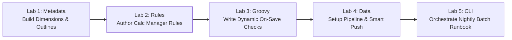

# 30. Labs_and_Exercises — Hands-On Configuration Labs & Step-by-Step Builds

> **Consultant High-Yield Summary:**  
> True technical confidence comes from hands-on keyboard practice. This module provides complete step-by-step laboratory exercises: building custom dimensions from CSV files, configuring dense/sparse attributes, writing optimized business rules, authoring Groovy validation scripts, and orchestrating EPM Automate runbooks.

---

## 🎯 Live Interactive Visual Architecture Card

<b>🎯 Live Interactive Architecture Card: Hands-On Implementation Lab Track</b>

| Lab Exercise | Technical Domain | Practical Skill Mastered |
| :--- | :--- | :--- |
| **Lab 01: Outline Architecture** | Dimensions & Storage | Sizing blocks, setting dense/sparse attributes, configuring Dynamic Calc upper parents. |
| **Lab 02: Business Rules** | Calc Manager & Essbase | Authoring scoped FIX statements, using `@CALCPARALLEL`, implementing dynamic driver formulas. |
| **Lab 03: Groovy Validation** | Event-Driven Scripting | Intercepting form saves, validating inputs, and throwing custom `VetoException` error alerts. |
| **Lab 04: Data Pipeline** | Data Integration | Building Import Formats, setting up Multi-Dim mappings, and loading trial balance files. |

---

## 🏛️ Architectural Comparison & Design Patterns

| Lab Stage | Learning Objective | Verification Gate |
| :--- | :--- | :--- |
| Metadata Lab | Build 12-dimension outline from scratch | Database Refresh succeeds with zero errors; block size = 48 KB |
| Calculations Lab | Write OpEx allocation business rule | Level 0 allocations calculate correctly and roll up instantly in Hybrid BSO |
| Automation Lab | Execute automated daily maintenance script | EPM Automate script runs headless, uploads file, refreshes cube, and logs out |

---

## 💼 Tough & Twisted Review Scenarios (Consultant Review Defense)

### Question 1: "In Lab 01, after building dimensions and running Database Refresh, your block size is 280 KB. How do you reduce it below 100 KB without deleting members?"
> **Consultant Model Answer:**  
> Inspect the dense dimensions. Typically, a custom business dimension (such as Department or Product) was mistakenly marked as Dense. In Essbase, only Account and Period should generally be Dense. Changing that custom dimension from Dense to Sparse immediately reduces the block size back into the optimal 8 KB - 100 KB range.

---

## 📑 Complete Document Catalog

| # | Document File | Topic Description |
|---|---------------|-------------------|
| 01 | [22.01_Hands_On_Labs.md](./22.01_Hands_On_Labs.md) | 🧪 Hands-On Labs |
| 02 | [22.01_Lab_Build_Application_From_Scratch.md](./22.01_Lab_Build_Application_From_Scratch.md) | 22.01 — Lab: Build a Planning Application from Scratch |
| 03 | [22.02_Lab_Advanced_Rules.md](./22.02_Lab_Advanced_Rules.md) | 22.02 — Lab: Build Advanced Rules and Rulesets |
| 04 | [22.03_Lab_Build_Dashboards.md](./22.03_Lab_Build_Dashboards.md) | 22.03 — Lab: Build Executive Dashboards |

---

> **Consultant Implementation Note:** Master the architectural comparison and review defense questions in this module before presenting designs to client stakeholders or senior review panels.