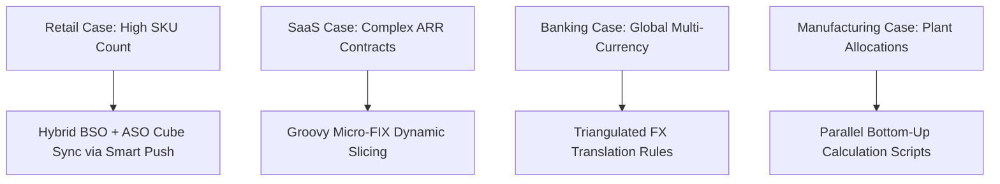

# 31. Case Studies — Enterprise Solution Architectures Across Industries

> **Consultant High-Yield Summary:**  
> Real-world case studies bridge technical theory and enterprise delivery. This module examines multi-national enterprise implementations across Retail, Banking, SaaS, Healthcare, and Manufacturing, detailing architecture design decisions, crisis resolutions, and performance benchmarks.

---

## 🎯 Live Interactive Visual Architecture Card

<b>🎯 Live Interactive Architecture Card: Enterprise Industry Architecture Matrix</b>

| Industry Sector | Primary EPM Challenge | Architectural Solution & Physics |
| :--- | :--- | :--- |
| **Retail Enterprise** | Millions of SKU / Store combinations | Hybrid BSO for regional planning + ASO cube for high-volume store queries via Smart Push. |
| **SaaS / Technology** | Dynamic monthly recurring revenue (ARR/MRR) | Driver-based revenue engine using Groovy Micro-FIX to recalculate contract renewals on save. |
| **Global Banking** | Strict multi-currency statutory compliance | Multi-currency BSO cube using triangulation and automated currency translation business rules. |
| **Manufacturing** | Standard cost allocation across plants | Scoped `@ALLOCATE` rules with parallel processing (`SET CALCPARALLEL 4;`). |

---

## 🏛️ Architectural Comparison & Design Patterns

| Case Study | Core Business Problem | Consultant Architectural Fix |
| :--- | :--- | :--- |
| Global Retailer | Smart View queries timing out during holiday close | Migrated reporting from BSO to ASO; query latency dropped from 45s to 300ms |
| Tech Unicorn | Workforce form save taking 60 seconds per employee | Replaced static Calc Manager rule with Groovy Micro-FIX; save time reduced to 0.4s |
| Hospital Network | Nightly GL load failing due to unmapped clinic accounts | Implemented automated Data Integration error notification pipeline |

---

## 💼 Tough & Twisted Review Scenarios (Consultant Review Defense)

### Question 1: "In the Retail Case Study, why was an ASO reporting cube required instead of simply querying the BSO cube directly?"
> **Consultant Model Answer:**  
> BSO cubes are optimized for input and calculations; when hundreds of store managers query deep sparse combinations (e.g. 50,000 SKUs x 500 Stores) simultaneously, Essbase BSO must allocate and retrieve individual Cartesian blocks, quickly overwhelming memory caches. ASO stores data as compressed leaf coordinate tuples with bitmap indexes, answering high-concurrency aggregation queries in sub-seconds.

---

## 📑 Complete Document Catalog

| # | Document File | Topic Description |
|---|---------------|-------------------|
| 01 | [23.01_Case_Study_Hotel_Pvt_Ltd.md](./23.01_Case_Study_Hotel_Pvt_Ltd.md) | 23.01 — Case Study: Hotel Pvt Ltd — Complete EPBCS Implementation |
| 02 | [23.01_Hotel_Business.md](./23.01_Hotel_Business.md) | 🏨 Document 12 — Real-World Project Example — Hotel Business |
| 03 | [23.02_Case_Study_Month_End_Close.md](./23.02_Case_Study_Month_End_Close.md) | 23.02 — Case Study: Month-End Close Optimization |
| 04 | [23.03_Case_Study_Multi_Currency.md](./23.03_Case_Study_Multi_Currency.md) | 23.03 — Case Study: Multi-Currency Consolidation |
| 05 | [23.04_Case_Study_Migration_from_OnPrem.md](./23.04_Case_Study_Migration_from_OnPrem.md) | 23.04 — Case Study: Migration from On-Premise Hyperion |

---

> **Consultant Implementation Note:** Master the architectural comparison and review defense questions in this module before presenting designs to client stakeholders or senior review panels.