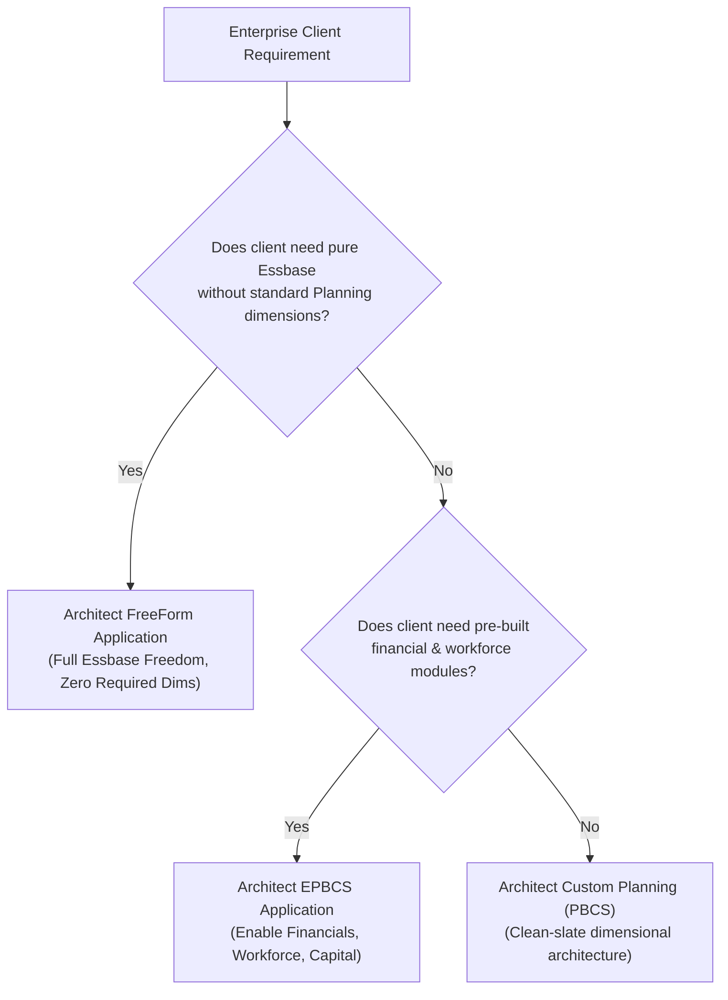

# 32. Architect Masterclass — Enterprise Governance, Scale & System Decisions

> **Consultant High-Yield Summary:**  
> Senior EPM Architects make the foundational system design decisions that determine the multi-year success of enterprise platforms. This masterclass covers FreeForm vs Standard Planning, multi-pod topologies, hybrid aggregation engine vector boundaries, and disaster recovery strategies.

---

## 🎯 Live Interactive Visual Architecture Card

<b>🎯 Live Interactive Architecture Card: Architect Decision Framework & System Topologies</b>

| Architecture Decision | Option A: Standard Planning | Option B: FreeForm Planning |
| :--- | :--- | :--- |
| **Required Dimensions** | Must include 6 standard dimensions (Account, Period, Entity, etc.) | Zero required dimensions; create any arbitrary dimensional schema. |
| **Application Modules** | Supports EPBCS modules (Financials, Workforce, etc.) | Pure custom Essbase cube in the cloud; no pre-built modules. |
| **Cube Types** | BSO and ASO cubes within Planning framework | Pure BSO, ASO, or Hybrid Essbase cubes; supports direct Essbase outline imports (`.otl`). |
| **Best Use Case** | Corporate budgeting, forecasting, and integrated financial statements | Complex standalone analytical models, actuarial cubes, and migration of legacy Essbase cubes. |

---

## 🏛️ Architectural Comparison & Design Patterns

| Architecture Domain | Junior Implementation Mindset | Senior Architect Mindset |
| :--- | :--- | :--- |
| Dimension Design | Adds dimensions whenever users ask for new data cuts | Strictly governs dimensionality; evaluates block size and sparse combinatorics |
| Calculation Logic | Writes monolithic CALC ALL scripts | Designs event-driven micro-calculations, parallel streams, and in-memory dynamic vectors |
| Environment Governance | Manages DEV and PROD ad-hoc via manual clicks | Automates multi-pod synchronization, cloning, and automated regression testing |

---

## 💼 Tough & Twisted Review Scenarios (Consultant Review Defense)

### Question 1: "When should an enterprise architect recommend a FreeForm Planning application instead of Standard Planning?"
> **Consultant Model Answer:**  
> When migrating legacy on-premises standalone Essbase cubes (BSO or ASO) that do not conform to Planning's mandatory dimensions (e.g. applications without an Entity or Scenario dimension, or non-calendar time models like 13-period manufacturing calendars). FreeForm allows deploying pure Essbase cubes directly into Cloud EPM without restructuring the outline to fit Planning conventions.

---

## 📑 Complete Document Catalog

| # | Document File | Topic Description |
|---|---------------|-------------------|
| 01 | [24.01_Masterclass_Performance_Tuning.md](./24.01_Masterclass_Performance_Tuning.md) | Architect Masterclass: Advanced Performance Tuning |
| 02 | [24.01_The_Perfect_EPM_Architecture.md](./24.01_The_Perfect_EPM_Architecture.md) | 24.01 The Perfect EPM Architecture |
| 03 | [24.01_The_Springboard_and_Settings_Map.md](./24.01_The_Springboard_and_Settings_Map.md) | The Complete EPBCS Springboard & Settings Map — The Architects Reference |
| 04 | [24.02_Essbase_Under_The_Hood.md](./24.02_Essbase_Under_The_Hood.md) | Essbase Under the Hood — Cloud Storage Mechanics & Block Math |
| 05 | [24.03_Elite_Groovy_Architecture.md](./24.03_Elite_Groovy_Architecture.md) | Elite Groovy Architecture — Memory Management, REST Payloads & Grid Streaming |
| 06 | [24.04_The_Dark_Arts_of_Performance.md](./24.04_The_Dark_Arts_of_Performance.md) | The Dark Arts of Performance — Advanced Calculation & Parallel Tuning |
| 07 | [24.05_The_Crack_Guy_Interviews.md](./24.05_The_Crack_Guy_Interviews.md) | The Crack Guy Interviews — 30 Ultra-Hard Architectural Scenarios & Trick Questions |
| 08 | [24.06_EDMCS_and_Metadata_Governance_Deep_Dive.md](./24.06_EDMCS_and_Metadata_Governance_Deep_Dive.md) | EDMCS & Enterprise Metadata Governance — The Architects Deep Dive |
| 09 | [24.07_IPM_Insights_and_Auto_Predict_AI_Engine.md](./24.07_IPM_Insights_and_Auto_Predict_AI_Engine.md) | IPM Insights & Auto-Predict AI Engine — The Architects Deep Dive |
| 10 | [24.08_The_Complete_Error_Code_Encyclopedia.md](./24.08_The_Complete_Error_Code_Encyclopedia.md) | The Complete Error Code Encyclopedia — Root Causes & Architectural Fixes |
| 11 | [24.09_EPM_Integration_Agent_and_Local_SQL_Tunneling.md](./24.09_EPM_Integration_Agent_and_Local_SQL_Tunneling.md) | EPM Integration Agent & Local SQL Tunneling — The Architects Deep Dive |
| 12 | [24.10_FreeForm_Cubes_GenAI_and_Future_Architecture.md](./24.10_FreeForm_Cubes_GenAI_and_Future_Architecture.md) | FreeForm Cubes, GenAI & The Future of EPM Architecture |

---

> **Consultant Implementation Note:** Master the architectural comparison and review defense questions in this module before presenting designs to client stakeholders or senior review panels.