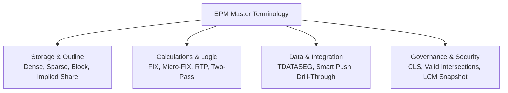

# 34. Glossary — Authoritative Dictionary of EPM, Essbase & Finance Terms

> **Consultant High-Yield Summary:**  
> Precision in terminology separates freshers from experienced consultants. This comprehensive glossary defines core concepts across Essbase storage mechanics, calculation commands, Cloud EPM platform architecture, and corporate finance accounting standards.

---

## 🎯 Live Interactive Visual Architecture Card

<b>🎯 Live Interactive Architecture Card: Core Terminology & Architectural Concepts Matrix</b>

| Term Category | Key Technical Terms | Precise Consultant Definition |
| :--- | :--- | :--- |
| **Storage Kernel** | Dense, Sparse, Block, Implied Share | The structural definitions of multidimensional Cartesian space and allocation physics. |
| **Application Tier** | POD, LCM, Redwood, Navigation Flow | Cloud infrastructure, identity management, and presentation architecture. |
| **Logic & Calc** | Groovy, RTP, Bottom-Up, Top-Down, Two-Pass | Execution engines, scoping directives, and calculation order controls. |
| **Data Exchange** | Pipeline, TDATASEG, Smart Push, Drill-Through | Staging, transformation, and inter-cube synchronization mechanisms. |

---

## 🏛️ Architectural Comparison & Design Patterns

| Term | Colloquial Definition | Architectural Consultant Definition |
| :--- | :--- | :--- |
| Block | A group of data cells | Multidimensional Cartesian array in memory/disk pre-allocated to the product of all dense dimensions * 8 bytes. |
| Smart Push | Copying data fast | Direct in-memory kernel-to-kernel streaming of form slices from BSO to ASO without staging tables. |
| Valid Intersection | Hiding invalid accounts | Relational rule engine that suppresses invalid multidimensional coordinate combinations on forms and Smart View. |

---

## 💼 Tough & Twisted Review Scenarios (Consultant Review Defense)

### Question 1: "Why is it dangerous to refer to an Essbase database as a 'relational table' when speaking to clients or review panels?"
> **Consultant Model Answer:**  
> Because Essbase is NOT a relational database. It has no rows, columns, foreign keys, or SQL tables. It is an Online Analytical Processing (OLAP) multidimensional cube where data is addressed by multidimensional coordinates and stored in dense cell arrays located via sparse B-tree indexes. Conflating OLAP with relational concepts demonstrates a fundamental misunderstanding of multidimensional storage physics.

---

## 📑 Complete Document Catalog

| # | Document File | Topic Description |
|---|---------------|-------------------|
| 01 | [26.01_EPM_Domain_Terminology.md](./26.01_EPM_Domain_Terminology.md) | EPM Domain Terminology and Full Forms |
| 02 | [26.01_Oracle_EPM_Glossary.md](./26.01_Oracle_EPM_Glossary.md) | 26.01 Oracle EPM Glossary |

---

> **Consultant Implementation Note:** Master the architectural comparison and review defense questions in this module before presenting designs to client stakeholders or senior review panels.