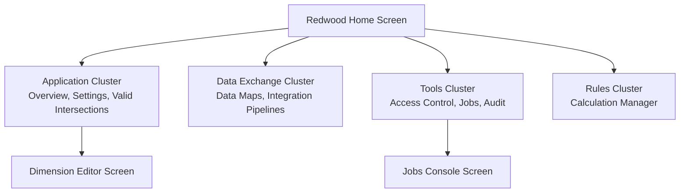

# 36. Screen Encyclopedia — Complete Redwood Web UI Console Reference

> **Consultant High-Yield Summary:**  
> A complete visual and functional catalog of every administrative screen, modal, and configuration panel in the Redwood Cloud EPM interface. Covering Application Settings, Dimension Editor, Valid Intersections Designer, Data Maps Console, Jobs Console, and Navigation Flows Designer.

---

## 🎯 Live Interactive Visual Architecture Card

<b>🎯 Live Interactive Architecture Card: Redwood Administrative Console Architecture</b>

| Administrative Screen | Navigation Path | Key Configuration Controls |
| :--- | :--- | :--- |
| **Dimension Editor** | Application -> Overview -> Dimensions | Dense/sparse assignment, member hierarchy edits, storage properties, formulas. |
| **Valid Intersections** | Application -> Valid Intersections | Anchor dimension selection, non-anchor rules, wildcard inclusion/exclusion rules. |
| **Data Maps Console** | Application -> Data Exchange -> Data Maps | Source-to-target cube mappings, Smart Push attachment, unmapped dimension defaults. |
| **Jobs Console** | Application -> Jobs | Active job monitoring, historical execution logs, error download, job scheduling. |
| **Access Control** | Tools -> Access Control | User assignment, Native Group management, role mappings, security reports. |

---

## 🏛️ Architectural Comparison & Design Patterns

| Console Screen | Primary Administrative Action | Consultant Implementation Caution |
| :--- | :--- | :--- |
| Dimension Editor | Create/modify members and storage properties | Always execute Database Refresh immediately after metadata modifications |
| Valid Intersections | Define allowable multi-dimensional combinations | Test in Smart View: overly restrictive rules can block valid data loads |
| Jobs Console | Inspect execution history of rules and imports | Download error logs immediately; historical logs are purged automatically |

---

## 💼 Tough & Twisted Review Scenarios (Consultant Review Defense)

### Question 1: "In the Jobs Console, what does a job status of 'Completed with Warnings' indicate, and where do you find the warning details?"
> **Consultant Model Answer:**  
> It indicates that the main job executed, but non-fatal exceptions occurred (e.g. some records rejected during data load, or some member formulas skipped). Click on the job name in the Jobs Console to open the Job Details panel, then click 'View Log' or 'Download Error File' to inspect the exact line numbers and members that triggered warnings.

---

## 📑 Complete Document Catalog

| # | Document File | Topic Description |
|---|---------------|-------------------|
| 01 | [28.01_Application_Overview_Screen.md](./28.01_Application_Overview_Screen.md) | 28.01 — Application Overview Screen: Complete Guide |
| 02 | [28.02_Valid_Intersections_Screen_Deep_Dive.md](./28.02_Valid_Intersections_Screen_Deep_Dive.md) | 28.02 — Valid Intersections Screen: Deep Dive |
| 03 | [28.03_Access_Control_Screen_Deep_Dive.md](./28.03_Access_Control_Screen_Deep_Dive.md) | 28.03 — Access Control Screen: Deep Dive |
| 04 | [28.04_Data_Management_Setup_Screens.md](./28.04_Data_Management_Setup_Screens.md) | 28.04 — Data Management Setup Screens |
| 05 | [28.05_Job_Console_and_Scheduling_Screens.md](./28.05_Job_Console_and_Scheduling_Screens.md) | 28.05 — Job Console and Scheduling Screens |
| 06 | [28.06_Data_Integration_Mapping_Screens.md](./28.06_Data_Integration_Mapping_Screens.md) | 28.06 — Data Integration Mapping Screens |
| 07 | [28.07_Dashboards_Deep_Dive.md](./28.07_Dashboards_Deep_Dive.md) | 28.07 Dashboards 2.0 — Complete Screen Deep Dive |
| 08 | [28.08_Task_Lists_and_Flows.md](./28.08_Task_Lists_and_Flows.md) | 28.08 — Task Lists and Flows: Complete Screen Guide |
| 09 | [28.09_Approval_Flow_Process.md](./28.09_Approval_Flow_Process.md) | 28.09 — Approval Flow Process: Complete Screen Guide |
| 10 | [28.10_Jobs_and_Scheduling_Deep_Dive.md](./28.10_Jobs_and_Scheduling_Deep_Dive.md) | 28.10 — Jobs and Scheduling: Deep Dive |
| 11 | [28.13_Dimension_Editor_Screen_Complete.md](./28.13_Dimension_Editor_Screen_Complete.md) | 🏗️ 28.13 — Dimension Editor Screen: Complete Encyclopedia |
| 12 | [28.14_Member_Properties_Screen_Complete.md](./28.14_Member_Properties_Screen_Complete.md) | 🏷️ 28.14 — Member Properties Screen: Complete Encyclopedia |
| 13 | [28.15_Forms_Designer_Screen_Complete.md](./28.15_Forms_Designer_Screen_Complete.md) | 📝 28.15 — Forms Designer Screen: Complete Encyclopedia |
| 14 | [28.16_Business_Rules_Screen_Complete.md](./28.16_Business_Rules_Screen_Complete.md) | 🧮 28.16 — Calculation Manager (Business Rules) Screen: Complete Encyclopedia |
| 15 | [28.17_Smart_Lists_Screen_Complete.md](./28.17_Smart_Lists_Screen_Complete.md) | 📋 28.17 — Smart Lists Screen: Complete Encyclopedia |
| 16 | [28.18_Substitution_Variables_Screen_Complete.md](./28.18_Substitution_Variables_Screen_Complete.md) | 🔄 28.18 — Substitution Variables Screen: Complete Encyclopedia |
| 17 | [28.19_Currencies_Screen_Complete.md](./28.19_Currencies_Screen_Complete.md) | 💱 28.19 — Currencies Screen: Complete Encyclopedia |
| 18 | [28.20_Action_Menus_Screen_Complete.md](./28.20_Action_Menus_Screen_Complete.md) | 🖱️ 28.20 — Action Menus Screen: Complete Encyclopedia |
| 19 | [28.21_Application_Settings_Screen_Complete.md](./28.21_Application_Settings_Screen_Complete.md) | ⚙️ 28.21 — Application Settings Screen: Complete Encyclopedia |
| 20 | [28.22_Navigation_Flows_Designer_Screen.md](./28.22_Navigation_Flows_Designer_Screen.md) | 🔄 28.22 — Navigation Flows Designer Screen: Complete Encyclopedia |
| 21 | [28.23_Task_Lists_Designer_Screen_Complete.md](./28.23_Task_Lists_Designer_Screen_Complete.md) | ✅ 28.23 — Task Lists Designer Screen: Complete Encyclopedia |
| 22 | [28.24_Approval_Workflow_Screen_Complete.md](./28.24_Approval_Workflow_Screen_Complete.md) | 🔄 28.24 — Approval Workflow Screen: Complete Encyclopedia |
| 23 | [28.26_Valid_Intersections_Designer_Screen.md](./28.26_Valid_Intersections_Designer_Screen.md) | 🎯 28.26 — Valid Intersections Designer Screen: Complete Encyclopedia |
| 24 | [28.27_Data_Maps_Screen_Complete.md](./28.27_Data_Maps_Screen_Complete.md) | 🔀 28.27 — Data Maps Screen: Complete Encyclopedia |
| 25 | [28.28_Clear_Cube_Job_Screen_Complete.md](./28.28_Clear_Cube_Job_Screen_Complete.md) | 🗑️ 28.28 — Clear Cube Job Screen: Complete Encyclopedia |
| 26 | [28.29_Jobs_Console_All_Job_Types.md](./28.29_Jobs_Console_All_Job_Types.md) | 📊 28.29 — Jobs Console Screen: Complete Encyclopedia |
| 27 | [28.30_Access_Control_Complete_Screen.md](./28.30_Access_Control_Complete_Screen.md) | 🔒 28.30 — Access Control Screen: Complete Encyclopedia |

---

> **Consultant Implementation Note:** Master the architectural comparison and review defense questions in this module before presenting designs to client stakeholders or senior review panels.