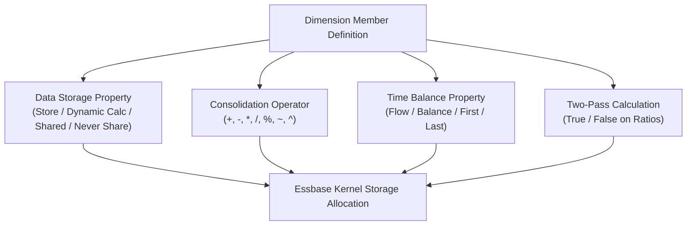

# 37. Property Encyclopedia — Exhaustive Outline, Member & Form Property Guide

> **Consultant High-Yield Summary:**  
> Every single property in Cloud EPM has direct operational consequences on calculation speed, storage allocation, and user interaction. This encyclopedia covers Dimension Properties, Member Storage, Consolidation Operators, Time Balance attributes, and Form Grid configuration settings.

---

## 🎯 Live Interactive Visual Architecture Card

<b>🎯 Live Interactive Architecture Card: Universal Member & Dimension Properties Matrix</b>

| Property Group | Key Properties | Operational Physics & Impact |
| :--- | :--- | :--- |
| **Storage Properties** | Store, Dynamic Calc, Shared, Never Share | Governs whether cell allocates physical disk bytes in .PAG files or computes in-memory. |
| **Consolidation Operators** | `+`, `-`, `*`, `/`, `%`, `~`, `^` | Defines mathematical aggregation logic during parent hierarchy rollups. |
| **Time Balance** | Flow, Balance, First, Last, Average | Governs how balance sheet accounts summarize across time periods (e.g. Q1 = March). |
| **Two-Pass Calculation** | Checkbox on Account Dimension | Forces ratio and margin % accounts to recalculate after full hierarchy consolidation. |
| **Skip Property** | None, Missing, Zeros, Missing and Zeros | Instructs Time Balance calculations to skip #Missing or zero periods when computing averages. |

---

## 🏛️ Architectural Comparison & Design Patterns

| Property | Stored | Dynamic Calc |
| :--- | :--- | :--- |
| Storage Footprint | Consumes 8 bytes in every existing sparse Cartesian block | Zero bytes on disk; evaluated purely in RAM during query |
| Calculation Timing | Calculated in advance via batch scripts or form save | Calculated on retrieval; re-evaluated every time user opens form |
| Outline Best Practice | Mandatory for Level 0 leaf cells storing actual data | Mandatory for upper sparse parent members in Hybrid BSO |

---

## 💼 Tough & Twisted Review Scenarios (Consultant Review Defense)

### Question 1: "Why is Two-Pass Calculation only effective on members of the Account dimension, and what happens if you check Two-Pass on a member in the Entity dimension?"
> **Consultant Model Answer:**  
> In Essbase, Two-Pass calculation is an Account dimension-specific compiler directive. Essbase's calculation order executes the Account dimension first and performs a second pass on Dynamic Calc account members after other dimensions aggregate. Setting Two-Pass on non-Account dimensions (like Entity or Department) is completely ignored by the Essbase calculation compiler.

---

## 📑 Complete Document Catalog

| # | Document File | Topic Description |
|---|---------------|-------------------|
| 01 | [29.01_Dimension_Properties.md](./29.01_Dimension_Properties.md) | 29.01 — Dimension Properties: Complete Reference |
| 02 | [29.02_All_Form_Properties_Exhaustive.md](./29.02_All_Form_Properties_Exhaustive.md) | 29.02 — All Form Properties: Exhaustive Reference |
| 03 | [29.02_UDA_and_Attribute_Configuration_Screen.md](./29.02_UDA_and_Attribute_Configuration_Screen.md) | 29.02 — UDA and Attribute Configuration |
| 04 | [29.03_Currency_and_Exchange_Rate_Properties.md](./29.03_Currency_and_Exchange_Rate_Properties.md) | 29.03 — Currency and Exchange Rate Properties |
| 05 | [29.03_Form_Properties_Impact_Analysis.md](./29.03_Form_Properties_Impact_Analysis.md) | Form Properties: Performance Impact Analysis |
| 06 | [29.04_Account_Dimension_Properties_Exhaustive.md](./29.04_Account_Dimension_Properties_Exhaustive.md) | Account Dimension Properties Exhaustive Guide |
| 07 | [29.05_Entity_and_Custom_Dim_Properties.md](./29.05_Entity_and_Custom_Dim_Properties.md) | Entity and Custom Dimension Properties |
| 08 | [29.06_Application_Settings_Impact.md](./29.06_Application_Settings_Impact.md) | Application Settings Impact |
| 09 | [29.07_Standard_vs_Attribute_Dimensions.md](./29.07_Standard_vs_Attribute_Dimensions.md) | Standard vs. Attribute Dimensions Deep Dive |
| 10 | [29.08_Form_Grid_Properties_Exhaustive.md](./29.08_Form_Grid_Properties_Exhaustive.md) | 📐 29.08 — Form Grid Properties: Exhaustive Reference |
| 11 | [29.16_Calc_Manager_Component_Properties.md](./29.16_Calc_Manager_Component_Properties.md) | 🧩 29.16 — Calc Manager Component Properties: Complete Reference |

---

> **Consultant Implementation Note:** Master the architectural comparison and review defense questions in this module before presenting designs to client stakeholders or senior review panels.