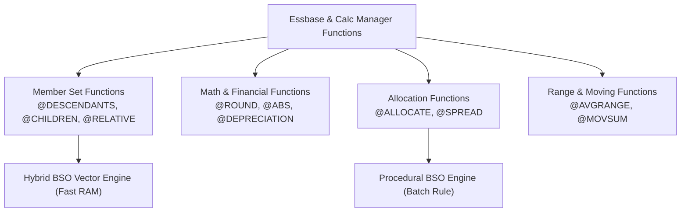

# 38. Function Reference Encyclopedia — Complete Essbase & Calc Manager Functions

> **Consultant High-Yield Summary:**  
> An exhaustive mathematical and operational reference to all Essbase and Calc Manager functions: Financial, Mathematical, Statistical, Allocation, Member Set, Date/Time, and String operations. Details syntax, parameters, return types, and Hybrid BSO compatibility.

---

## 🎯 Live Interactive Visual Architecture Card

<b>🎯 Live Interactive Architecture Card: Calculation Function Classification & Vector Compatibility</b>

| Function Family | Representative Functions | Hybrid BSO Vector Engine Compatibility |
| :--- | :--- | :--- |
| **Member Set Functions** | `@CHILDREN`, `@DESCENDANTS`, `@RELATIVE`, `@LIST` | 100% Compatible; evaluated natively in in-memory vector queries. |
| **Financial Functions** | `@DEPRECIATION`, `@NPV`, `@IRR`, `@INTEREST` | Procedural only; used in Level 0 business rules, NOT dynamic upper formulas. |
| **Mathematical Functions** | `@ABS`, `@EXP`, `@LOG`, `@ROUND`, `@TRUNCATE` | Fully compatible across both procedural rules and dynamic member formulas. |
| **Allocation Functions** | `@ALLOCATE`, `@MDALLOCATE`, `@SPREAD` | Procedural only; requires batch business rule execution on existing blocks. |
| **Cross-Dimensional** | `->` (Cross-Dim Operator), `@XREF`, `@XWRITE` | Fully supported in rules; triggers BSO fallback if used improperly in dynamic formulas. |

---

## 🏛️ Architectural Comparison & Design Patterns

| Function | Primary Use Case | Hybrid BSO Vector Engine Status |
| :--- | :--- | :--- |
| `@IDESCENDANTS` | Return member and all descendants in FIX scope | Fully supported in dynamic queries |
| `@CURRMBRRANGE` | Generate rolling period ranges dynamically | Unsupported in dynamic Hybrid formulas; forces BSO procedural fallback |
| `@CALCPARALLEL` | Multithread batch calculation scripts | BSO batch calculation directive; not used in dynamic formulas |

---

## 💼 Tough & Twisted Review Scenarios (Consultant Review Defense)

### Question 1: "Why does using `@CURRMBRRANGE` or `@PRIOR` in an upper-level Dynamic Calc member formula destroy query performance in Hybrid BSO?"
> **Consultant Model Answer:**  
> Hybrid BSO evaluates upper-level dynamic calculations using the lightning-fast ASO dynamic vector engine. The ASO vector engine supports pure additive and basic mathematical operations, but cannot process procedural functions like `@CURRMBRRANGE` or `@PRIOR` that require sequential recursion. When encountered, Essbase abandons vector aggregation and falls back to single-threaded BSO procedural calculation, increasing retrieval times from 200ms to 30+ seconds.

---

## 📑 Complete Document Catalog

| # | Document File | Topic Description |
|---|---------------|-------------------|
| 01 | [30.01_Essbase_Calculation_Functions.md](./30.01_Essbase_Calculation_Functions.md) | 30.01 — Essbase Calculation Functions: Complete Reference |
| 02 | [30.02_All_Member_Functions_Exhaustive.md](./30.02_All_Member_Functions_Exhaustive.md) | Exhaustive List: All @ Member Functions |
| 03 | [30.02_Groovy_API_Function_Reference.md](./30.02_Groovy_API_Function_Reference.md) | 30.02 — Groovy API Function Reference: Complete Guide |
| 04 | [30.03_Advanced_Financial_Functions.md](./30.03_Advanced_Financial_Functions.md) | 29.03 Advanced Financial Functions |
| 05 | [30.03_Member_Functions_Code_Examples.md](./30.03_Member_Functions_Code_Examples.md) | Member Functions: Exhaustive Code Examples |
| 06 | [30.04_Essbase_Calc_Commands_Deep_Dive.md](./30.04_Essbase_Calc_Commands_Deep_Dive.md) | Essbase Calculation Commands Deep Dive |
| 07 | [30.05_Planning_Formula_Expressions.md](./30.05_Planning_Formula_Expressions.md) | Planning Formula Expressions Deep Dive |

---

> **Consultant Implementation Note:** Master the architectural comparison and review defense questions in this module before presenting designs to client stakeholders or senior review panels.