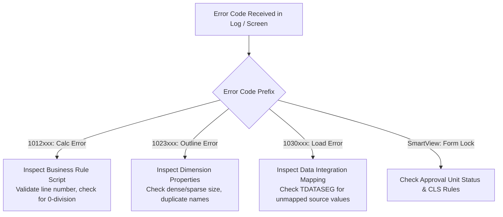

# 39. Error Encyclopedia — Essbase & Smart View Error Codes and Exact Fixes

> **Consultant High-Yield Summary:**  
> A comprehensive encyclopedia of Essbase error codes (1000000 to 1200000 series), Smart View submission traps, and Planning application validation failures with exact root causes and step-by-step resolution procedures.

---

## 🎯 Live Interactive Visual Architecture Card

<b>🎯 Live Interactive Architecture Card: Essbase Error Code Diagnostic & Resolution Map</b>

| Error Code Range | Error Category | Typical Root Cause & Fix Protocol |
| :--- | :--- | :--- |
| **1012000 - 1012999** | Calc Script Syntax & Execution | Unclosed FIX block, unknown member, or division by zero. Check Jobs log for line number. |
| **1023000 - 1023999** | Storage & Outline Structure | Block size exceeds limit, duplicate member name, or circular shared member reference. |
| **1030000 - 1030999** | Data Load & Buffer Failure | Rejected rows due to unmapped members, delimiter mismatch, or lock timeout during load. |
| **Smart View Errors** | Grid & Submission Failures | 'Grid too large' (disable suppression), 'Cannot submit' (dynamic calc cell write-back). |

---

## 🏛️ Architectural Comparison & Design Patterns

| Error Code / Message | Underlying Technical Cause | Exact Step-by-Step Fix |
| :--- | :--- | :--- |
| Essbase Error(1012001): Unknown Member | Member referenced in rule does not exist in Essbase outline | Add member to outline, or execute Database Refresh if already added in web |
| Essbase Error(1023040): Block size exceeds limit | Dense dimensions Cartesian product is too large | Change one or more large dense dimensions to Sparse in Dimension Editor |
| Smart View: Error 504 Gateway Timeout | Query took longer than web proxy timeout (typically 3-5 min) | Add row/column suppression, zoom in to smaller slice, or optimize dynamic formulas |

---

## 💼 Tough & Twisted Review Scenarios (Consultant Review Defense)

### Question 1: "A user gets 'Smart View Error: Cannot perform allocation or write-back on read-only cell'. Name 4 completely different architectural reasons why a cell is read-only."
> **Consultant Model Answer:**  
> 1) The cell is a **Dynamic Calc** member (leaf or parent). 2) The cell coordinate is restricted by **Cell-Level Security (CLS)**. 3) The cell coordinate is invalid under a **Valid Intersection** rule. 4) The Approval Unit containing this entity/scenario/version is in **Approved** or **Locked** status.

---

## 📑 Complete Document Catalog

| # | Document File | Topic Description |
|---|---------------|-------------------|
| 01 | [31.01_Essbase_Error_Codes_and_Resolutions.md](./31.01_Essbase_Error_Codes_and_Resolutions.md) | 31.01 — Essbase Error Codes and Resolutions: Complete Guide |
| 02 | [31.02_Smart_View_Error_Codes.md](./31.02_Smart_View_Error_Codes.md) | 31.02 — Smart View Error Codes and Resolutions: Complete Guide |
| 03 | [31.03_Data_Integration_Error_Codes.md](./31.03_Data_Integration_Error_Codes.md) | 31.03 — Data Integration Error Codes and Resolutions: Complete Guide |
| 04 | [31.04_Calc_Manager_Validation_Errors.md](./31.04_Calc_Manager_Validation_Errors.md) | 31.04 — Calc Manager Validation Errors: Complete Guide |

---

> **Consultant Implementation Note:** Master the architectural comparison and review defense questions in this module before presenting designs to client stakeholders or senior review panels.