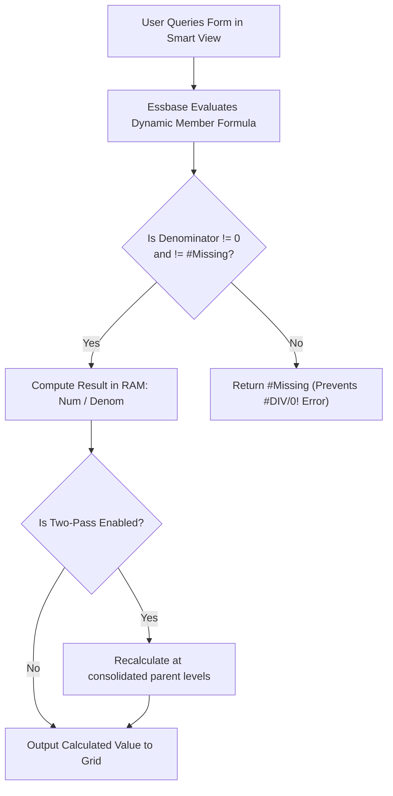

# 40. Member Formula Encyclopedia — Dynamic & Two-Pass Formula Patterns

> **Consultant High-Yield Summary:**  
> Member formulas attached directly to outline members execute in memory during retrieval. This encyclopedia provides production-tested formula patterns for Financial Margins, Rolling Moving Averages, Year-over-Year Growth, and Cash Flow derivations with complete defensive zero-division checks.

---

## 🎯 Live Interactive Visual Architecture Card

<b>🎯 Live Interactive Architecture Card: High-Performance Member Formula Architecture</b>

| Formula Pattern | Financial Application | Implementation Law & Syntax Pattern |
| :--- | :--- | :--- |
| **Dynamic Margin %** | Gross Margin %, EBITDA Margin % | Wrap division in zero-check; enable **Two-Pass Calculation** on Account dimension. |
| **Year-over-Year Growth** | `(CY - PY) / PY * 100` | Reference prior year using `@PRIOR` or dynamic substitution variables with missing-data checks. |
| **Defensive Zero-Check** | Any ratio or division formula | `IF ("Denom" != 0 AND "Denom" != #Missing) "Num" / "Denom"; ELSE #Missing; ENDIF` |
| **Time Dynamic Formulas** | YTD, QTD, Periodic conversions | Configure Dynamic Calc member formulas or utilize native Period / Time intelligence. |

---

## 🏛️ Architectural Comparison & Design Patterns

| Formula Pattern | Unprotected / Risky Formula | Consultant Production-Grade Formula |
| :--- | :--- | :--- |
| Margin % | `"Net_Income" / "Revenue" * 100;` | `IF ("Revenue" != 0 AND "Revenue" != #Missing) ("Net_Income" / "Revenue") * 100; ELSE #Missing; ENDIF` |
| Cost per Head | `"Total_OpEx" / "Headcount";` | `IF ("Headcount" > 0) "Total_OpEx" / "Headcount"; ELSE #Missing; ENDIF` |
| Two-Pass Setting | Unchecked (produces wrong rolled-up averages) | Checked (forces recalculation at summary parent nodes) |

---

## 💼 Tough & Twisted Review Scenarios (Consultant Review Defense)

### Question 1: "What happens if a consultant creates a dynamic margin % member formula without enabling Two-Pass Calculation?"
> **Consultant Model Answer:**  
> Parent summary levels will display mathematically incorrect rolled-up averages. Without Two-Pass, Essbase calculates the margin % at Level 0 children (e.g. Entity A = 10%, Entity B = 20%) and then simply adds them together (`+`) at the parent Entity node (showing 30%!). Enabling Two-Pass forces Essbase to first consolidate Total Net Income and Total Revenue across all entities, and then perform a second pass recalculating `Total Net Income / Total Revenue`, returning the correct weighted average.

---

## 📑 Complete Document Catalog

| # | Document File | Topic Description |
|---|---------------|-------------------|
| 01 | [32.01_Member_Formula_Complete_Guide.md](./32.01_Member_Formula_Complete_Guide.md) | 31.01 Member Formula Complete Guide |
| 02 | [32.05_Member_Formula_Patterns_Encyclopedia.md](./32.05_Member_Formula_Patterns_Encyclopedia.md) | 32.05 Member Formula Patterns Encyclopedia |

---

> **Consultant Implementation Note:** Master the architectural comparison and review defense questions in this module before presenting designs to client stakeholders or senior review panels.