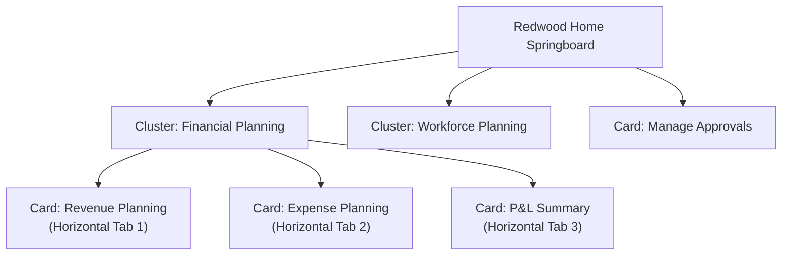

# 41. Navigation Encyclopedia — Redwood UX Navigation Map & Springboards

> **Consultant High-Yield Summary:**  
> A structured map of Cloud EPM Redwood navigation: Home Springboard, Cards, Horizontal and Vertical Tab layouts, Breadcrumbs, Global Search, and URL Deep-Linking for enterprise portal integration.

---

## 🎯 Live Interactive Visual Architecture Card

<b>🎯 Live Interactive Architecture Card: Redwood Springboard & Portal Navigation Topology</b>

| Navigation Element | Purpose & Access Pattern | Implementation Best Practice |
| :--- | :--- | :--- |
| **Home Springboard** | Central landing page displaying role-based cards | Customize per user persona via Navigation Flows. |
| **Cards & Clusters** | Grouped workflows (e.g. Financials, Approvals) | Use standard Redwood iconography and concise labels. |
| **Horizontal Tabs** | Sub-navigation within a single card | Limit horizontal tabs to 5-7 to prevent horizontal scrolling. |
| **Vertical Tabs** | Left-hand panel navigation within a card | Use vertical tabs for deep hierarchical workflows (e.g. Setup -> Input -> Review). |
| **URL Deep Linking** | Direct browser links to specific forms/dashboards | Embed EPM form URLs into corporate intranet portals or ERP homepages. |

---

## 🏛️ Architectural Comparison & Design Patterns

| Navigation Element | Horizontal Tab Layout | Vertical Tab Layout |
| :--- | :--- | :--- |
| Visual Position | Across the top of the form canvas | Docked vertically along the left edge of the screen |
| Ideal Use Case | Sequential linear steps (e.g. Step 1: Input, Step 2: Calculate, Step 3: Report) | Large collections of independent sub-forms or reference guides |
| Screen Real Estate | Preserves horizontal width; consumes vertical pixels | Consumes horizontal width; ideal for wide 16:9 displays |

---

## 💼 Tough & Twisted Review Scenarios (Consultant Review Defense)

### Question 1: "Can an administrator hide specific standard Redwood cards (e.g. Tools or Application) from standard business users?"
> **Consultant Model Answer:**  
> Yes. By creating a custom Navigation Flow, assigning it to the 'User' group, and marking the administrative cards or clusters as **Hidden**. Business users will only see the operational cards assigned to them, keeping the interface clean and preventing unauthorized access attempts.

---

## 📑 Complete Document Catalog

| # | Document File | Topic Description |
|---|---------------|-------------------|
| 01 | [33.00_Navigation_Encyclopedia_Index.md](./33.00_Navigation_Encyclopedia_Index.md) | 🗺️ Module 33: Navigation Encyclopedia — Master Index |
| 02 | [33.01_Home_Page_Navigation.md](./33.01_Home_Page_Navigation.md) | 33.01 Home Page Navigation |
| 03 | [33.02_Application_Menu_Navigation.md](./33.02_Application_Menu_Navigation.md) | 📱 33.02 — Application Menu: Complete Navigation Encyclopedia |
| 04 | [33.03_Data_Menu_Navigation.md](./33.03_Data_Menu_Navigation.md) | 📊 33.03 — Data Menu: Complete Navigation Encyclopedia |
| 05 | [33.04_Rules_Menu_Navigation.md](./33.04_Rules_Menu_Navigation.md) | ⚙️ 33.04 — Rules Menu: Complete Navigation Encyclopedia |
| 06 | [33.05_Administration_Menu_Navigation.md](./33.05_Administration_Menu_Navigation.md) | 🔧 33.05 — Administration Menu: Complete Navigation Encyclopedia |
| 07 | [33.06_Tools_Menu_Navigation.md](./33.06_Tools_Menu_Navigation.md) | 🛠️ 33.06 — Tools Menu: Complete Navigation Encyclopedia |
| 08 | [33.07_Settings_and_Actions_Menu.md](./33.07_Settings_and_Actions_Menu.md) | ⚙️ 33.07 — Settings and Actions Menu: Complete Encyclopedia |
| 09 | [33.08_Navigator_Complete.md](./33.08_Navigator_Complete.md) | 🧭 33.08 — Navigator Complete: Master Reference |

---

> **Consultant Implementation Note:** Master the architectural comparison and review defense questions in this module before presenting designs to client stakeholders or senior review panels.