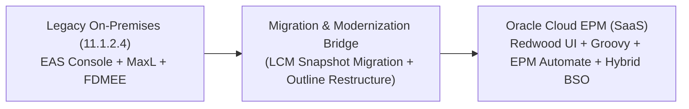

# 42. Reference Materials — Legacy Hyperion Architecture, MDX & Migration Blueprints

> **Consultant High-Yield Summary:**  
> Historical and advanced reference archives: comparing on-premises Hyperion Planning (11.1.2.4) with Cloud EPM, MDX scripting syntax for ASO cubes, migration playbooks, and architectural transition blueprints.

---

## 🎯 Live Interactive Visual Architecture Card

<b>🎯 Live Interactive Architecture Card: Hyperion On-Premises to Cloud EPM Evolution Matrix</b>

| Architecture Component | Legacy Hyperion On-Prem (11.1.2.4) | Modern Oracle Cloud EPM (SaaS) |
| :--- | :--- | :--- |
| **Administration Console** | Essbase Administration Services (EAS) | Redwood Web UI + Calculation Manager in browser. |
| **Automation CLI** | MaxL & ESSCMD batch scripts | EPM Automate CLI + OAuth2 REST API endpoints. |
| **Data Integration** | FDMEE (Financial Data Quality Management) | Unified Data Integration / Pipeline in cloud. |
| **Security Provider** | Shared Services / Native Directory | Oracle Identity Cloud Service (IDCS) / OCI IAM. |
| **Storage Kernel** | Classic BSO (batch CALC ALL required) | Hybrid BSO default (Dynamic Upper Sparse vectors). |

---

## 🏛️ Architectural Comparison & Design Patterns

| Technology Aspect | Legacy Hyperion On-Premises | Oracle Cloud EPM SaaS |
| :--- | :--- | :--- |
| Storage Engine | Classic BSO with stored parents requiring CALC ALL | Hybrid BSO with dynamic sparse parents in-memory |
| Scripting | MaxL shell scripting | Groovy event-driven scripting + REST API |
| Patching & Upgrades | Manual multi-month multi-million dollar upgrade projects | Monthly automatic updates managed by Oracle |

---

## 💼 Tough & Twisted Review Scenarios (Consultant Review Defense)

### Question 1: "When migrating an on-premises 11.1.2.4 BSO outline to Cloud EPM, what is the single most important outline restructuring step?"
> **Consultant Model Answer:**  
> Converting all Upper Stored sparse parent members to **Dynamic Calc (`~`)**. On-premises BSO relied on stored parents and batch CALC ALL scripts to roll up hierarchies. In Cloud EPM, Hybrid BSO is the standard: leaving upper parents as Stored bloats the disk snapshot, wastes storage, and misses out on sub-second dynamic vector aggregations.

---

## 📑 Complete Document Catalog

| # | Document File | Topic Description |
|---|---------------|-------------------|
| 01 | [CHANGELOG.md](./CHANGELOG.md) | Documentation Change Log |
| 02 | [findings.md](./findings.md) | Review Findings and Checkpoint |
| 03 | [MDX_Scripts_Complete_Guide.md](./MDX_Scripts_Complete_Guide.md) | MDX Scripts in Oracle EPM — Complete Deep-Dive Guide |
| 04 | [NotebookLM_Prompt_Data_Integration.md](./NotebookLM_Prompt_Data_Integration.md) | NotebookLM Prompt — Oracle EPM Cloud Data Integration: Complete Deep Dive Tutorial |
| 05 | [Oracle_EPM_Member_and_Dimension_Properties_Master_Guide.md](./Oracle_EPM_Member_and_Dimension_Properties_Master_Guide.md) | Oracle EPM Cloud — Member and Dimension Properties Master Architecture Guide |
| 06 | [Oracle_EPM_Shared_Members_Master_Guide.md](./Oracle_EPM_Shared_Members_Master_Guide.md) | Shared Members — Oracle EPM Cloud / Essbase |
| 07 | [oracle_sources.md](./oracle_sources.md) | Oracle EPM Cloud Source Register |
| 08 | [PBCS_EPBCS_Hyperion_Deep_Comparison.md](./PBCS_EPBCS_Hyperion_Deep_Comparison.md) | Oracle EPM: Hyperion vs PBCS vs EPBCS — Complete Deep-Dive Guide |
| 09 | [README.md](./README.md) | Documentation review log |

---

> **Consultant Implementation Note:** Master the architectural comparison and review defense questions in this module before presenting designs to client stakeholders or senior review panels.