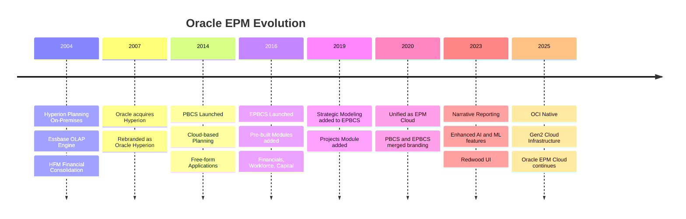
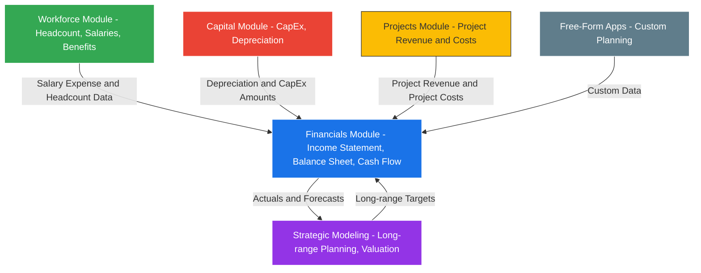
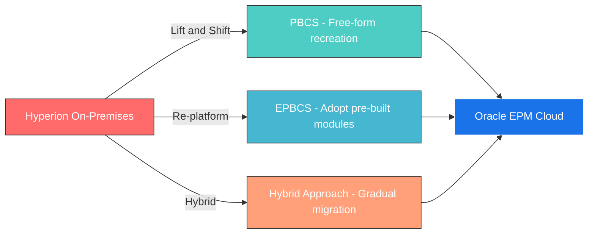

# Oracle EPM: Hyperion vs PBCS vs EPBCS — Complete Deep-Dive Guide

> [!NOTE]
> This document covers the full spectrum of Oracle's EPM evolution — from on-premises Hyperion to cloud-based PBCS and EPBCS — including modules, applications, architecture, dimensions, and key differences.

---

## Table of Contents

1. [High-Level Overview](#1-high-level-overview)
2. [Evolution Timeline](#2-evolution-timeline)
3. [Hyperion On-Premises — Deep Dive](#3-hyperion-on-premises--deep-dive)
4. [PBCS (Planning and Budgeting Cloud Service) — Deep Dive](#4-pbcs-planning-and-budgeting-cloud-service--deep-dive)
5. [EPBCS (Enterprise Planning and Budgeting Cloud Service) — Deep Dive](#5-epbcs-enterprise-planning-and-budgeting-cloud-service--deep-dive)
6. [Side-by-Side Comparison Table](#6-side-by-side-comparison-table)
7. [Modules & Applications Breakdown](#7-modules--applications-breakdown)
8. [Dimensions Comparison](#8-dimensions-comparison)
9. [Business Rules & Calc Manager](#9-business-rules--calc-manager)
10. [Data Integration](#10-data-integration)
11. [Security Model](#11-security-model)
12. [Reporting & Dashboards](#12-reporting--dashboards)
13. [Migration Path: Hyperion → Cloud](#13-migration-path-hyperion--cloud)
14. [Licensing & Cost Considerations](#14-licensing--cost-considerations)
15. [When to Use What](#15-when-to-use-what)

---

## 1. High-Level Overview

```
┌─────────────────────────────────────────────────────────────────────┐
│                    Oracle EPM Product Family                        │
├──────────────────┬──────────────────┬───────────────────────────────┤
│   HYPERION        │      PBCS        │         EPBCS                │
│   (On-Premises)   │   (Cloud Basic)  │   (Cloud Enterprise)         │
├──────────────────┼──────────────────┼───────────────────────────────┤
│ • Full control    │ • Cloud-hosted   │ • Cloud-hosted               │
│ • Self-managed    │ • Oracle-managed │ • Oracle-managed             │
│ • Custom infra    │ • Standard Plan  │ • Pre-built modules          │
│ • Multiple        │ • Free-form      │ • Financials, Workforce,     │
│   products        │   applications   │   Capital, Projects,         │
│   (HFM, Planning, │ • Custom dims    │   Strategic Modeling         │
│   Essbase, etc.)  │ • Basic planning │ • Best-practice content      │
└──────────────────┴──────────────────┴───────────────────────────────┘
```

| Product | Full Name | Deployment | Status |
|---------|-----------|-----------|--------|
| **Hyperion** | Oracle Hyperion EPM System | On-Premises | Legacy (support continues, no new features) |
| **PBCS** | Planning and Budgeting Cloud Service | Oracle Cloud (OCI) | Merged into EPM Cloud |
| **EPBCS** | Enterprise Planning and Budgeting Cloud Service | Oracle Cloud (OCI) | Merged into EPM Cloud |

> [!IMPORTANT]
> As of recent Oracle updates, **PBCS and EPBCS have been unified under "Oracle EPM Cloud"** (also called Oracle Cloud EPM or Fusion Cloud EPM). The distinction still matters for licensing and which modules you have access to.

---

## 2. Evolution Timeline



---

## 3. Hyperion On-Premises — Deep Dive

### 3.1 What is Hyperion?

Oracle Hyperion is the **on-premises EPM suite** that includes multiple standalone products for planning, consolidation, reporting, and data management. Each product is installed, configured, and maintained separately on customer-managed infrastructure.

### 3.2 Hyperion Products / Components

| Product | Purpose | Database Engine |
|---------|---------|-----------------|
| **Hyperion Planning** | Budgeting, Forecasting, Planning | Essbase (BSO/ASO) |
| **Essbase** | Multi-dimensional OLAP database | BSO (Block Storage) / ASO (Aggregate Storage) |
| **HFM (Hyperion Financial Management)** | Financial Consolidation & Close | Relational (SQL Server/Oracle DB) |
| **FDM / FDMEE** | Data Integration & Mapping | Relational |
| **DRM (Data Relationship Management)** | Master Data Management for dimensions | Relational |
| **Hyperion Financial Reporting (FR)** | Pixel-perfect financial reports | Connects to Essbase / HFM |
| **Smart View** | Excel add-in for ad hoc analysis | Connects to all products |
| **Calculation Manager** | Business rule design & management | Essbase scripts |
| **EPMA (EPM Architect)** | Centralized dimension management | Relational |
| **Hyperion Strategic Finance** | Long-range strategic modeling | Proprietary engine |
| **Hyperion Profitability & Cost Management (HPCM)** | Cost allocation & profitability | Essbase |
| **Hyperion Tax Provisioning** | Tax reporting & provisioning | Essbase |
| **Hyperion Workforce Planning** | Headcount & compensation planning | Essbase |
| **Hyperion Capital Asset Planning** | CapEx planning | Essbase |

### 3.3 Hyperion Architecture

```
┌───────────────────────────────────────────────────────────────┐
│                     Client Tier                                │
│  ┌──────────┐  ┌──────────┐  ┌──────────────┐                │
│  │ Web      │  │ Smart    │  │ Financial    │                 │
│  │ Browser  │  │ View     │  │ Reporting    │                 │
│  │ (Thin)   │  │ (Excel)  │  │ Studio       │                 │
│  └────┬─────┘  └────┬─────┘  └──────┬───────┘                │
├───────┼──────────────┼───────────────┼────────────────────────┤
│                     Web Tier                                   │
│  ┌──────────────────────────────────────────┐                  │
│  │      Oracle HTTP Server / WebLogic       │                  │
│  │      (Workspace, EPM Registry)           │                  │
│  └────────────────┬─────────────────────────┘                  │
├───────────────────┼──────────────────────────────────────────  │
│                Application Tier                                │
│  ┌─────────┐  ┌─────────┐  ┌──────┐  ┌───────┐  ┌─────────┐ │
│  │Planning │  │  HFM    │  │FDMEE │  │  DRM  │  │Calc Mgr │ │
│  │ Server  │  │ Server  │  │Server│  │Server │  │ Server  │ │
│  └────┬────┘  └────┬────┘  └──┬───┘  └───┬───┘  └────┬────┘ │
├───────┼─────────────┼─────────┼──────────┼───────────┼───────┤
│                   Data Tier                                    │
│  ┌─────────────┐  ┌──────────────────┐  ┌──────────────────┐  │
│  │  Essbase     │  │  Relational DB   │  │  Shared Services │  │
│  │  (BSO/ASO)   │  │  (Oracle/SQL)    │  │  (LDAP/Security) │  │
│  └─────────────┘  └──────────────────┘  └──────────────────┘  │
└───────────────────────────────────────────────────────────────┘
```

### 3.4 Essbase Storage Types in Hyperion

| Feature | BSO (Block Storage) | ASO (Aggregate Storage) |
|---------|-------------------|------------------------|
| **Use Case** | Input-heavy, write-back | Reporting, large datasets |
| **Calculations** | Calc scripts, business rules | Aggregation only |
| **Data Input** | Yes (read/write) | Limited (load buffers) |
| **Performance** | Good for small-medium cubes | Excellent for large cubes |
| **Upper-Level Data** | Stored or Dynamic Calc | Always dynamically calculated |
| **Sparse/Dense** | Manual optimization needed | Auto-optimized |
| **Procedural Calcs** | Full support | Not supported |

### 3.5 Hyperion Key Dimensions

Standard dimensions in Hyperion Planning:

| Dimension | Type | Required | Purpose |
|-----------|------|----------|---------|
| Account | Account | Yes | Chart of accounts, financial line items |
| Period | Time | Yes | Monthly, quarterly, yearly time periods |
| Year | Year | Yes | Fiscal/calendar years |
| Scenario | Scenario | Yes | Actual, Budget, Forecast, Plan |
| Version | Version | Yes | Working, Final, Draft |
| Entity | Entity | Yes | Organizational units, cost centers |
| Currency | Currency | Optional | Multi-currency support |
| Custom 1-20 | Generic | Optional | Products, Projects, Channels, etc. |

---

## 4. PBCS (Planning and Budgeting Cloud Service) — Deep Dive

### 4.1 What is PBCS?

PBCS is Oracle's **cloud-based planning solution** — essentially Hyperion Planning moved to the cloud with enhancements. It allows organizations to build **free-form custom applications** for budgeting, forecasting, and planning without needing to manage infrastructure.

### 4.2 Key Characteristics of PBCS

- **Free-form applications only** — you design your own dimensions, forms, and business rules
- **No pre-built modules** — everything is built from scratch
- **Essbase-powered** — uses cloud Essbase (BSO and ASO hybrid)
- **Oracle-managed infrastructure** — patching, upgrades, backups handled by Oracle
- **Monthly updates** — Oracle pushes new features monthly
- **Smart View support** — same Excel add-in as on-premises
- **Simplified administration** — no WebLogic, no separate servers

### 4.3 PBCS Application Types

| Application Type | Storage | Use Case |
|-----------------|---------|----------|
| **Standard (BSO)** | Block Storage Option | Input-heavy planning, budgeting with complex calculations |
| **Reporting (ASO)** | Aggregate Storage Option | Large reporting cubes, aggregation-heavy |
| **Hybrid (BSO + ASO)** | Hybrid | Best of both — input with BSO, reporting with ASO |
| **Free-Form** | BSO/ASO/Hybrid | Fully custom — you define everything |

### 4.4 PBCS Dimensions

| Dimension | Type | Required | Notes |
|-----------|------|----------|-------|
| Account | Account | Yes | Financial measures, KPIs |
| Period | Time | Yes | Months, quarters |
| Year | Year | Yes | Multiple years |
| Scenario | Scenario | Yes | Actual, Budget, Forecast |
| Version | Version | Yes | Working, Final |
| Entity | Entity | Yes | Org units |
| Currency | Currency | Optional | Multi-currency |
| Custom dimensions | Generic | Optional | Up to ~13 custom dimensions (varies by cube count) |

### 4.5 PBCS Features

| Feature | Available | Notes |
|---------|-----------|-------|
| Free-form Applications | Yes | Build from scratch |
| Task Lists | Yes | Workflow management |
| Approval Workflow | Yes | Planning unit hierarchy |
| Business Rules (Calc Manager) | Yes | Groovy, MDX, Calc scripts |
| Data Maps / Smart Push | Yes | Inter-cube data movement |
| Sandboxing | Yes | What-if scenarios |
| Smart View | Yes | Excel-based ad hoc |
| Data Integration (Cloud DI) | Yes | Built-in ETL |
| Financial Reporting (FR) | No | Use Reports (new) |
| Pre-built Modules | No | Only in EPBCS |
| Strategic Modeling | No | Only in EPBCS |
| Narrative Reporting | Yes | Cloud-native reporting |
| Groovy Rules | Yes | Advanced scripting |
| REST APIs | Yes | Automation and integration |
| EPM Automate | Yes | Command-line automation |

### 4.6 PBCS Architecture

```
┌─────────────────────────────────────────────────────────────────┐
│                    Oracle Cloud Infrastructure (OCI)             │
│                                                                  │
│  ┌───────────────────────────────────────────────────────────┐   │
│  │                   EPM Cloud Platform                       │   │
│  │  ┌─────────────┐  ┌──────────────┐  ┌─────────────────┐  │   │
│  │  │  Web UI      │  │  REST APIs   │  │  Smart View     │  │   │
│  │  │  (Browser)   │  │  (EPM Auto)  │  │  (Excel)        │  │   │
│  │  └──────┬───────┘  └──────┬───────┘  └────────┬────────┘  │   │
│  │         │                 │                    │           │   │
│  │  ┌──────┴─────────────────┴────────────────────┴────────┐ │   │
│  │  │              Application Layer                        │ │   │
│  │  │  ┌────────────┐  ┌────────────┐  ┌────────────────┐  │ │   │
│  │  │  │ Planning   │  │ Calc       │  │ Data           │  │ │   │
│  │  │  │ Engine     │  │ Manager    │  │ Integration    │  │ │   │
│  │  │  └─────┬──────┘  └─────┬──────┘  └───────┬────────┘  │ │   │
│  │  └────────┼───────────────┼──────────────────┼───────────┘ │   │
│  │           │               │                  │             │   │
│  │  ┌────────┴───────────────┴──────────────────┴───────────┐ │   │
│  │  │                   Cloud Essbase                        │ │   │
│  │  │          (BSO / ASO / Hybrid Cubes)                    │ │   │
│  │  └───────────────────────────────────────────────────────┘ │   │
│  └───────────────────────────────────────────────────────────┘   │
└─────────────────────────────────────────────────────────────────┘
```

---

## 5. EPBCS (Enterprise Planning and Budgeting Cloud Service) — Deep Dive

### 5.1 What is EPBCS?

EPBCS is the **premium tier** of Oracle's cloud planning solution. It includes everything in PBCS **plus pre-built planning modules** with best-practice content, pre-defined dimensions, forms, dashboards, business rules, and workflows.

> [!TIP]
> Think of it this way:
> - **PBCS** = Empty canvas — you build everything
> - **EPBCS** = Canvas with pre-drawn templates — you customize and extend

### 5.2 EPBCS Pre-Built Modules (The Key Differentiator)

EPBCS includes **5 pre-built planning modules**:

---

#### Module 1: Financials

**Purpose:** Revenue and expense planning at a financial statement level.

| Feature | Details |
|---------|---------|
| **What it does** | Plan Income Statement, Balance Sheet, Cash Flow |
| **Pre-built content** | Chart of accounts, financial ratios, driver-based planning |
| **Key capabilities** | Revenue planning, expense planning, balance sheet planning, cash flow planning |
| **Drivers** | Revenue drivers (price x volume), expense drivers (per headcount, % of revenue) |
| **Accounts** | Pre-built P&L, BS, and CF account hierarchies |
| **Rolling forecasts** | Built-in support for rolling forecast methodology |
| **Reporting** | Pre-built dashboards and KPI reports |

**Financials Pre-Built Dimensions:**

| Dimension | Members (Examples) |
|-----------|-------------------|
| Account | Revenue, COGS, Gross Profit, OpEx, EBITDA, Net Income, Total Assets, Total Liabilities |
| Entity | Company, Division, Department |
| Scenario | Plan, Forecast, Actual |
| Version | Working, Final |
| Currency | Multi-currency with translation |
| Plan Element | Custom driver categorization |

---

#### Module 2: Workforce

**Purpose:** Detailed headcount and compensation planning.

| Feature | Details |
|---------|---------|
| **What it does** | Plan headcount, salaries, benefits, bonuses, taxes at the employee level |
| **Pre-built content** | Compensation elements, benefit rates, tax tables |
| **Key capabilities** | New hire planning, attrition modeling, merit increases, position budgeting |
| **Granularity** | Individual employee OR job-code level |
| **Integration** | Auto-feeds into Financials module (salary to OpEx) |

**Workforce Planning Types:**

| Type | Granularity | Use Case |
|------|------------|----------|
| **Employee-level** | Individual employees | Detailed HR planning |
| **Job-level** | By job code / position | Departmental planning |
| **Hybrid** | Both | Mix based on department need |

**Workforce Pre-Built Dimensions:**

| Dimension | Purpose |
|-----------|---------|
| Employee | Individual employees or positions |
| Job | Job codes / titles |
| Union Code | Union membership tracking |
| Pay Type | Salary, Hourly, Contract |
| Component | Base Salary, Bonus, Benefits, Taxes, Overtime |
| Property | Hire Date, Termination Date, FTE, Status |

**Workforce Key Calculations (Pre-Built):**

- Total Compensation = Base Salary + Benefits + Taxes + Bonus
- FTE Calculation with start/end date proration
- Merit increase effective dating
- Employer tax calculations (FICA, FUTA, SUTA, etc.)
- Benefits as % of salary or flat rate
- Headcount trending and attrition modeling

---

#### Module 3: Capital

**Purpose:** Capital asset and CapEx planning.

| Feature | Details |
|---------|---------|
| **What it does** | Plan capital expenditures, asset depreciation, asset lifecycle |
| **Pre-built content** | Depreciation methods, asset categories, approval workflows |
| **Key capabilities** | New asset planning, existing asset management, depreciation calculations |
| **Integration** | Feeds into Financials (CapEx to Balance Sheet, Depreciation to P&L) |

**Capital Pre-Built Features:**

| Feature | Details |
|---------|---------|
| Depreciation Methods | Straight-line, Declining Balance, Sum-of-Years-Digits |
| Asset Categories | Buildings, Equipment, Vehicles, IT, Furniture |
| Useful Life | Configurable per asset category |
| Salvage Value | Residual value calculations |
| Capitalization | Threshold-based capitalization rules |
| Disposal Planning | Asset retirement and write-off |

**Capital Pre-Built Dimensions:**

| Dimension | Purpose |
|-----------|---------|
| Asset Class | Category of capital asset |
| Asset Detail | Individual assets or asset groups |
| Asset Property | Cost, Useful Life, Salvage Value, Depreciation |

---

#### Module 4: Projects

**Purpose:** Project financial planning and resource allocation.

| Feature | Details |
|---------|---------|
| **What it does** | Plan project revenues, costs, margins, and resource needs |
| **Pre-built content** | Project lifecycle stages, resource types, billing rates |
| **Key capabilities** | Project costing, resource planning, utilization, project P&L |
| **Integration** | Feeds into Financials (Project Revenue/Cost to P&L) |

**Projects Pre-Built Dimensions:**

| Dimension | Purpose |
|-----------|---------|
| Project | Individual projects |
| Project Type | Internal, External, Capital, Maintenance |
| Resource Class | Resource categories |
| Project Phase | Planning, Execution, Closure |

---

#### Module 5: Strategic Modeling

**Purpose:** Long-range strategic and financial modeling (replaces Hyperion Strategic Finance).

| Feature | Details |
|---------|---------|
| **What it does** | Long-range financial modeling, M&A analysis, valuation, debt modeling |
| **Pre-built content** | Financial statement models, valuation templates, debt schedules |
| **Key capabilities** | What-if scenarios, sensitivity analysis, Monte Carlo simulation, DCF modeling |
| **Integration** | Can import/export data with other EPBCS modules |
| **Unique** | Has its own modeling engine (not Essbase-based) |

**Strategic Modeling Unique Features:**

| Feature | Purpose |
|---------|---------|
| **Scenario Analysis** | Multiple strategic scenarios with comparison |
| **Sensitivity Analysis** | Impact of variable changes on outcomes |
| **Monte Carlo Simulation** | Probabilistic modeling |
| **Debt Scheduling** | Amortization, revolving credit, bonds |
| **Valuation Models** | DCF, WACC, comparable analysis |
| **Charts & Graphs** | Built-in visualization |
| **Goal Seeking** | Reverse-calculate inputs from target outputs |
| **Consolidation** | Roll-up of multiple model entities |

---

### 5.3 EPBCS Module Integration Flow



### 5.4 EPBCS Application Structure

When you enable modules in EPBCS, the system creates multiple **cubes** automatically:

| Cube | Created By | Storage | Purpose |
|------|-----------|---------|---------|
| **OEP_FS** | Financials | BSO | Financial Statement planning (input) |
| **OEP_REP** | Financials | ASO | Financial Reporting (aggregation) |
| **OEP_WFP** | Workforce | BSO | Workforce planning (input) |
| **OEP_WFREP** | Workforce | ASO | Workforce reporting |
| **OEP_CAP** | Capital | BSO | Capital planning (input) |
| **OEP_CAPREP** | Capital | ASO | Capital reporting |
| **OEP_PJT** | Projects | BSO | Project planning (input) |
| **OEP_PJTREP** | Projects | ASO | Project reporting |
| **OEP_SM** | Strategic Modeling | Custom | Strategic modeling engine |

> [!NOTE]
> **OEP** stands for **Oracle Enterprise Planning** — this prefix is used for all pre-built module cubes.

---

## 6. Side-by-Side Comparison Table

### 6.1 Feature Comparison

| Feature | Hyperion On-Prem | PBCS | EPBCS |
|---------|-----------------|------|-------|
| **Deployment** | On-premises (customer servers) | Oracle Cloud (OCI) | Oracle Cloud (OCI) |
| **Infrastructure** | Customer-managed | Oracle-managed | Oracle-managed |
| **Upgrades** | Manual (yearly/quarterly) | Automatic (monthly) | Automatic (monthly) |
| **Patching** | Customer responsibility | Oracle handles | Oracle handles |
| **Planning Engine** | Essbase (BSO/ASO) | Cloud Essbase (Hybrid) | Cloud Essbase (Hybrid) |
| **Free-form Apps** | Yes | Yes | Yes |
| **Pre-built Modules** | No (Separate products) | No | Yes (5 modules) |
| **Financials Module** | Separate (Planning) | Build yourself | Pre-built |
| **Workforce Module** | Separate product | Build yourself | Pre-built |
| **Capital Module** | Separate product | Build yourself | Pre-built |
| **Projects Module** | N/A | N/A | Pre-built |
| **Strategic Modeling** | Strategic Finance (separate) | N/A | Integrated |
| **HFM / Consolidation** | Separate product | Use FCCS | Use FCCS |
| **Financial Reporting** | FR Studio | Use Reports | Use Reports |
| **Narrative Reporting** | N/A | Yes | Yes |
| **Smart View** | Yes | Yes | Yes |
| **Data Integration** | FDMEE / ODI | Cloud Data Integration | Cloud Data Integration |
| **Calc Manager** | Yes | Yes | Yes |
| **Groovy Rules** | No | Yes | Yes |
| **REST APIs** | Limited | Full | Full |
| **EPM Automate** | N/A | Yes | Yes |
| **Sandboxing** | Yes | Yes | Yes |
| **Task Lists** | Yes | Yes | Yes |
| **Approval Workflow** | Yes | Yes | Yes |
| **Multi-Currency** | Yes | Yes | Yes |
| **Max Dimensions** | 20+ custom | Up to ~13 custom | Up to ~13 custom + module dims |
| **Mobile Access** | Limited | Yes | Yes |
| **AI/ML Features** | No | IPM Insights | IPM Insights |
| **Predictive Planning** | No | Yes | Yes |

### 6.2 Administration Comparison

| Admin Task | Hyperion On-Prem | PBCS / EPBCS Cloud |
|-----------|-----------------|-------------------|
| Server setup | Manual install + config | Oracle provisions |
| Database setup | Manual (Oracle DB / SQL Server) | Automatic |
| WebLogic config | Manual | N/A (handled by Oracle) |
| SSL Certificates | Manual | Oracle-managed |
| Backups | Customer DBA team | Daily automatic + on-demand (Migration) |
| Disaster Recovery | Customer builds DR | Oracle SLA-backed |
| OS Patching | Customer IT team | Oracle handles |
| EPM Patching | Manual download + apply | Automatic monthly |
| Performance tuning | Manual Essbase optimization | Limited control (Oracle tunes) |
| User provisioning | Shared Services / LDAP | IDCS / OCI IAM |
| Environment cloning | Manual export/import | Snapshot + Clone feature |

---

## 7. Modules & Applications Breakdown

### 7.1 PBCS Application Components

Since PBCS has **no pre-built modules**, you create everything manually:

```
PBCS Application
├── Cubes (Plan Types)
│   ├── Plan1 (BSO) ─── Primary input cube
│   ├── Plan2 (BSO) ─── Secondary input cube
│   ├── Plan3 (BSO) ─── Tertiary input cube
│   └── Reporting (ASO) ─── Aggregation/Reporting
│
├── Dimensions (Custom-defined)
│   ├── Account (required)
│   ├── Period (required)
│   ├── Year (required)
│   ├── Scenario (required)
│   ├── Version (required)
│   ├── Entity (required)
│   ├── Currency (optional)
│   └── Custom dims (user-defined)
│
├── Data Forms
│   └── All custom-built
│
├── Business Rules
│   └── All custom-built (Calc Scripts / Groovy)
│
├── Task Lists
│   └── All custom-built
│
└── Dashboards
    └── All custom-built
```

### 7.2 EPBCS Application Components

EPBCS adds **pre-built content on top of PBCS capabilities**:

```
EPBCS Application
├── Pre-Built Modules (enable as needed)
│   ├── Financials
│   │   ├── OEP_FS cube (BSO input)
│   │   ├── OEP_REP cube (ASO reporting)
│   │   ├── Pre-built accounts (P&L, BS, CF)
│   │   ├── Pre-built forms (Revenue, Expense, BS)
│   │   ├── Pre-built rules (Aggregation, Allocation, FX)
│   │   ├── Pre-built dashboards
│   │   └── Pre-built task lists
│   │
│   ├── Workforce
│   │   ├── OEP_WFP cube (BSO input)
│   │   ├── OEP_WFREP cube (ASO reporting)
│   │   ├── Pre-built employee/job dimensions
│   │   ├── Pre-built compensation rules
│   │   ├── Pre-built headcount forms
│   │   ├── Pre-built merit/bonus calculations
│   │   └── Auto-integration with Financials
│   │
│   ├── Capital
│   │   ├── OEP_CAP cube (BSO input)
│   │   ├── OEP_CAPREP cube (ASO reporting)
│   │   ├── Pre-built asset dimensions
│   │   ├── Pre-built depreciation rules
│   │   ├── Pre-built capital forms
│   │   └── Auto-integration with Financials
│   │
│   ├── Projects
│   │   ├── OEP_PJT cube (BSO input)
│   │   ├── OEP_PJTREP cube (ASO reporting)
│   │   ├── Pre-built project dimensions
│   │   └── Auto-integration with Financials
│   │
│   └── Strategic Modeling
│       ├── Separate modeling engine
│       ├── Pre-built financial models
│       ├── Scenario comparison
│       └── Valuation and debt models
│
├── Free-Form Applications (same as PBCS)
│   └── Custom cubes, dimensions, forms, rules
│
└── Shared Components
    ├── Data Integration
    ├── Narrative Reporting
    ├── Smart View
    ├── EPM Automate
    └── REST APIs
```

---

## 8. Dimensions Comparison

### 8.1 Required Dimensions Across Products

| Dimension Type | Hyperion Planning | PBCS | EPBCS |
|---------------|-------------------|------|-------|
| **Account** | Required | Required | Required |
| **Period** | Required | Required | Required |
| **Year** | Required | Required | Required |
| **Scenario** | Required | Required | Required |
| **Version** | Required | Required | Required |
| **Entity** | Required | Required | Required |
| **Currency** | Optional | Optional | Optional |

### 8.2 EPBCS Module-Specific Dimensions

These dimensions are **automatically created** when you enable EPBCS modules:

| Dimension | Module | Purpose |
|-----------|--------|---------|
| Employee | Workforce | Individual employees |
| Job | Workforce | Job codes |
| Union Code | Workforce | Union affiliation |
| Element | Workforce | Pay components |
| Property | Workforce | Employee properties |
| Asset Class | Capital | Asset categories |
| Asset Detail | Capital | Individual assets |
| Project | Projects | Individual projects |
| Project Element | Projects | Project cost elements |
| Resource Class | Projects | Resource types |
| Plan Element | Financials | Planning drivers |

### 8.3 Dimension Limits

| Limit | Hyperion | PBCS | EPBCS |
|-------|---------|------|-------|
| Max dimensions per cube | ~20 | ~20 (practical: 13-15 custom) | ~20 (includes module dims) |
| Max members per dimension | Server memory limited | Cloud-limited (varies) | Cloud-limited (varies) |
| Max dense dimensions | Performance-dependent | 3-4 recommended | 3-4 recommended |
| Max sparse dimensions | Performance-dependent | Remaining dims | Remaining dims |
| Attribute dimensions | Unlimited | Yes (limited) | Yes (limited) |

---

## 9. Business Rules & Calc Manager

### 9.1 Rule Types Across Products

| Rule Type | Hyperion | PBCS | EPBCS |
|-----------|---------|------|-------|
| **Calc Scripts (Essbase)** | Yes | Yes | Yes |
| **MDX Scripts** | Yes | Yes | Yes |
| **Groovy Scripts** | No | Yes | Yes |
| **Graphical Rules** | Yes | Yes | Yes |
| **Template-based Rules** | Yes | Yes | Yes |
| **Pre-built Module Rules** | N/A | N/A | Yes |

### 9.2 EPBCS Pre-Built Business Rules (Examples)

| Module | Rule Name | What It Does |
|--------|-----------|-------------|
| Financials | `OEP_Calculate Revenue` | Calculates revenue from price x quantity drivers |
| Financials | `OEP_Calculate Expenses` | Calculates expenses from drivers (per HC, % Rev) |
| Financials | `OEP_Calculate Balance Sheet` | Derives BS items from P&L and assumptions |
| Financials | `OEP_Calculate Cash Flow` | Calculates cash flow from P&L and BS changes |
| Financials | `OEP_Roll Up` | Aggregates across entities |
| Workforce | `OEP_Calculate Compensation` | Computes total comp: salary + benefits + taxes |
| Workforce | `OEP_Process Terminations` | Handles employee separations and cost adjustments |
| Workforce | `OEP_Process Transfers` | Moves employees between entities |
| Workforce | `OEP_Calculate Benefits` | Computes benefits costs from rates |
| Workforce | `OEP_Calculate Taxes` | Employer-side tax calculations |
| Capital | `OEP_Calculate Depreciation` | Runs depreciation based on method and useful life |
| Capital | `OEP_Calculate Capitalization` | Determines capital vs. expense treatment |
| Projects | `OEP_Calculate Project Costs` | Computes total project costs |

### 9.3 Groovy in Cloud (PBCS and EPBCS Only)

Groovy is a **cloud-exclusive** scripting language not available in on-premises Hyperion:

```groovy
// Example: Groovy rule in PBCS/EPBCS
// Calculate bonus as 10% of salary for all employees
def scenarioName = operation.grid.pov.find{it.dimName == 'Scenario'}.essbaseMbrName

operation.grid.dataCellIterator({DataCell cell ->
    if (cell.accountName == "OEP_Bonus") {
        def salary = cell.crossDimCell("Account#OEP_Base Salary").data
        cell.data = salary * 0.10
    }
})
```

**Groovy Advantages Over Calc Scripts:**

| Feature | Calc Scripts | Groovy |
|---------|-------------|--------|
| Data movement across cubes | Limited (Data Maps) | Direct cross-cube access |
| External REST API calls | No | Yes |
| Email notifications | No | Yes |
| Conditional logic complexity | Basic IF/THEN | Full programming language |
| String manipulation | Limited | Full Java string library |
| Error handling | Basic | Try/catch blocks |
| Debugging | Limited | Logging + stack traces |
| Smart Push triggering | Separate step | Inline |

---

## 10. Data Integration

### 10.1 Integration Tools by Product

| Tool | Hyperion | PBCS | EPBCS |
|------|---------|------|-------|
| **FDMEE** | Primary tool | N/A | N/A |
| **ODI** | Yes | N/A | N/A |
| **Cloud Data Integration** | N/A | Yes | Yes |
| **Data Management (Cloud FDMEE)** | N/A | Yes | Yes |
| **EPM Automate** | N/A | Yes | Yes |
| **REST APIs** | Limited | Full | Full |
| **Smart View** | Yes | Yes | Yes |
| **Data Exchange** | N/A | Yes | Yes |
| **Flat File Import** | Yes | Yes | Yes |

### 10.2 Data Maps & Smart Push (PBCS/EPBCS)

In cloud, **Data Maps** and **Smart Push** replace some on-premises data movement needs:

| Feature | Data Maps | Smart Push |
|---------|-----------|------------|
| Direction | BSO to/from ASO | BSO to ASO |
| Use Case | Full data movement between cubes | Selective push of changed data |
| Performance | Slower (full mapping) | Faster (incremental) |
| Triggering | Manual / Business Rule | Business Rule / Groovy |
| Mapping | Full dimension mapping | Dimension mapping with filters |

---

## 11. Security Model

### 11.1 Security Architecture Comparison

| Aspect | Hyperion (On-Prem) | PBCS / EPBCS (Cloud) |
|--------|-------------------|---------------------|
| **User Directory** | Shared Services (LDAP/MSAD) | Oracle Identity Cloud (IDCS) / OCI IAM |
| **Provisioning** | Shared Services Console | EPM Cloud Access Control |
| **Authentication** | LDAP / SSO (OAM) | IDCS / SAML 2.0 SSO |
| **Roles** | Planning roles + Shared Services groups | Predefined cloud roles |
| **Data Security** | Dimension-level filters | Dimension-level security |
| **Form-level Security** | Yes | Yes |
| **Rule-level Security** | Yes | Yes |

### 11.2 Cloud EPM Roles

| Role | Description |
|------|-------------|
| **Service Administrator** | Full control — create apps, manage users, all admin tasks |
| **Power User** | Create forms, rules, dimensions — but cannot manage security |
| **Planner** | Enter data, run rules, submit plans |
| **Viewer** | Read-only access to forms and reports |
| **Approvals Administrator** | Manage approval workflows |

---

## 12. Reporting & Dashboards

### 12.1 Reporting Tools Comparison

| Tool | Hyperion | PBCS | EPBCS |
|------|---------|------|-------|
| **Financial Reporting (FR)** | Primary | Deprecated | Deprecated |
| **Interactive Reporting (IR)** | Yes | N/A | N/A |
| **Web Analysis** | Yes | N/A | N/A |
| **Reports (Cloud Reports)** | N/A | Yes (Replacement for FR) | Yes |
| **Narrative Reporting** | N/A | Yes | Yes |
| **Dashboards (Infolets)** | Limited | Yes | Yes |
| **Smart View** | Yes | Yes | Yes |
| **OBIEE / Analytics** | Integration | Use OAC | Use OAC |

### 12.2 Cloud Dashboards

Cloud EPM (PBCS/EPBCS) dashboards support:

- **Infolets** — KPI tiles on the home page
- **Dashboards** — Multi-component layouts with charts, forms, tiles
- **Chart types** — Bar, Line, Pie, Area, Bubble, Waterfall, Combination
- **Interactivity** — POV selection, drill-through, member selection
- **Dynamic content** — Runtime prompts, context-sensitive data

---

## 13. Migration Path: Hyperion to Cloud

### 13.1 Migration Options



### 13.2 Migration Considerations

| Consideration | Details |
|--------------|---------|
| **Application redesign** | Hyperion apps may need restructuring for cloud limits |
| **Dimension limits** | Cloud has different dimension/member limits than on-prem |
| **Business rules** | Calc scripts transfer; add Groovy for new functionality |
| **Data integration** | FDMEE to Cloud Data Integration mapping |
| **Security** | LDAP to IDCS/OCI IAM migration |
| **Reports** | FR to Cloud Reports or Narrative Reporting |
| **Training** | Users need training on new cloud UI |
| **HFM to FCCS** | HFM consolidation moves to Financial Consolidation and Close (FCCS) |
| **Essbase to Cloud Essbase** | Standalone Essbase moves to Oracle Analytics Cloud (OAC) |

### 13.3 Tools for Migration

| Tool | Purpose |
|------|---------|
| **LCM (Lifecycle Management)** | Export Hyperion artifacts |
| **Migration (Snapshot)** | Import into cloud |
| **EPM Automate** | Automate migration steps |
| **Cloud Migration Utility** | Specialized migration tool |

---

## 14. Licensing & Cost Considerations

### 14.1 Licensing Models

| Model | Hyperion | PBCS | EPBCS |
|-------|---------|------|-------|
| **License Type** | Perpetual + Annual Support | Subscription (SaaS) | Subscription (SaaS) |
| **Pricing Basis** | Named Users / Processors | Named Users | Named Users |
| **Infrastructure Cost** | Customer pays (servers, DB, network) | Included | Included |
| **Support Cost** | ~22% of license annually | Included | Included |
| **Upgrade Cost** | Implementation cost | Included (automatic) | Included (automatic) |

### 14.2 Cost Comparison (Conceptual)

| Cost Category | Hyperion (On-Prem) | PBCS/EPBCS (Cloud) |
|--------------|-------------------|-------------------|
| License / Subscription | High upfront | Monthly/Annual subscription |
| Hardware / Infrastructure | $$$ (customer pays) | Included |
| DBA / IT Support | $$$ (dedicated team) | Minimal (Oracle manages) |
| Patching / Upgrades | $$ (downtime + effort) | Included (automatic) |
| Disaster Recovery | $$$ (customer builds) | Included (Oracle SLA) |
| Total Cost of Ownership | Higher long-term | Generally lower |

> [!WARNING]
> EPBCS is typically **more expensive per user** than PBCS due to the pre-built modules. However, it can be cheaper overall when you factor in the **reduced implementation time** (pre-built content vs. building from scratch).

---

## 15. When to Use What

### 15.1 Decision Matrix

| Scenario | Recommended Product |
|----------|-------------------|
| You need full control over infrastructure | **Hyperion On-Premises** (if still supported) |
| You have unique/niche planning requirements | **PBCS** (free-form flexibility) |
| You need standard financial planning quickly | **EPBCS Financials** |
| You need headcount/compensation planning | **EPBCS Workforce** |
| You need CapEx and depreciation planning | **EPBCS Capital** |
| You need project financial planning | **EPBCS Projects** |
| You need long-range strategic modeling | **EPBCS Strategic Modeling** |
| You need financial consolidation | **FCCS** (separate cloud product) |
| You need standalone OLAP/analytics | **Oracle Analytics Cloud (OAC)** |
| You want best-practice content out of the box | **EPBCS** |
| You want maximum customization with minimal cost | **PBCS** |
| You are migrating from Hyperion with minimal changes | **PBCS** (closer to on-prem) |
| You are migrating and want to modernize | **EPBCS** (adopt modules) |

### 15.2 Oracle EPM Cloud — Full Product Suite

PBCS and EPBCS are part of the broader **Oracle EPM Cloud** suite:

| Cloud Product | Replaces (On-Prem) | Purpose |
|--------------|-------------------|---------|
| **EPM Cloud Planning** (PBCS/EPBCS) | Hyperion Planning | Budgeting, Planning, Forecasting |
| **FCCS** (Financial Consolidation and Close) | HFM | Financial Consolidation |
| **ARCS** (Account Reconciliation) | ARM | Account Reconciliation |
| **TRCS** (Tax Reporting) | Hyperion Tax Provisioning | Tax Provision |
| **Profitability and Cost Management Cloud** | HPCM | Cost Allocation |
| **Narrative Reporting** | FR + Management Reporting | Report Authoring |
| **Enterprise Data Management (EDM)** | DRM | Master Data Management |
| **Oracle Analytics Cloud (OAC)** | OBIEE + Essbase standalone | Analytics and OLAP |

---

## Summary — Key Takeaways

> [!IMPORTANT]
> **Bottom Line:**
> - **Hyperion** = Legacy on-premises suite with maximum control but high maintenance cost
> - **PBCS** = Cloud planning with free-form flexibility — you build everything from scratch
> - **EPBCS** = Cloud planning with pre-built modules (Financials, Workforce, Capital, Projects, Strategic Modeling) — faster to deploy, best-practice content included
> - **PBCS + EPBCS are now unified as Oracle EPM Cloud** — the distinction is primarily in licensing and which modules you have access to
> - **Oracle's strategic direction is cloud** — all new features go to EPM Cloud, Hyperion on-prem is in sustaining support
