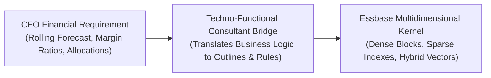

# 43. Techno-Functional Review — Dual-Hat Mastery: Financial Logic to Bitwise Physics

> **Consultant High-Yield Summary:**  
> The most valued EPM consultants operate with dual-hat fluency: translating corporate CFO financial requirements into low-level Essbase bitwise storage physics, calculation scripts, and automated data pipelines. This module unifies financial logic with technical execution for senior review panels.

---

## 🎯 Live Interactive Visual Architecture Card

<b>🎯 Live Interactive Architecture Card: Techno-Functional Dual-Hat Competency Spectrum</b>

| Functional Finance Requirement | Technical Implementation Architecture | Underlying Essbase Kernel Physics |
| :--- | :--- | :--- |
| **18-Month Rolling Forecast** | Substitution variables (`&CurPeriod`), dynamic columns | Dynamic FIX scopes evaluate only active forecast months, bypassing closed historical blocks. |
| **Operating Margin %** | Dynamic Calc account with Two-Pass enabled | In-memory RAM evaluation during retrieval; forces recalculation after parent entity rollups. |
| **Intercompany Eliminations** | Plug accounts and automated consolidation rules | Reverses matching intercompany receivables/payables at first common parent entity node. |
| **Trial Balance GL Ingestion** | Data Integration pipeline with Explicit / Like maps | Transforms external debit/credit balances into signed numeric cells inside Essbase Cartesian blocks. |

---

## 🏛️ Architectural Comparison & Design Patterns

| Consultant Profile | Pure Functional Consultant | Pure Technical Developer | Techno-Functional Architect |
| :--- | :--- | :--- | :--- |
| Finance Fluency | High: speaks GAAP, IFRS, P&L, and working capital | Low: struggles to understand debit/credit accounting | High: translates executive accounting into technical designs |
| Essbase Physics | Low: treats cube as black box; causes block explosion | High: writes code but designs flawed business logic | High: optimizes block size, cache sizing, and Groovy micro-FIX |
| FTE Conversion Status | Struggles on technical panel reviews | Struggles on client business walkthroughs | Guaranteed top-tier FTE conversion and lead role |

---

## 💼 Tough & Twisted Review Scenarios (Consultant Review Defense)

### Question 1: "A CFO asks why the budget cannot have 25 different reporting dimensions in a single planning cube. How do you answer techno-functionally?"
> **Consultant Model Answer:**  
> Explain the trade-off in business and storage terms: While having 25 dimensions seems appealing for granular reporting, every sparse dimension exponentially expands Cartesian combinations. In Essbase, 25 dimensions causes block explosion, increasing cube size into hundreds of gigabytes and causing form saves to take 45+ seconds instead of 1 second. Propose the best-practice architecture: Keep the planning cube lean (10-12 dimensions) for sub-second budgeting, and push consolidated numbers via Smart Push to an Aggregate Storage (ASO) reporting cube where high dimensionality can be queried in sub-seconds without impacting planning performance.

---

## 📑 Complete Document Catalog

| # | Document File | Topic Description |
|---|---------------|-------------------|
| 01 | [01_Techno_Functional_Role_and_Methodology.md](./01_Techno_Functional_Role_and_Methodology.md) | 01 The Techno-Functional Role, Implementation Methodology, and Project Lifecycle |
| 02 | [02_Application_Types_PBCS_EPBCS_Custom_FreeForm_FCCS.md](./02_Application_Types_PBCS_EPBCS_Custom_FreeForm_FCCS.md) | 02 Oracle EPM Application Types: PBCS, EPBCS, Custom, FreeForm, and FCCS |
| 03 | [03_Application_Creation_Screen_by_Screen_Every_Property.md](./03_Application_Creation_Screen_by_Screen_Every_Property.md) | 03 Application Creation: Screen-by-Screen Walkthrough, Every Property, and Behind-the-Scenes Mechanics |
| 04 | [04_Twisted_Interview_Questions_Part_1_Architecture_and_Essbase.md](./04_Twisted_Interview_Questions_Part_1_Architecture_and_Essbase.md) | 04 Twisted Interview Questions — Part 1: Essbase Kernel & Storage Physics |
| 05 | [05_Twisted_Interview_Questions_Part_2_Calc_Manager_and_Groovy.md](./05_Twisted_Interview_Questions_Part_2_Calc_Manager_and_Groovy.md) | 05 Twisted Interview Questions — Part 2: Calculation Manager, Rules & Groovy |
| 06 | [06_Twisted_Interview_Questions_Part_3_Forms_SmartPush_DataMaps.md](./06_Twisted_Interview_Questions_Part_3_Forms_SmartPush_DataMaps.md) | 06 Twisted Interview Questions — Part 3: Forms, Smart Push & Data Movement |
| 07 | [07_Twisted_Interview_Questions_Part_4_Modules_and_Troubleshooting.md](./07_Twisted_Interview_Questions_Part_4_Modules_and_Troubleshooting.md) | 07 Twisted Interview Questions — Part 4: EPBCS Modules, Security & Administration |
| 08 | [08_Emergency_Scenario_Walkthroughs_and_War_Stories.md](./08_Emergency_Scenario_Walkthroughs_and_War_Stories.md) | 08 Emergency Scenario Walkthroughs & Production War Stories |

---

> **Consultant Implementation Note:** Master the architectural comparison and review defense questions in this module before presenting designs to client stakeholders or senior review panels.