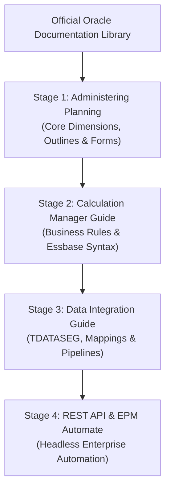

# 44. Oracle PDF Books — Curated Official Documentation Library & Reading Guide

> **Consultant High-Yield Summary:**  
> The definitive collection of official Oracle Cloud EPM documentation manuals, user guides, REST API specifications, and administration handbooks. This curated guide provides recommended reading sequences for consultants across each career milestone.

---

## 🎯 Live Interactive Visual Architecture Card

<b>🎯 Live Interactive Architecture Card: Official Documentation Library & Reading Tracks</b>

| Document Title | Primary Focus | Recommended Consultant Stage |
| :--- | :--- | :--- |
| **Administering Planning** | End-to-end administration, dimensions, security, forms | Mandatory reading for Freshers (Months 0-3). |
| **Designing with Calculation Manager** | Business rules, formulas, scripts, system templates | Junior Consultants (Months 3-6). |
| **Administering Data Integration** | Pipelines, Import Formats, Mapping tables, Drill-through | Junior to Mid-Level Consultants (Months 6-12). |
| **EPM Cloud REST APIs** | Headless HTTP endpoints, JSON payloads, async polling | Senior Consultants & Integration Engineers. |
| **Oracle Essbase Technical Reference** | Low-level calc commands, CDFs, kernel cache settings | Technical Architects & Calculation Specialists. |

---

## 🏛️ Architectural Comparison & Design Patterns

| Study Approach | Ad-Hoc Googling / Guesswork | Structured Official Doc Study |
| :--- | :--- | :--- |
| Knowledge Depth | Fragmented; misses critical edge cases and parameter limits | Comprehensive: understands documented syntax, constraints, and release notes |
| Review Defense | Fails when panel asks about undocumented behaviors | Cites official Oracle architecture and documented best practices |
| Problem Solving | Relies on trial-and-error; risks production corruption | Pinpoints exact error codes and verified resolution procedures |

---

## 💼 Tough & Twisted Review Scenarios (Consultant Review Defense)

### Question 1: "Where does a consultant verify whether a new Cloud EPM feature or function is available in their instance?"
> **Consultant Model Answer:**  
> The monthly **Oracle Cloud EPM What's New Guide** published in Oracle Readiness documentation. Oracle updates Cloud EPM monthly (e.g. 26.01, 26.02); checking the monthly release notes reveals new features, deprecations, bug fixes, and upcoming changes before they impact client instances.

---

## 📑 Complete Document Catalog

| # | Document File | Topic Description |
|---|---------------|-------------------|
| 01 | [3_TO_6_MONTH_ROADMAP.md](./3_TO_6_MONTH_ROADMAP.md) | 🗓️ 3-TO-6 MONTH STUDY ROADMAP |
| 02 | [DO_NOT_STUDY_NOW.md](./DO_NOT_STUDY_NOW.md) | 🚫 DO NOT STUDY NOW — Excluded Documents |
| 03 | [INITIAL_ANALYSIS.md](./INITIAL_ANALYSIS.md) | 📊 INITIAL ANALYSIS — Oracle EPM Documentation Catalog |
| 04 | [MASTER_INDEX.md](./MASTER_INDEX.md) | 📖 MASTER INDEX — Oracle EPM Study Library |
| 05 | [README.md](./README.md) | 🚀 START HERE — Oracle EPM Study Library |
| 06 | [README_v10.md](./README_v10.md) | 09 — Migration (LCM) |
| 07 | [README_v11.md](./README_v11.md) | 10 — EPM Automate |
| 08 | [README_v12.md](./README_v12.md) | 11 — Groovy Scripting |
| 09 | [README_v13.md](./README_v13.md) | 12 — REST APIs |
| 10 | [README_v14.md](./README_v14.md) | 13 — Operations & Troubleshooting |
| 11 | [README_v15.md](./README_v15.md) | 14 — Functional Planning (Planning Modules) |
| 12 | [README_v16.md](./README_v16.md) | 15 — Advanced Reference |
| 13 | [README_v17.md](./README_v17.md) | 90 — Legacy / Client Support |
| 14 | [README_v2.md](./README_v2.md) | 01 — EPM Cloud Foundation |
| 15 | [README_v3.md](./README_v3.md) | 02 — Oracle Cloud EPM Planning |
| 16 | [README_v4.md](./README_v4.md) | 03 — Oracle Essbase |
| 17 | [README_v5.md](./README_v5.md) | 04 — Calculation Manager |
| 18 | [README_v6.md](./README_v6.md) | 05 — Oracle Smart View for Office |
| 19 | [README_v7.md](./README_v7.md) | 06 — Oracle Cloud EPM FreeForm |
| 20 | [README_v8.md](./README_v8.md) | 07 — Data Integration / Data Management |
| 21 | [README_v9.md](./README_v9.md) | 08 — Security / Access Control |

---

> **Consultant Implementation Note:** Master the architectural comparison and review defense questions in this module before presenting designs to client stakeholders or senior review panels.