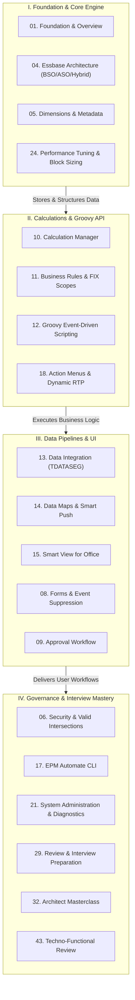

# Oracle Cloud EPM & Essbase Source Archive — Master Engineering Bible

Welcome to the **Oracle Cloud EPM & Essbase Source Archive**, the definitive technical reference containing over **1,340 in-depth engineering documents across 44 structured categories**.

This archive serves as the exhaustive encyclopedia for **Technical Consultant Freshers, Implementation Specialists, and Enterprise Architects** preparing for high-stakes Full-Time Employee (FTE) conversion reviews, technical panel interviews, and complex production troubleshooting.

---

## 🎯 Live Interactive Visual Architecture Card

<b>🎯 Live Interactive Architecture Card: 44-Category Master System Architecture</b>

| System Pillar | Core Technology Engine | Categories Included | Consultant Review Defense & Operational Physics |
| :--- | :--- | :--- | :--- |
| **I. Foundation & Platform** | OCI Gen 2 / Multi-Tier SaaS | 01, 02, 03, 42, 43, 44 | WebLogic application tier, IDCS identity management, relational metadata repository. |
| **II. Core Essbase Storage Kernel** | Essbase C-Kernel (BSO / ASO / Hybrid) | 04, 05, 24, 37, 38, 40 | Dense Cartesian arrays, sparse index pointers, block allocation physics (8-100 KB target). |
| **III. Business Logic & Calculations** | Calc Manager / Essbase CSC / Groovy | 10, 11, 12, 16, 18, 23 | Scoped FIX/ENDFIX, parallel calculation (`@CALCPARALLEL`), event-driven Groovy micro-FIX. |
| **IV. Data Pipeline & Exchange** | Data Integration / Smart Push | 13, 14, 15, 20 | `TDATASEG` staging, Explicit/Like mappings, in-memory BSO to ASO streaming on save. |
| **V. Presentation & Redwood UX** | Oracle JET / Redwood UI | 07, 08, 09, 36, 41 | Web form grid design, row/column suppression, Approval Unit Hierarchies, state locks. |
| **VI. Governance & Administration** | EPM Automate / LCM / Activity Report | 06, 17, 21, 22, 25, 26, 39 | Daily maintenance window (1-hr), Cell-Level Security, snapshot cloning, error codes. |
| **VII. Delivery & Masterclass** | Implementation / Projects / Defense | 19, 27, 28, 29, 30, 31, 32, 33, 34, 35 | EPBCS pre-built modules, CRP1/CRP2 milestones, UAT sign-offs, FTE defense matrix. |

---

## 🚀 Standalone Interactive HTML Cards Suite

Four dedicated interactive HTML applications have been engineered in `./interactive_cards/` to provide browser-based exploration, dynamic filtering, formula inspection, and scenario simulation:

| Interactive HTML Card | Tool Focus | Interactive Capability & Physics | File Link |
| :--- | :--- | :--- | :--- |
| **Card 01: 44-Category Master Catalog** | Complete Archive Navigator | Filter all 44 categories by pillar (Core Essbase, Logic, Data, UI, Admin), instant search, and 1-click index access. | [Open Card 01](./interactive_cards/card_src_01_master_catalog.html) |
| **Card 02: Calc Manager Function Finder** | CDF & Function Inspector | Search 800+ Essbase & Calc Manager functions; inspect syntax, parameter specs, and Hybrid BSO vector compatibility badges. | [Open Card 02](./interactive_cards/card_src_02_calc_manager_function_finder.html) |
| **Card 03: Property & Screen Encyclopedia** | Outline & Redwood Inspector | Interactive matrix contrasting outline storage properties (Two-Pass, Implied Share, Time Balance) and Redwood administrative screens. | [Open Card 03](./interactive_cards/card_src_03_property_screen_encyclopedia.html) |
| **Card 04: Review Defense Matrix** | Architect Masterclass Simulator | Interactive review interview simulator testing candidate defense across 5 high-stakes production crises (45s Form Save, Block Explosion, Security Collisions). | [Open Card 04](./interactive_cards/card_src_04_interview_defense_matrix.html) |

---

## 📚 Complete 44-Category Master Archive Index

Every single category folder contains an exhaustive, standardized `00_INDEX.md` featuring a **Live Interactive Visual Card**, domain-specific **Mermaid diagram**, **Architectural Comparison Table**, **Tough & Twisted Review Scenarios**, and a complete file catalog:

| Category | Domain Title | Document Volume | Index File Link |
| :--- | :--- | :--- | :--- |
| **Category 01** | [Foundation and Overview](./01_Foundation_and_Overview/00_INDEX.md) | 37 Docs | [00_INDEX.md](./01_Foundation_and_Overview/00_INDEX.md) |
| **Category 02** | [Study Path and Roadmap](./02_Study_Path_and_Roadmap/00_INDEX.md) | 6 Docs | [00_INDEX.md](./02_Study_Path_and_Roadmap/00_INDEX.md) |
| **Category 03** | [Finance Concepts](./03_Finance_Concepts/00_INDEX.md) | 4 Docs | [00_INDEX.md](./03_Finance_Concepts/00_INDEX.md) |
| **Category 04** | [Essbase Architecture](./04_Essbase_Architecture/00_INDEX.md) | 26 Docs | [00_INDEX.md](./04_Essbase_Architecture/00_INDEX.md) |
| **Category 05** | [Dimensions and Metadata](./05_Dimensions_and_Metadata/00_INDEX.md) | 21 Docs | [00_INDEX.md](./05_Dimensions_and_Metadata/00_INDEX.md) |
| **Category 06** | [Security and Access](./06_Security_and_Access/00_INDEX.md) | 11 Docs | [00_INDEX.md](./06_Security_and_Access/00_INDEX.md) |
| **Category 07** | [User Interface and Navigation](./07_User_Interface_and_Navigation/00_INDEX.md) | 5 Docs | [00_INDEX.md](./07_User_Interface_and_Navigation/00_INDEX.md) |
| **Category 08** | [Forms](./08_Forms/00_INDEX.md) | 45 Docs | [00_INDEX.md](./08_Forms/00_INDEX.md) |
| **Category 09** | [Workflow and Approvals](./09_Workflow_and_Approvals/00_INDEX.md) | 6 Docs | [00_INDEX.md](./09_Workflow_and_Approvals/00_INDEX.md) |
| **Category 10** | [Calc Manager](./10_Calc_Manager/00_INDEX.md) | 847 Docs | [00_INDEX.md](./10_Calc_Manager/00_INDEX.md) |
| **Category 11** | [Business Rules](./11_Business_Rules/00_INDEX.md) | 11 Docs | [00_INDEX.md](./11_Business_Rules/00_INDEX.md) |
| **Category 12** | [Groovy Scripting](./12_Groovy_Scripting/00_INDEX.md) | 9 Docs | [00_INDEX.md](./12_Groovy_Scripting/00_INDEX.md) |
| **Category 13** | [Data Integration](./13_Data_Integration/00_INDEX.md) | 8 Docs | [00_INDEX.md](./13_Data_Integration/00_INDEX.md) |
| **Category 14** | [Data Maps and Smart Push](./14_Data_Maps_and_Smart_Push/00_INDEX.md) | 18 Docs | [00_INDEX.md](./14_Data_Maps_and_Smart_Push/00_INDEX.md) |
| **Category 15** | [Smart View](./15_Smart_View/00_INDEX.md) | 21 Docs | [00_INDEX.md](./15_Smart_View/00_INDEX.md) |
| **Category 16** | [Smart Lists](./16_Smart_Lists/00_INDEX.md) | 12 Docs | [00_INDEX.md](./16_Smart_Lists/00_INDEX.md) |
| **Category 17** | [EPM Automate](./17_EPM_Automate/00_INDEX.md) | 10 Docs | [00_INDEX.md](./17_EPM_Automate/00_INDEX.md) |
| **Category 18** | [Action Menus](./18_Action_Menus/00_INDEX.md) | 6 Docs | [00_INDEX.md](./18_Action_Menus/00_INDEX.md) |
| **Category 19** | [EPBCS Modules](./19_EPBCS_Modules/00_INDEX.md) | 7 Docs | [00_INDEX.md](./19_EPBCS_Modules/00_INDEX.md) |
| **Category 20** | [REST API](./20_REST_API/00_INDEX.md) | 4 Docs | [00_INDEX.md](./20_REST_API/00_INDEX.md) |
| **Category 21** | [System Administration](./21_System_Administration/00_INDEX.md) | 13 Docs | [00_INDEX.md](./21_System_Administration/00_INDEX.md) |
| **Category 22** | [Application Lifecycle](./22_Application_Lifecycle/00_INDEX.md) | 52 Docs | [00_INDEX.md](./22_Application_Lifecycle/00_INDEX.md) |
| **Category 23** | [Planning Concepts](./23_Planning_Concepts/00_INDEX.md) | 6 Docs | [00_INDEX.md](./23_Planning_Concepts/00_INDEX.md) |
| **Category 24** | [Performance Tuning](./24_Performance_Tuning/00_INDEX.md) | 5 Docs | [00_INDEX.md](./24_Performance_Tuning/00_INDEX.md) |
| **Category 25** | [Debugging and Troubleshooting](./25_Debugging_and_Troubleshooting/00_INDEX.md) | 5 Docs | [00_INDEX.md](./25_Debugging_and_Troubleshooting/00_INDEX.md) |
| **Category 26** | [Production Support](./26_Production_Support/00_INDEX.md) | 5 Docs | [00_INDEX.md](./26_Production_Support/00_INDEX.md) |
| **Category 27** | [Implementation](./27_Implementation/00_INDEX.md) | 4 Docs | [00_INDEX.md](./27_Implementation/00_INDEX.md) |
| **Category 28** | [Projects](./28_Projects/00_INDEX.md) | 2 Docs | [00_INDEX.md](./28_Projects/00_INDEX.md) |
| **Category 29** | [Interview Preparation](./29_Interview_Preparation/00_INDEX.md) | 13 Docs | [00_INDEX.md](./29_Interview_Preparation/00_INDEX.md) |
| **Category 30** | [Labs and Exercises](./30_Labs_and_Exercises/00_INDEX.md) | 5 Docs | [00_INDEX.md](./30_Labs_and_Exercises/00_INDEX.md) |
| **Category 31** | [Case Studies](./31_Case_Studies/00_INDEX.md) | 6 Docs | [00_INDEX.md](./31_Case_Studies/00_INDEX.md) |
| **Category 32** | [Architect Masterclass](./32_Architect_Masterclass/00_INDEX.md) | 13 Docs | [00_INDEX.md](./32_Architect_Masterclass/00_INDEX.md) |
| **Category 33** | [Cheat Sheets](./33_Cheat_Sheets/00_INDEX.md) | 12 Docs | [00_INDEX.md](./33_Cheat_Sheets/00_INDEX.md) |
| **Category 34** | [Glossary](./34_Glossary/00_INDEX.md) | 3 Docs | [00_INDEX.md](./34_Glossary/00_INDEX.md) |
| **Category 35** | [Certification](./35_Certification/00_INDEX.md) | 3 Docs | [00_INDEX.md](./35_Certification/00_INDEX.md) |
| **Category 36** | [Screen Encyclopedia](./36_Screen_Encyclopedia/00_INDEX.md) | 28 Docs | [00_INDEX.md](./36_Screen_Encyclopedia/00_INDEX.md) |
| **Category 37** | [Property Encyclopedia](./37_Property_Encyclopedia/00_INDEX.md) | 12 Docs | [00_INDEX.md](./37_Property_Encyclopedia/00_INDEX.md) |
| **Category 38** | [Function Reference Encyclopedia](./38_Function_Reference_Encyclopedia/00_INDEX.md) | 8 Docs | [00_INDEX.md](./38_Function_Reference_Encyclopedia/00_INDEX.md) |
| **Category 39** | [Error Encyclopedia](./39_Error_Encyclopedia/00_INDEX.md) | 5 Docs | [00_INDEX.md](./39_Error_Encyclopedia/00_INDEX.md) |
| **Category 40** | [Member Formula Encyclopedia](./40_Member_Formula_Encyclopedia/00_INDEX.md) | 3 Docs | [00_INDEX.md](./40_Member_Formula_Encyclopedia/00_INDEX.md) |
| **Category 41** | [Navigation Encyclopedia](./41_Navigation_Encyclopedia/00_INDEX.md) | 10 Docs | [00_INDEX.md](./41_Navigation_Encyclopedia/00_INDEX.md) |
| **Category 42** | [Reference Materials](./42_Reference_Materials/00_INDEX.md) | 16 Docs | [00_INDEX.md](./42_Reference_Materials/00_INDEX.md) |
| **Category 43** | [Techno Functional Review](./43_Techno_Functional_Review/00_INDEX.md) | 9 Docs | [00_INDEX.md](./43_Techno_Functional_Review/00_INDEX.md) |
| **Category 44** | [Oracle PDF Books](./44_Oracle_PDF_Books/00_INDEX.md) | 22 Docs | [00_INDEX.md](./44_Oracle_PDF_Books/00_INDEX.md) |

---

## 🛡️ Senior Architect Review Defense Principles

1. **Speak in Low-Level Storage Physics:** Never refer to Essbase as a 'database table'. Always discuss dense Cartesian blocks, sparse index keys, and block size math (`Dense members * 8 bytes`).
2. **Scoping Law:** Always scope calculations strictly to Sparse dimensions using `FIX / ENDFIX`. Calculate dense members directly inside the formula block.
3. **The Hybrid Rollup Law:** Upper-level sparse parent members must be **Dynamic Calc (`~`)**. Never store parent blocks on disk in Hybrid BSO.
4. **Least-Privilege Precedence:** In security conflicts across groups, **None** always overrides **Read**, and **Read** overrides **Write**.
5. **Event-Driven Efficiency:** Replace monolithic Calc Manager business rules with **Groovy Micro-FIX** scripts scoped strictly to `operation.grid.dataCellIterator { it.edited }`.

