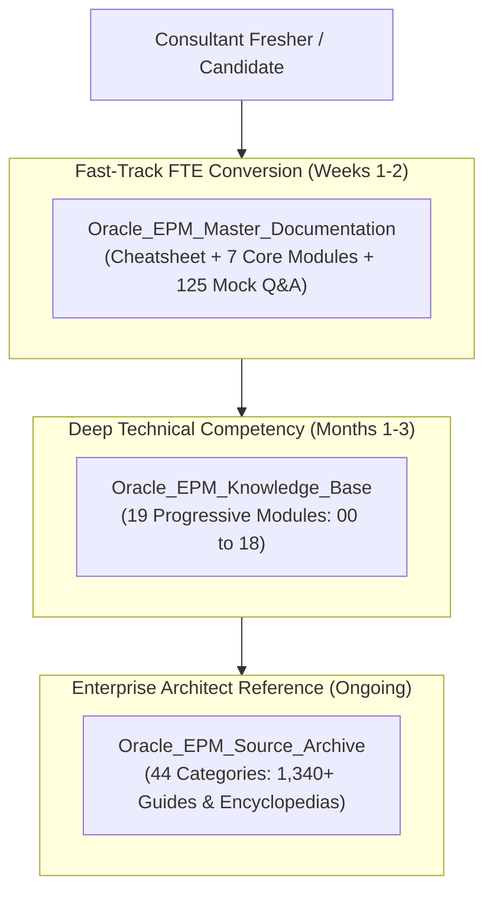

# Oracle Cloud EPM & Essbase Enterprise Master Repository

Welcome to the **Oracle Cloud EPM & Essbase Enterprise Master Repository**.

This repository is the definitive, comprehensive knowledge and review-cracking system engineered specifically for **Oracle Cloud EPM Technical Consultants, Implementation Specialists, and Freshers** preparing for high-stakes Full-Time Employee (FTE) conversion reviews, technical panel interviews, and enterprise production operations.

---

## 🎯 Master Architecture & Repository Organization

The repository is organized into three complementary, deeply integrated documentation suites:

```
d:\Oracle EPM Cloud\
├── Oracle_EPM_Master_Documentation\     <-- THE CONSULTANT REVIEW & INTERVIEW CRACKING KIT
│   ├── 00_CRACK_THE_REVIEW_INTERVIEW_CHEATSHEET.md
│   ├── README.md
│   ├── 01_Foundational_Architectures_BSO_ASO_Hybrid\
│   ├── 02_Outline_Dimensions_Member_Properties\
│   ├── 03_Calculations_Business_Rules_and_Groovy\
│   ├── 04_Data_Manipulation_Transactions_WriteBack\
│   ├── 05_Client_Tools_SmartView_and_Dashboards\
│   ├── 06_Production_Troubleshooting_and_Performance_Tuning\
│   ├── 07_Master_Mock_Review_and_Scenario_Exams\
│   └── interactive_cards\ (5 Interactive HTML Dashboards)
│
├── Oracle_EPM_Knowledge_Base\            <-- 19-MODULE PROGRESSIVE CURRICULUM
│   ├── README.md
│   ├── 00_Foundation\ to 18_Reference\ (65 Comprehensive Guides with Live Visual Cards)
│   └── interactive_cards\ (8 Interactive HTML Dashboards)
│
└── Oracle_EPM_Source_Archive\            <-- 44-CATEGORY ENGINEERING REFERENCE BIBLE
    ├── README.md
    ├── 01_Foundation_and_Overview\ to 44_Oracle_PDF_Books\ (1,340+ Documents with Live Cards)
    └── interactive_cards\ (4 Interactive HTML Dashboards)
```

---

## 🎯 Live Interactive Visual Architecture Card

<details open>
<summary><b>🎯 Live Interactive Architecture Card: Enterprise Documentation Architecture</b></summary>

| Documentation Suite | Target Audience | Primary Focus & Deliverable | Direct Link |
| :--- | :--- | :--- | :--- |
| **Master Documentation** | Freshers & Junior Consultants | High-stakes FTE review defense, mock interview exams, rapid-fire cheatsheet, and core architecture. | [Open Master Documentation](Oracle_EPM_Master_Documentation/README.md) |
| **Knowledge Base** | Implementation Specialists | 19-module progressive curriculum covering all EPM subsystems, security, Groovy, REST APIs, and tuning. | [Open Knowledge Base](Oracle_EPM_Knowledge_Base/README.md) |
| **Source Archive** | Architects & Senior Consultants | Exhaustive 44-category engineering reference containing 1,340+ guides, screen & property encyclopedias. | [Open Source Archive](Oracle_EPM_Source_Archive/README.md) |



</details>

---

## 🚀 Master Interactive HTML Dashboards & Cards Gallery (17 Applications)

Every suite includes standalone interactive HTML cards built with modern responsive styling, live parameter calculators, dynamic vector inspectors, and scenario simulators:

### 1. Master Documentation Suite (`Oracle_EPM_Master_Documentation/interactive_cards/`)
* 📊 **[Card 01: BSO vs ASO vs Hybrid Interactive Comparison](Oracle_EPM_Master_Documentation/interactive_cards/card_01_bso_aso_hybrid.html)** — Dual-kernel storage engine comparison with live block size calculator.
* 📐 **[Card 02: Dense vs Sparse Multidimensional Matrix](Oracle_EPM_Master_Documentation/interactive_cards/card_02_dense_sparse_matrix.html)** — Cartesian combinatorics simulator and block explosion calculator.
* ⚡ **[Card 03: Groovy Dynamic Micro-FIX & Event Execution](Oracle_EPM_Master_Documentation/interactive_cards/card_03_groovy_execution.html)** — Interactive form save event interceptor and micro-FIX benchmarker.
* 🔒 **[Card 04: Multi-Layer Security & Valid Intersections](Oracle_EPM_Master_Documentation/interactive_cards/card_04_security_matrix.html)** — Least-privilege collision evaluator (None > Read > Write) and cell-level security.
* 🔄 **[Card 05: Data Maps & In-Memory Smart Push Pipeline](Oracle_EPM_Master_Documentation/interactive_cards/card_05_data_maps_smart_push.html)** — Form save context streaming simulator from BSO to ASO.

### 2. Knowledge Base Suite (`Oracle_EPM_Knowledge_Base/interactive_cards/`)
* 🌐 **[Card KB-01: EPM Cloud Platform Ecosystem](Oracle_EPM_Knowledge_Base/interactive_cards/card_kb_01_ecosystem_architecture.html)** — Interactive OCI Gen 2 pod topology and 7 business process navigator.
* 🛡️ **[Card KB-02: Security Collision & Valid Intersections](Oracle_EPM_Knowledge_Base/interactive_cards/card_kb_02_security_intersections.html)** — Group permission inheritance and coordinate suppression simulator.
* 💻 **[Card KB-03: Groovy Micro-FIX Rule Builder](Oracle_EPM_Knowledge_Base/interactive_cards/card_kb_03_groovy_rule_builder.html)** — Dynamic script generation and `throwVetoException` tester.
* ⚙️ **[Card KB-04: Calculation Manager Scoping Evaluator](Oracle_EPM_Knowledge_Base/interactive_cards/card_kb_04_calc_business_rules.html)** — Bottom-up vs top-down block iterator and `@CALCPARALLEL` multithreading.
* 🔀 **[Card KB-05: Data Integration & Smart Push Pipeline](Oracle_EPM_Knowledge_Base/interactive_cards/card_kb_05_data_integration_maps.html)** — `TDATASEG` staging pipeline and direct inter-cube streaming.
* 🗄️ **[Card KB-06: Essbase Kernel Deep Dive](Oracle_EPM_Knowledge_Base/interactive_cards/card_kb_06_essbase_deep_dive.html)** — Dynamic Calc Cache, Page/Index file allocation, and Implied Share inspector.
* 🖥️ **[Card KB-07: EPM Automate Command Runner](Oracle_EPM_Knowledge_Base/interactive_cards/card_kb_07_epm_automate_terminal.html)** — Interactive headless batch command simulator with real syntax output.
* 📦 **[Card KB-08: Application Lifecycle & Snapshot Migration](Oracle_EPM_Knowledge_Base/interactive_cards/card_kb_08_lifecycle_migration.html)** — Selective LCM migration and pod cloning flowbuilder.

### 3. Source Archive Suite (`Oracle_EPM_Source_Archive/interactive_cards/`)
* 🧭 **[Card SRC-01: 44-Category Master Catalog Navigator](Oracle_EPM_Source_Archive/interactive_cards/card_src_01_master_catalog.html)** — Real-time filterable navigator across all 44 archive categories.
* 🔍 **[Card SRC-02: Calc Manager Function Finder](Oracle_EPM_Source_Archive/interactive_cards/card_src_02_calc_manager_function_finder.html)** — Search 800+ CDFs with Hybrid BSO vector compatibility badges.
* 📋 **[Card SRC-03: Property & Screen Encyclopedia](Oracle_EPM_Source_Archive/interactive_cards/card_src_03_property_screen_encyclopedia.html)** — Interactive matrix of outline properties and Redwood console panels.
* ⚔️ **[Card SRC-04: Review Defense Matrix](Oracle_EPM_Source_Archive/interactive_cards/card_src_04_interview_defense_matrix.html)** — High-stakes interview simulator contrasting junior traps with architect answers.

---

## ⚡ High-Priority Fast-Track Links for Interview Preparation

* 📑 **[Rapid-Fire Interview Cracking Cheatsheet](Oracle_EPM_Master_Documentation/00_CRACK_THE_REVIEW_INTERVIEW_CHEATSHEET.md)** — Core formulas, block sizing, security laws, and 1-minute answers.
* 🎯 **[50-Question Fresher-to-FTE Conversion Panel Exam](Oracle_EPM_Master_Documentation/07_Master_Mock_Review_and_Scenario_Exams/7.1_Fresher_to_FTE_Conversion_Panel_Interview_Exam.md)** — Rigorous scenario exam with scoring rubrics.
* 💼 **[75-Question Comprehensive Master Q&A Bank](Oracle_EPM_Master_Documentation/07_Master_Mock_Review_and_Scenario_Exams/7.2_The_Ultimate_Consultant_Interview_Master_QnA.md)** — Exhaustive technical interview questions and deep answers.
* 🏛️ **[Techno-Functional Dual-Hat Review Bible](Oracle_EPM_Source_Archive/43_Techno_Functional_Review/00_INDEX.md)** — Unifying corporate financial logic with bitwise Essbase storage physics.
